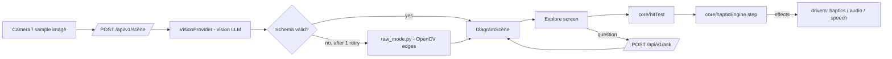

# Design Document

## Overview
Ghost Touch is a React PWA (Chrome on Android) backed by a FastAPI service. The backend turns an image into a validated, normalized `DiagramScene`. The frontend turns finger movement over that scene into vibration, speech, and tone **effects** through a pure haptic engine. Browser APIs are isolated in drivers so the engine can be property-tested and the web vibration driver can later be swapped for Capacitor.



## Components and Interfaces

### Backend
| Module | Responsibility |
|---|---|
| `schema.py` | Pydantic `DiagramScene` (source of truth). Exports JSON Schema for TS generation. |
| `vision/base.py` | `class VisionProvider(Protocol): async def extract(image: bytes) -> dict` |
| `vision/<provider>.py` | Concrete provider; prompt asks for JSON matching the schema; model from env. |
| `validate.py` | Parse, normalize, enforce invariants (unique ids, valid references, coords in [0,1]); repair trivial issues (clamp ±0.02 overshoot, drop dangling segments). |
| `raw_mode.py` | Grayscale → blur → Canny → contours → Douglas–Peucker simplification → ≤300 normalized segments. |
| `ask.py` | Answers a question from scene JSON only; must reply "I don't know" when the scene lacks the information. |
| `main.py` | Routes, 15 s timeout, CORS for the Vercel origin. |

**API**
- `POST /api/v1/scene` — multipart `image` → `{ scene: DiagramScene, mode: "ai" | "raw", reason?: "invalid" | "timeout" | "error" }`
- `POST /api/v1/ask` — `{ scene, question, lang }` → `{ answer: string }`
- `GET /api/v1/health`

### Frontend core (pure, property-tested)
```ts
// geometry.ts
toScreen(p: NormPoint, view: Viewport): ScreenPoint
toNorm(p: ScreenPoint, view: Viewport): NormPoint
distToSegment(p, a, b): number

// hitTest.ts
type Target =
  | { kind: 'vertex'; id: string; label?: string }
  | { kind: 'line'; id: string; elementKind: 'segment' | 'polyline' | 'axis' }
  | { kind: 'bar'; id: string; label: string; value: number }
  | { kind: 'none' };
hitTest(scene: DiagramScene, finger: ScreenPoint, view: Viewport, radii: Radii): Target
// priority: vertex > bar edge/line > bar interior > none

// pitch.ts
pitchForY(yNorm: number): number          // 0 = top -> 1000 Hz, 1 = bottom -> 200 Hz
pitchForValue(v: number, max: number): number

// hapticEngine.ts
type Input =
  | { kind: 'move'; t: number; target: Target; yNorm: number }
  | { kind: 'lift'; t: number };
type Effect =
  | { kind: 'vibrate'; pattern: number | number[] }
  | { kind: 'speak'; text: string }
  | { kind: 'tone'; hz: number | null };
step(state: EngineState, input: Input, cfg: HapticConfig): { state: EngineState; effects: Effect[] }

// correct.ts
movePoint(scene: DiagramScene, pointId: string, x: number, y: number): DiagramScene
renameLabel(scene: DiagramScene, elementId: string, newLabel: string): DiagramScene
deletePoint(scene: DiagramScene, pointId: string): DiagramScene
deleteSegment(scene: DiagramScene, segmentId: string): DiagramScene
historyReducer(state: HistoryState, action: HistoryAction): HistoryState
```

**Engine rules** (mirrors the tuned prototype):
1. Enter a new vertex → `vibrate(cornerPattern)`, `speak(label)`, `tone(null)`; set `quietUntil = t + quietMs`.
2. Same vertex as last step → no effects.
3. On a line, `t ≥ quietUntil` and `t − lastBuzz > retriggerMs` → `vibrate(lineMs)`.
4. On a curve → also `tone(pitchForY(yNorm))`.
5. Leave all lines → `vibrate(0)` only if `t ≥ quietUntil`; `tone(null)`.
6. Lift → `vibrate(0)`, `tone(null)`; reset state.

`HapticConfig` defaults: `lineMs 80, retriggerMs 70, cornerPattern [50,90,50], quietMs 450, vertexRadius 22, lineRadius 14` (values live in `tech.md`).

### Frontend drivers
- `HapticDriver { vibrate(pattern): boolean; stop(): void }` — `WebHapticDriver` now, `CapacitorHapticDriver` later.
- `AudioDriver { setTone(hz | null) }` — one sine oscillator with smoothed frequency and gain.
- `SpeechDriver { speak(text, lang); listen(lang): Promise<string> }` — every `speak` cancels the previous utterance.
- `DiagramStore { list(): Promise<StoreResult<SavedDiagram[]>>; get(id): Promise<StoreResult<SavedDiagram|undefined>>; put(entry): Promise<StoreResult<void>>; delete(id): Promise<StoreResult<void>> }` where `StoreResult<T> = { ok: true; value: T } | { ok: false; error: string }` — `IDBDiagramStore` backed by IndexedDB; `MemoryDiagramStore` in-memory fake for tests. Every call wrapped in try/catch; errors surfaced via return value, never thrown. A write counts as successful only after the IndexedDB transaction completes, not when the request succeeds (a quota error is reported at commit; see task 20.1).

### Screens
`Start` → `Capture` → (`Explore` ⇄ `Ask`) ; `SavedDiagrams` ← Capture ; `Correct` (Kiroween, sighted mode).

## Data Models
```python
class Point(BaseModel):    id: str; x: float; y: float; label: str | None = None
class Segment(BaseModel):  id: str; a: str; b: str; label: str | None = None   # point ids
class Polyline(BaseModel): id: str; points: list[tuple[float, float]]; label: str | None = None
class Bar(BaseModel):      id: str; x0: float; x1: float; y_top: float; y_base: float; label: str; value: float
class Axes(BaseModel):     x_axis_y: float | None = None; y_axis_x: float | None = None
class DiagramScene(BaseModel):
    version: Literal[1] = 1
    kind: Literal["geometry", "function_graph", "bar_chart", "unknown"]
    title: str | None = None
    points: list[Point] = []
    segments: list[Segment] = []
    polylines: list[Polyline] = []
    bars: list[Bar] = []
    axes: Axes | None = None
    facts: list[str] = []   # e.g. "AB = 5 cm", "angle C = 90°" — used by Ask
```
All `x`, `y` values are in [0, 1], origin top-left. Aspect ratio is kept in `Viewport` (letterboxed), never stretched.

### Saved diagram entry (TypeScript, frontend only)
```ts
// core/savedDiagrams.ts
interface SavedDiagram {
  id: string;                 // generated from clock + rng, injected for testability
  createdAt: number;          // Date.now() ms, used for eviction ordering
  title: string;              // spoken title: scene.title ?? kind + first labelled points
  thumbnailDataUrl: string;   // canvas.toDataURL('image/jpeg', 0.7) after first render
  scene: DiagramScene;        // full scene; offline exploration works without the network
  pinned: boolean;            // if true, immune to automatic eviction
}

// Pure core — no browser APIs
savedTitle(scene: DiagramScene, lang: string): string
makeId(nowMs: number, rng: () => number): string
chooseEviction(entries: SavedDiagram[]): SavedDiagram | undefined  // oldest unpinned, or undefined
capExceeded(count: number, cap: number): boolean
orderForDisplay(entries: SavedDiagram[]): SavedDiagram[]  // newest-first
```

Cap: 20 entries. Eviction target: oldest by `createdAt` among unpinned entries.
Storage unavailability is handled gracefully: the app keeps working and speaks a short explanation.

## Error Handling
Each property maps to requirements and runs with fast-check (frontend) or Hypothesis (backend), ≥200 cases.

| # | Property | Validates |
|---|---|---|
| P1 | **Every point is reachable:** for any valid scene and viewport, `hitTest` at a point's screen position returns that vertex. | 4.3, 4.6 |
| P2 | **Vertex beats line:** any finger position within the vertex radius of a point is never classified as `line`. | 4.6 |
| P3 | **Corner pulse is never merged:** for any input sequence, no `vibrate(lineMs)` or `vibrate(0)` effect is emitted within `quietMs` after a corner pattern. | 4.5, 4.2 |
| P4 | **No repeated corner:** consecutive moves on the same vertex emit the corner pattern exactly once. | 4.4 |
| P5 | **Continuous line buzz:** while every input is on a line and the quiet window has passed, the gap between line vibrate effects never exceeds `retriggerMs + one input interval`. | 4.1 |
| P6 | **Lift silences everything:** after `lift`, the effect list contains `vibrate(0)` and `tone(null)`. | 4.7 |
| P7 | **Pitch is monotonic:** `y1 < y2 ⇒ pitchForY(y1) > pitchForY(y2)`, and output is always in [200, 1000]. | 5.1, 5.2 |
| P8 | **Coordinate round-trip:** `toNorm(toScreen(p)) ≈ p` within 1e-9 for any viewport. | 3.2 |
| P9 | **Validator invariants:** any scene accepted by `validate.py` has unique ids, valid point references, and all coordinates in [0, 1]. Garbage input never raises an unhandled exception. | 3.2, 3.3, 3.5 |
| P10 | **Raw Mode bound:** for any image, `raw_mode` returns ≤300 segments, all normalized. | 8.2 |
| P11 | **Bar pitch order:** bars with larger values never get a lower pitch. | 6.2 |
| P12 | **Explore gesture events reach the engine:** an integration test with synthetic pointer events through hitTest, step and runEffects, including a lift, produces the expected effects at each stage. | 13.2 |
| P13 | **Validator rejects colour- or shape-only labels:** labels made only of words from the colour/shape list are rejected; labels with any other word are accepted. | 3.6 |
| P14 | **Serialise round-trip:** `deserialise(serialise(entry))` returns an identical `DiagramScene` for any valid scene (all coordinate values preserved, kind preserved, no data loss). | 11.1 |
| P15 | **Eviction invariants:** after any sequence of saves on a store that was at the cap, the count never exceeds the cap, no pinned entry is ever evicted, and the entry removed is always the oldest unpinned one. | 11.5, 11.6 |
| P16 | **Correct edit invariants:** any sequence of valid edits on a valid scene yields a scene that either satisfies the invariants (unique ids, no dangling segment references, all coordinates in [0, 1]) or is explicitly rejected. | 9.2, 9.3 |
| P17 | **Undo/Redo round-trip:** undo after any edit restores the previous scene exactly; redo re-applies it. | 9.2 |
| P18 | **Alive animation bound and flash frequency:** for any keyframe or animation in `frontend/src/styles/explore.css` and `Spark.tsx`, declared duration is <= 1.2 s and pulse frequency is <= 3 flashes per second. | 14.5 |
| P19 | **CSS @import ordering and stylesheet integrity:** in all stylesheets under `frontend/src/styles/`, every `@import` statement must precede all other CSS style rules, and every referenced stylesheet must exist on disk. | 14.1, 14.6 |
| P20 | **Design token color conformance:** every color declaration in component and screen stylesheets (excluding canvas 2D contexts and brand SVGs) must consume CSS custom properties (`var(--gt-*)`) or allowed token fallbacks, prohibiting unmanaged bare hex literals. | 14.1, 14.6 |
| P21–P24 | **Image header parsing (backend, `test_infra_props.py`, agy):** dimension sniffing never raises; PNG and JPEG headers decode to their exact size; EXIF orientations 5–8 swap width and height. | 15 |
| P25–P28 | **Scene cache (backend, `test_infra_props.py`, agy):** same bytes give the same key; the cache never exceeds `max_entries`; a get after a put returns the entry unless evicted; expiry is monotonic. | 15 |
| P29–P30 | **Rate limiter (backend, `test_infra_props.py`, agy):** a new client is always granted its first request; never more than `per_minute` requests in any 60 s window. | 15 |
| P31 | **Edit operations are total, local and bounded (Kiro):** for any scene and any numeric input including NaN and Infinity, `movePoint` never throws, keeps coordinates in [0, 1], changes only its target, and never mutates its input; `renameLabel` changes exactly one label (trimmed) and rejects blank labels with an `Error`; `deletePoint` removes the point and exactly its incident segments; `deleteSegment` removes only that segment. | 9.2 |
| P32 | **The invariant checker catches every violation (Kiro):** `validateSceneInvariants` accepts every well-formed scene (points, segments, polylines, bars, axes) and rejects a well-formed scene after any single injected violation: duplicate id, dangling reference, or a coordinate outside [0, 1] including NaN and Infinity. | 9.2, 9.3 |
| P33 | **List order and spoken title (Kiro):** `orderForDisplay` is a newest-first permutation that does not mutate its input; `savedTitle` is never blank and is the trimmed scene title, otherwise the kind followed by at most three trimmed point labels. | 11.1, 11.3 |
| P34 | **Re-saving or pinning an existing entry never evicts (Kiro):** `applyAdd` with a stored id replaces it in place; count, order and all other entries are unchanged, even in a full store of pinned entries. | 11.5, 11.6 |
| P35 | **Corrupt storage never crashes the reader (Kiro):** `deserialise` never throws on any input; it returns `undefined` or a fully typed entry; an entry with a missing or mistyped required field is rejected. | 11.7 |
| P36 | **Centre tick fires once per excursion (Kiro):** the tick fires only inside the centre radius, and between two ticks the cursor must leave the 1.5× re-arm radius; a hold that stays at the centre ticks exactly once. | 13.3 |
| P37 | **Centre tick never merges with a corner (Kiro):** a tick never fires inside the corner quiet window or in a step that emits the corner pattern; "Centre." is spoken at most once; the engine never emits the centre-tick pattern, which stays shorter than every line and corner pulse. | 13.3, 4.5 |
| P38 | **Exit swipe is unambiguous (Kiro):** the two-finger exit swipe fires exactly for fast, downward, mostly vertical motion of both fingers, and never together with the Ask long-press. | 13.5, 13.6 |
| P47 | **A scene built from its own facts is never flagged (agy; spec written after the code by Kiro):** a triangle whose three length facts are its own drawn side lengths times any scale (1 to 50), and a bar chart whose bar facts are its own bar heights times any scale (2 to 100), give `consistent` with no findings. Kiro added the same for scenes with `aspect` ≠ 1 and for mixed units (Requirement 18.6, 18.7). | 18.3, 18.6, 18.7 |
| P48 | **Invariant under uniform scale and translation (agy):** scaling and translating every point of a scene (an honest and a forged triangle) does not change the status, the number of findings, the first finding's segment or its message. | 18.9 |
| P49 | **Unsure means silent (agy):** prose-only facts, any "not to scale" / "not drawn to scale" fact (even next to wildly wrong lengths), and fewer than two matched lengths all give `silent` with no findings. | 18.5 |
| P50 | **Order does not matter (agy):** any permutation of the facts and of the segments of the forged triangle gives the same status, finding count, first segment and message. | 18.9 |
| P51 | **An unlabelled corner is spoken in the active language (Kiro, task 31; amended task 76):** the engine emits `speakKey('vertex.unlabelled', { id })` for a missing or blank label and `speak(label)` otherwise, never English text of its own; `runEffects` and `mergeAnnouncements` word the key in en, hi and gu, joined after any axis crossings; the corner pattern and quiet window are unchanged. Wording rule (task 76): when `isMachineId(id)` (`core/speakable.ts`, for example `raw_p17`) the key is spoken as `t('vertex.unnamed')` and never contains the id; for every other id it is `tf('vertex.unlabelled', { id })` exactly as before. Both shell paths use the one function `speakKeyWords` (`drivers/index.ts`), so they cannot differ. The engine's effects are unchanged: it still emits the key with the raw id, so the engine properties hold for machine ids too. The original claim is tested over non-machine ids (`idArb` filtered by `!isMachineId`); the machine-id case is P51b. | 4.3, 10.1, 43 |
| P51b | **A machine-id corner is spoken as the unnamed corner in every path (Kiro, task 76):** for any machine-made id (`raw_`/`point_`/`pt_`/`seg_`/`line_`/`poly_`/`bar_` plus digits, any id with `_` and a digit, any id over 12 characters), in en, hi and gu, `runEffects` speaks exactly `t('vertex.unnamed')`, `mergeAnnouncements` ends with it after any axis crossings, `speechText` returns it, and none of them contains the id. Pinned example: `raw_p17`. 200+ runs. | 4.3, 10.1, 43 |
| P52 | **The optimised hit test gives exactly the previous answer (Kiro, task 32, PERF-01):** on random scenes (NaN and out-of-range coordinates, dangling segments, duplicate ids, a 2000-point polyline), random letterboxed viewports, random radii and fingers aimed at the radius band, `hitTest` deep-equals a frozen copy of the previous implementation, ties included. | 4.1, 4.6 |
| P53 | **A bar with a non-finite value is never announced (Kiro, task 32, R3-07):** a finger inside such a bar never gets a bar target for it; finite bars next to it still answer with a finite `maxValue`; no bar target ever carries NaN or Infinity. | 6.1, 6.2 |
| P54 | **Adding a point keeps the scene valid (Kiro, task 34):** for any valid scene, any finite x and y (including huge and negative values), any optional label and any optional id (free, taken or blank), `addPoint` returns a scene that passes `validateSceneInvariants`, has exactly one more point with a fresh id and clamped coordinates, leaves every other element equal, and does not mutate its input. | 19.1, 19.3 |
| P55 | **Adding a segment keeps the scene valid, or changes nothing (Kiro, task 34):** for any valid scene and two distinct existing point ids with no segment between them, `addSegment` returns a valid scene with exactly one more segment from a to b and a fresh id; for an unknown endpoint, a == b, or an existing pair in either direction it returns the same scene object. | 19.2, 19.3 |
| P56 | **Add then undo is exact (Kiro, task 34):** applying `addPoint` or `addSegment` through `historyReducer` and then undoing gives back the previous scene object; redo gives back the edited one. | 19.5 |
| P57 | **Bad coordinates never make a bad scene (Kiro, task 34):** for coordinates drawn from NaN, ±Infinity, huge, negative and ordinary values, `addPoint` returns either the same scene (NaN or infinite input) or a scene that passes `validateSceneInvariants`. | 19.3, 19.4 |
| P58 | **Add point outcome (spec by Kiro, task 36, to be built by agy):** for any scene, any x, y (including NaN, ±Infinity, huge and negative) and any label, `planAddPoint` returns `added` exactly when x and y are finite and the scene has fewer points than the cap; then its scene equals `addPoint(scene, x, y, label)` with the label trimmed and cut to 60 characters, and its `id` and `label` are those of the new last point. Otherwise it returns `limit` or `badCoords` with the same scene object. The result never has more points than the cap. | 20.2, 20.5 |
| P59 | **Add edge outcome and reason (task 36):** for any scene and any two strings, `planAddSegment` returns `samePoint` when a === b, `unknownPoint` when either is not a point id, `alreadyJoined` when a segment joins them in either direction, `limit` at the segment cap (checked in that order), each with the same scene object; otherwise `added`, with a scene equal to `addSegment(scene, a, b)`. | 20.3.3, 20.5 |
| P60 | **Undo names what it removes (task 36):** for any scene and any successful add, `describeUndo(after, before)` names the added point's id, or both endpoints of the added edge; for a move, rename or delete it returns `undefined`, so the existing undo wording is used. | 20.4 |
| P61 | **New strings are complete and honest (task 36):** every key in `GHOSTWRITER_KEYS` exists in `en`, `hi` and `gu`, is not blank, has the same `{placeholders}` in all three, has Hindi and Gujarati values that differ from English, and its English value contains none of "verified", "correct", "checked", "approved" (case-insensitive). Run over random placeholder values (200+ runs) through `tf()`. | 20.6, 20.7 |
| P62 | **Deleting a curve or a bar keeps the scene valid and removes exactly one element (Kiro, task 37.1):** for any valid scene and the id of one of its polylines (or bars), `deletePolyline` (or `deleteBar`) returns a scene that passes `validateSceneInvariants`, has exactly one polyline (or bar) fewer, has no element with that id, keeps the remaining polylines (or bars) in order, and does not mutate its input. | 21.1, 21.2, 21.4, 21.5 |
| P63 | **An unknown id changes nothing (Kiro, task 37.1):** for any valid scene and any id that is not a polyline id (or not a bar id), including the ids of points, segments and the other kind, the function returns the same scene object. | 21.3 |
| P64 | **Delete then undo is exact (Kiro, task 37.1):** applying either deletion through `historyReducer` and undoing gives back the previous scene object, and redo gives back the edited one. A no-op leaves the history unchanged. | 21.6 |
| P65 | **Other kinds are untouched (Kiro, task 37.1):** after either deletion, `points`, `segments`, `axes`, `facts`, `title`, `kind`, `aspect` and the other element kind are the same references as before. | 21.1, 21.2 |
| P66 | **Sanitised share text never begins with a badge (Kiro, task 38):** for any string mixed from badge words (English in any case, Hindi, Gujarati), check marks with or without U+FE0F, invisible marks, whitespace, connectors and ordinary text, `sanitizeShareName` and `sanitizeShareTitle` return a string that does not begin with a badge word, a check mark, an invisible mark or whitespace. 300 runs. | 22.1 |
| P67 | **Only badges sanitise to nothing (Kiro, task 38):** for any non-empty mix of badge words, check marks, invisible marks, whitespace and connectors with at least one badge, both functions return the empty string. 300 runs. | 22.2 |
| P68 | **Sanitising is idempotent (Kiro, task 38):** for any mix as in P66, `f(f(x))` equals `f(x)` for both functions. 300 runs. | 22.3 |
| P69 | **No connector is left over and the name is kept (Kiro, task 38):** for a badge prefix (with connectors) followed by ordinary text that has no "and" and no "&", the result ends with that text and contains neither the word "and" nor "&". 300 runs. | 22.4 |
| P70 | **Ordinary text is not over-stripped (Kiro, task 38):** for names such as Andrew, Verity, Verifiedcity, Certifiedx, Hindi and Gujarati names, joined by single spaces, both functions return the input unchanged. 300 runs. | 22.5 |
| P71 | **A name or title with `$` patterns appears exactly once (Kiro, task 38):** for any language in en, hi, gu and any name and title built from words and the patterns `$`, `$&`, `$'`, `` $` ``, `$1`, `$$`, `honestSharedByLabel`, `formatShareTitleAnnouncement` (both announcement shapes), `exploreAnnouncement` (shared, `honestTitle`) and `buildHonestShareAnnouncement` contain the name or title exactly once and no literal `{name}` or `{title}`. 300 runs. | 22.6 |
| P72 | **The saved store never ends above its cap (Kiro, task 38):** for any sequence of saves, pins, unpins and one-shot put and delete failures, on a store with and without `putWithEviction`, and any cap in 2, 3, 5, `SAVED_DIAGRAMS_CAP`, the store holds at most `cap` entries after every `saveDiagramWithEviction`, whatever it returned. 300 runs. | 22.7 |
| P73 | **A pinned entry is never evicted (Kiro, task 38):** over the same sequences, every id that was pinned before a save is still in the store after it. 300 runs. | 22.8 |
| P74 | **A failed delete never reports success over the cap (Kiro, task 38):** over the same sequences plus a persistent delete failure, whenever `saveDiagramWithEviction` returns `ok: true` the store holds at most `cap` entries. 300 runs. | 22.9 |
| P75 | **Saving an existing id updates it in place (Kiro, task 38):** a successful save of an id that is already stored keeps the entry count, removes no other entry, evicts nothing and stores the new title, thumbnail and scene; a failed one leaves the store as it was. 300 runs. | 22.10 |
| P76 | **Updating in place keeps pinned and createdAt (Kiro, task 38):** a successful save of an id that is already stored keeps the stored `pinned` and `createdAt` even when the entry passed in has other values. 300 runs. | 22.11 |
| P77 | **No share string claims verification (Kiro, task 38):** for every `share.` key and each of en, hi, gu (every pair is run as an explicit example, then 300 random pairs), the string contains no "verified" (any case), "सत्यापित" or "પ્રમાણિત". | 22.12 |
| P78 | **The honest "not checked" strings stay (Kiro, task 38):** for each of en, hi, gu, `share.sharedBy` and `share.sharedUnnamed` exist, say "not checked" in that language, and still contain the `{name}` placeholder where they had it. 200 runs. | 22.12 |
| P85 | **Buzz timing matches the vibration pattern (Kiro, task 41; helper by Antigravity, W3):** for any number or array, including zero, negative, NaN and infinite entries, `patternToBuzzes` (`drivers/haptics.ts`) gives one buzz per positive finite ON (even-index) entry, with that entry's duration, at the running sum of every earlier positive finite entry, in order. Nothing else gives a buzz, so there are never more than ceil(length / 2) buzzes. A number n > 0 gives `[{ atMs: 0, durationMs: n }]` and anything else gives `[]`. Example: `DEFAULT_HAPTICS.cornerPattern` [50, 90, 50] gives buzzes at 0 and 140 ms, 50 ms each. | 1.4, 1.5 |
| P39 | **Validation is a fixed point (Kiro, Hypothesis, backend):** a well-formed scene passes `validate_scene` unchanged, and validating an accepted scene's own output returns the same scene. | 9.3 |
| P40 | **Rate-limit identity resists spoofing (Kiro, Hypothesis, backend):** for any `X-Forwarded-For` the client forges, the client key equals the key of the same peer without forgery; with zero trusted hops the key is the peer address. | 16.1 |
| P41 | **Rate-limit state is bounded (Kiro, Hypothesis, backend):** after any sequence of requests and clock advances, the limiter holds no empty window and no more keys than clients active in the last window; the limit itself never admits more than `per_minute` requests. | 16.2 |
| P42 | **Guards are path-normalisation invariant (Kiro, Hypothesis, backend):** every guarded route has the same body limit and rate limit under any number of trailing or repeated slashes. | 16.5 |
| P43 | **Back navigation is total and spoken (Kiro, fast-check):** for every screen and dirty flag, Back leads to a defined screen, always carries a non-empty announcement, and never discards unsaved Teacher edits without a confirmation step. | 17.1 |
| P44 | **Announcements join in order without loss (Kiro, fast-check):** joining any list of announcements keeps every non-blank part, in the given order, as one utterance; axis crossings come before the vertex. | 17.2 |
| P45 | **Fact answers are bounded (Kiro, Hypothesis, backend):** for any facts, the clamped answer has at most two sentences and at most the answer character limit, and clamping twice equals clamping once. | 16.10 |
| P46 | **"Don't know" ignores trailing punctuation (Kiro, Hypothesis, backend):** adding any of `.`, `।`, `॥` or spaces after a "don't know" phrase in any language does not change `is_dont_know`. | 16.10 |

## Error Handling
| Failure | Behavior |
|---|---|
| Vibration unsupported | Announce, continue with audio-only (Req 1.3) |
| LLM invalid twice / timeout / provider error | Raw Mode scene + spoken explanation (Req 3.3, 3.4, 8.1) |
| Network offline | Offer samples and saved diagrams |
| Speech recognition unavailable | Text input (Req 7.4) |
| Image too large | Downscale client-side to 1600 px longest side before upload |
| IndexedDB unavailable | Speak "Saving is unavailable on this device"; app continues without saving (Req 11.7) |
| Storage full / all entries pinned | Speak "Could not save: all slots are pinned"; app continues (Req 11.5, 11.7) |

## Testing Strategy
- **Property tests:** P1–P57 as above (P58–P61 are specified for task 36 and not built yet), each with at least 200 cases; these are the headline of the Kiro write-up. P31–P39 were added by Kiro in review (Task 19). A property that has never failed is checked by mutation: P34, P36 and P16/P31 were each confirmed to fail when the code under test was deliberately broken.
- **Unit tests:** fixtures for the three sample diagrams; provider mocked with recorded responses.
- **Device test checklist (manual, on Nord CE6 + one budget phone):** distinguish line vs. corner with eyes closed; trace a triangle and name it; identify the highest bar; follow a sine curve and count peaks.
- **User test (Kiroween):** at least one session with a blind student or a school for the blind, recorded with consent for the demo.

## Security and Robustness, round 2 (Requirements 16 and 17)

### Backend
| Concern | Design |
|---|---|
| Client identity (16.1) | One pure function, `client_key(peer, forwarded_for, trusted_hops)` in `limits.py`. With `trusted_hops = 0` it returns `peer`. With `n >= 1` it splits `X-Forwarded-For`, and uses the n-th entry from the right (the one the trusted proxy appended); if the header has fewer than n entries it falls back to `peer`. Everything the client wrote sits to the left and is never read. `TRUSTED_PROXY_HOPS` sets n; unset means 1 when `RENDER` is set, otherwise 0. |
| Limiter state (16.2) | `_allow` pops expired timestamps; when a window is empty after popping, its key is deleted. Memory is bounded by clients active in the last window. |
| Ask concurrency (16.3, 16.9) | `get_ask_semaphore()` beside `get_scene_semaphore()`; `ASK_MAX_CONCURRENCY` (default 4) and `ASK_QUEUE_WAIT_SECONDS` (default 2). Busy gives 503 with `Retry-After`. A disconnect while waiting gives 499. |
| Path normalisation (16.5) | One pure function, `normalize_path(path)`, collapses repeated slashes and strips trailing slashes (the root stays `/`). The middleware looks up limits and rates by the normalised path. |
| Headers (16.4, 16.6) | `SecurityHeadersMiddleware` adds `Content-Security-Policy: default-src 'none'; frame-ancestors 'none'` and `X-Frame-Options: DENY` to API responses. `frontend/vercel.json` adds the CSP below, HSTS and Permissions-Policy. |
| Streamed overflow (16.8) | A body that grows past its limit while streaming is answered 413 by the middleware; it never surfaces as a 500. |
| WebP and Raw Mode (16.7) | `sniff_image_dimensions` walks RIFF chunks (FourCC plus little-endian size, padded to even) until a `VP8 `, `VP8L` or `VP8X` chunk. Raw Mode keeps the longest 1000 candidate segments before it de-duplicates, since only 300 are ever kept. |
| Ask answers (16.10) | `facts_lookup` output goes through `clamp_answer`. `parse_ai_reply` accepts only a string `answer`. `is_dont_know` strips `.`, `।`, `॥` on both sides. A lone unit token never selects a fact. The identifier "A" is an article only when no point has id `A`. |
| Scene limits (16.11) | `MAX_POLYLINE_POINTS = 2000` for `/ask` (matches `frontend/src/share/limits.ts`). `/validate` keeps its own stricter structural limits (500 points, 1000 segments). |

### Content-Security-Policy (frontend host)
`default-src 'self'; script-src 'self'; style-src 'self' 'unsafe-inline'; img-src 'self' data: blob:; font-src 'self' data:; connect-src 'self' <API origin> ; worker-src 'self' blob:; media-src 'self' blob:; object-src 'none'; base-uri 'self'; frame-ancestors 'none'`. The API origin is the Render service. `style-src 'unsafe-inline'` is kept because React sets inline styles and the lab theme uses them; scripts stay strict. The policy is checked by building and previewing the production bundle and watching the console.

### Frontend (flow layer; pure and unit tested)
| Concern | Design |
|---|---|
| Back navigation (17.1) | `flow/navigation.ts` gains a pure `backTransition(screen, dirty)` returning `{ next, announceKey, needsConfirm }`. Every screen has an announcement key. A dirty Teacher screen returns `needsConfirm: true` and `next` stays `teach` until the user confirms. |
| Announcement join (17.2) | `flow/explore.ts` gains `joinAnnouncements(parts)`: drops blank parts, keeps order, joins with `. `. The Explore move handler builds `[...axisCrossings, vertexText]` and speaks once. The engine's own `speak` effect text is used as the last part. |
| Unmount safety (17.3) | `SavedDiagrams` guards its async load with an `active` flag cleared in the effect cleanup. |
| Delete and focus (17.4) | One combined message; focus moves to the heading. |
| Pointer capture (17.5) | `setPointerCapture` is wrapped in try/catch in Explore; the Teacher canvas handles `onLostPointerCapture` like pointer up. |
| Voice notice (17.6) | The `speech.noVoiceNotice` key already exists in the `en`, `hi` and `gu` tables; the driver reads it with `t()` and fills in `{lang}`, and holds no English. Whether a device's default voice can pronounce the Hindi or Gujarati sentence is for the phone test (step 12.3). |

Contract decisions A2 SEC-01, A2 SEC-04 and A5-05 are not changed by this round.

## Spec Ghost: facts against the drawing (Requirement 18, spec after code)
Built by Antigravity (module, first tests P47-P50, wiring in lane k1); this section was written by Kiro after the code, from what the code does, and records Kiro's changes from the review separately.

### Module
`frontend/src/core/verify.ts` (moved by Kiro from `frontend/src/verify/verify.ts`, which now only re-exports it so existing imports keep working). Pure: no browser API, no React, no i18n; English wording constants only, translated by the callers.
- `parseFacts(facts, scene?)` recognises: `XY = n [unit]`, `length of (side|hypotenuse) XY is n [unit]`, `Side XY is n [unit]` / `has a length of n`, `XY: n` (a segment when the name is two letters or matches a segment), `label: n` and `label has a value of n` (bars), `angle X = n°|degrees`, `angle at (vertex) X is n°`, `m∠X`, `∠X`, three-letter angles such as `ADC`, `X is a right angle`, and `not (drawn) to scale`. Everything else is ignored.
- `verifyScene(scene, { mode })` → `{ status: 'consistent' | 'disagree' | 'silent', findings }`. Steps: silent without facts or with "not to scale"; match each length fact to a segment by id, label, endpoint ids or endpoint labels, in either order; match bar facts by label or id; silent when fewer than two lengths are matched (segments, else bars); compare ratios (two matched lengths: their scales against each other; three or more: each scale against the median); then angles at a vertex with exactly two incident segments, or a three-letter angle.
- Tolerances: 15 % for lengths (25 % when `mode` is `'ai'`), 8 degrees for angles.
- Wording: `VERIFY_WORDING.disagree(name)` = "Facts and drawing disagree on {name}. I can't tell which is right."; the i18n key `verify.disagree` carries the same sentence in en, hi, gu.
- Angle names (M4-10, Kiro): the English `message` keeps "angle B" (18.2 unchanged). An angle finding also carries `angleVertex` ("B"). The pure helper `localizedFindingTarget(finding, angleName)` returns `angleName(angleVertex)` for an angle finding and `getFindingTarget(finding)` otherwise; the core stays language-free because the caller passes `angleName`. `flow/navigation.ts` and `flow/ask.ts` pass `v => tf('verify.angleName', { vertex: v })`, with `verify.angleName` = "angle {vertex}" (en), "कोण {vertex}" (hi), "ખૂણા {vertex}" (gu, the form used before પર). Question matching in Ask still uses the English target and the bare vertex.
- Kiro's changes (task 29): drawn x distances are multiplied by `scene.aspect` (default 1, ignored unless finite and positive), the rule `semantic.py` already uses; matched lengths in different known units are converted to millimetres first, and an unknown unit among differing units means silent.

### Wiring (lane k1, not changed by Kiro)
- `flow/navigation.ts` `verifyCaveatForScene` and `exploreAnnouncement` add the sentence (first finding only) to the entry announcement with `joinAnnouncements`, so it is one utterance; `App.tsx` uses them for photos, samples, saved diagrams, shared links and after Correct mode.
- `flow/ask.ts` `caveatForQuestion` puts the sentence in front of an answer whose question names a disputed element (either letter order, whole words only).

### Known limits (not changed)
- A bar chart whose value axis does not start at 0 draws bar heights that are not proportional to the values; such a chart can be flagged. Nothing in `DiagramScene` says where the axis starts.
- With exactly two matched lengths the check cannot tell which side is wrong; it names the first one in the announcement.
- The Explore renderer draws the unit square without `aspect`, so on a scene with `aspect` ≠ 1 the shape felt is stretched even when the check (correctly) stays silent.

## Ghostwriter: add what the AI missed (Requirement 19)
Written by Kiro before the code. Two pure edits join the existing ones in `frontend/src/core/correct.ts`; the Teach screen hook-up is a later Antigravity lane.

### Functions
- `addPoint(scene, x, y, label?, id?) → DiagramScene`
  - NaN or infinite x or y: return `scene` itself (19.4).
  - Otherwise x and y go through `clamp01` (19.1).
  - Id: `id` is used as given (trimmed) when it is not blank and not used by any point, segment, polyline or bar. Otherwise the first free id in the order `A` … `Z`, then `P1`, `P2`, … is used. Ids are unique across all element kinds because `validateSceneInvariants` checks them that way.
  - Label: trimmed; a blank or missing label is left out of the new point (an unlabelled corner is spoken through `vertex.unlabelled`, Requirement 4).
  - Result: `{ ...scene, points: [...points, newPoint] }`. Nothing else is copied or changed.
- `addSegment(scene, a, b, id?) → DiagramScene`
  - Return `scene` itself when a or b is not a point id, when a === b, or when a segment already joins a and b in either direction (19.2).
  - Id: `id` (trimmed) when it is not blank and free; otherwise `${a}${b}`, and if that is taken `${a}${b}2`, `${a}${b}3`, … (first free).
  - Result: `{ ...scene, segments: [...segments, { id, a, b }] }`. No label: a segment is named by its endpoints.
- No new history action: the caller does `historyReducer(state, { type: 'apply', scene: addPoint(...) })`. A no-op returns the same object, so `applyEdit` leaves the history unchanged and undo is never offered for nothing (19.5).

### Spec Ghost after an edit (19.6)
Checked, not changed. `verifyScene` builds every sentence from `VERIFY_WORDING.disagree(name)`, where `name` comes from the printed facts (the target of a length fact, `angle X`, or a bar label), never from a point or segment label the teacher typed. A consistent result adds nothing. So no path after an add can make Spec Ghost say "verified" or "correct", and no extra test was added. Adding a missing point or segment can make a fact match a drawn element, so a scene that was silent may now report a disagreement; that is the intended behaviour. The separate "Verified by …" line on shared links (owner decision R1) is not Spec Ghost wording and is out of scope here.

## Ghostwriter in Teach mode (Requirement 20)
Spec by Kiro, written before the code; to be built by the Antigravity lane g1. Teach screen only (`screens/Teach.tsx`); Explore is not touched.

### Pure module: `frontend/src/flow/ghostwriter.ts`
No React, no browser API. Speech text is produced with `tf()` so the screen only speaks what it is given.
- `GHOSTWRITER_POINT_CAP = Math.min(LIMITS.maxPoints, 500)` and `GHOSTWRITER_SEGMENT_CAP = Math.min(LIMITS.maxSegments, 1000)`. The 500 and 1000 mirror the backend `MAX_SCENE_POINTS` and `MAX_SCENE_SEGMENTS` (`backend/app/validate.py`); a comment says so. Today the caps are 300 and 300, set by sharing.
- `type GhostwriterMode = { kind: 'idle' } | { kind: 'addPoint' } | { kind: 'addEdgeFirst' } | { kind: 'addEdgeSecond'; first: string }`.
- `planAddPoint(scene, x, y, label?) → { kind: 'added'; scene; id; label? } | { kind: 'limit' | 'badCoords'; scene }`. The checks run in order: non-finite coordinates give `badCoords`, then `points.length >= GHOSTWRITER_POINT_CAP` gives `limit`, otherwise `addPoint(scene, x, y, cleanLabel(label))`. `cleanLabel` trims, cuts to `LIMITS.maxLabel` characters and turns blank into `undefined`.
- `planAddSegment(scene, a, b) → { kind: 'added'; scene; id; a; b } | { kind: 'samePoint' | 'unknownPoint' | 'alreadyJoined' | 'limit'; scene }`, checked in that order, then `addSegment(scene, a, b)`.
- `describeUndo(present, previous) → { kind: 'point'; id } | { kind: 'segment'; a; b } | undefined`. It returns a value only when `present` is `previous` plus exactly one appended point or segment, with nothing else changed (same lengths otherwise and the same leading elements).
- `ghostwriterSpeech(outcome) → string`, `undoSpeech(description) → string`, and `nextMode(mode, event) → { mode, speech? }`. The events are `pressAddPoint`, `pressAddEdge`, `canvasTap { x, y, pointId? }`, `pickPoint { id }` and `escape`. `nextMode` encodes 20.2.2, 20.2.3, 20.3.2 and 20.3.5. It does not touch the scene; the screen calls `planAddPoint` / `planAddSegment` when `nextMode` says so (`action: { kind: 'addPoint', x, y } | { kind: 'addSegment', a, b }`).

### Screen wiring (`screens/Teach.tsx`)
- The existing "Add vertex" button and `handleAddVertex` become "Add point", driven by `nextMode`. `flow/teach.ts` `addVertex` / `generateUniquePointId` are no longer used by Teach for adding (20.2.6); the lane may keep them for other callers or remove them and their tests. The lane says which in its report.
- Canvas taps already go through `pointerToScene` (`flow/correctCanvas.ts`) and the point hit test in `flow/correct.ts`; the lane reuses both.
- Apply: `outcome.kind === 'added'` → `applySceneEdit(outcome.scene)` (the existing helper, which uses `applyEdit`), then speak `ghostwriterSpeech(outcome)`. Any other outcome → speak only; no history change.
- Undo: before undoing, compute `describeUndo(history.present, history.past.at(-1))`. Speak `undoSpeech(d)` when it is defined, otherwise the existing `teach.undo`.
- Spec Ghost: no call is added. The edited scene is checked where edited scenes already are: when a shared link is opened (`exploreAnnouncement(scene, 'shared')`, Requirement 18.1).

### New i18n keys (`GHOSTWRITER_KEYS`, en shown; hi and gu by the lane, marked for native review)
| Key | English |
|---|---|
| `teach.addPoint` | Add point |
| `teach.addPointArmed` | Tap the drawing where the new point goes, or press Add point again to put it in the centre. |
| `teach.pointAddedUnlabelled` | Added {point}. (`{point}` = `tf('vertex.unlabelled', { id })`) |
| `teach.pointAddedLabelled` | Added point {id}, labelled {label}. |
| `teach.pointLimit` | This diagram already has {max} points, the most that can be shared. |
| `teach.pointBadCoords` | That spot is outside the drawing. Try again. |
| `teach.addEdge` | Add edge |
| `teach.addEdgeFirst` | Choose the first point. |
| `teach.addEdgeSecond` | {id} chosen. Choose the second point. |
| `teach.edgeAdded` | Joined {a} and {b}. |
| `teach.edgeSamePoint` | That is the same point. Choose a different second point. |
| `teach.edgeAlreadyJoined` | {a} and {b} are already joined. |
| `teach.edgeUnknownPoint` | That point is no longer in the diagram. |
| `teach.edgeLimit` | This diagram already has {max} edges, the most that can be shared. |
| `teach.addCancelled` | Adding cancelled. |
| `teach.undidAddPoint` | Undone: point {id} removed. |
| `teach.undidAddEdge` | Undone: edge from {a} to {b} removed. |
After `teach.edgeSamePoint` the mode stays `addEdgeSecond` with the same first point, so the teacher can pick again. After every other add-edge outcome the mode returns to `idle`.

### Tests the lane writes
- `tests/ghostwriter.prop.test.ts`: P58-P61, 200 runs or more each.
- `tests/ghostwriter.teach.test.tsx` (jsdom, like `teach.canvas.pointer.test.tsx`), one test each:
  - both controls have an accessible name and are at least 48 × 48 CSS px;
  - add point by tap and by a second press;
  - add edge;
  - each no-op reason is spoken;
  - undo of each add is spoken;
  - the point cap;
  - Explore renders no add control.
- An example for 20.6: a triangle whose facts give a length for `CD` while `D` and `CD` are missing is silent. After adding `D` and `CD` in Teach, `exploreAnnouncement(scene, 'shared')` contains the unchanged `verify.disagree` sentence when the drawn `CD` does not match.

## Correct mode: delete curves and bars (Requirement 21)
Written by Kiro before the code (task 37.1).

### Core (`frontend/src/core/correct.ts`)
- `deletePolyline(scene, id)` and `deleteBar(scene, id)` follow the shape of `deleteSegment`, with one difference: they return `scene` itself when no element of that kind has the id (21.3). That lets `applyEdit` skip a history entry for a no-op.
- The result is `{ ...scene, polylines: polylines.filter(p => p.id !== id) }` (or `bars`). Nothing else is copied.
- An empty `polylines` or `bars` array is kept as `[]`; it is not removed. Removing the last drawable element is allowed (21.7).

### What the later UI lane must add (not built here; `Correct.tsx` and `flow/` were not edited)
- **Selection:** `flow/correct.ts` `CorrectSelection` gains `{ kind: 'polyline'; id }` and `{ kind: 'bar'; id }`. `hitTestCorrect` gains, after points and segments:
  - a polyline hit within `HIT_SEGMENT_RADIUS_PX` of any piece;
  - a bar hit inside the bar's rectangle.
  
  The priority is point > segment > polyline > bar. `getSelectedLabel` and `getSelectionAnnouncement` name the curve or bar by label, otherwise by id.
- **Controls:** the existing Delete button (`correct.delete`, at least 48 × 48 CSS px, accessible name) deletes the selected polyline or bar too. It needs no new button. The keyboard Delete shortcut follows the same path.
- **History:** apply through `applyEdit`; Undo speaks the existing `correct.undo`.
- **New i18n keys** (en given; hi and gu by the lane, listed in `docs/user-test/translation-review.csv` and `.md` for native review):

  | Key | English |
  |---|---|
  | `correct.selectedPolyline` | Selected curve |
  | `correct.selectedBar` | Selected bar |
  | `correct.polylineDeleted` | Deleted curve |
  | `correct.barDeleted` | Deleted bar |
  | `correct.nothingLeft` | Nothing is left to feel in this diagram. Undo brings it back. |

  `correct.nothingLeft` is spoken after a delete leaves no point, segment, polyline or bar.
- **Tests the lane writes:** selection and hit priority for curves and bars; deleting each kind from the screen; the spoken text in en, hi and gu; and undo after a curve or bar delete.

## Round-5 audit invariants as property tests (Requirement 22)
Written by Kiro before the tests (task 38). Tests only: no file under `frontend/src/` changes. Lanes p2 and p3 had already merged into `main` (2d108ca) when these first ran, so they test the fixed code. Files, all new and all `*.prop.test.ts` so the agy lanes cannot edit them (AGENTS.md rule 1):

| File | Properties | Pins |
|---|---|---|
| `frontend/tests/share.sanitize.prop.test.ts` | P66-P70 | `sanitizeShareName`, `sanitizeShareTitle` (`flow/share.ts`); audit R5-01 |
| `frontend/tests/share.template.prop.test.ts` | P71 | the four announcement builders in `flow/share.ts` and `flow/navigation.ts`; audit R5-06 |
| `frontend/tests/saved.eviction.prop.test.ts` | P72-P76 | `saveDiagramWithEviction` (`flow/saved.ts`); audit R5-06 and the pinning and in-place rules of brief p2 |
| `frontend/tests/share.honesty.prop.test.ts` | P77-P78 | the `share.` keys of `tables` in `i18n/index.ts`; audit R5-02 |

### Sanitising oracle (P66-P70)
- Input is built from items, each either a word-like item (badge word, "and", an ordinary name) or a mark-like item (check mark, invisible mark, whitespace, "&"). Two word-like items are always joined by a separator (a space or one of `: , . -`), so the generator never makes "verifiedcertified" and then calls it a badge. A word-like item may be followed directly by a mark-like item, and the other way round: "Verified✅ Name" and "✅Verified Name" are the spoofs the properties exist for.
- "Begins with" is checked with regular expressions on the output only; the sanitiser's own regular expressions are never reused. A badge word counts only when the next character is not a letter, a combining mark or a number, so "Verifiedcity" is a legitimate name and is checked as one by P70.
- Counterexamples are shown with non-ASCII characters escaped as `\u{..}`, because the interesting ones are invisible.
- Decision: P66 and P67 include the case where a badge word is directly followed by a mark ("verified✓"). The audit lists check marks before a badge word, not after it, but the mark-after form is the same spoof: "✅Verified✅ Mrs Sharma" is still shown as "Verified✅ Mrs Sharma" by the merged fix. It is in scope.

### Template oracle (P71)
- The name is `Mr <word><patterns><word>` and the title `Fig <word><patterns><word>`, so they differ and neither contains the other. "Exactly once" is a count of non-overlapping occurrences. The patterns are the five the brief lists plus `$$`, which `String.prototype.replace` also treats specially. Braces never occur in generated text, so a literal `{name}` can only come from a failed substitution.
- The scene for `exploreAnnouncement` is `{ kind: 'unknown', title }`, which `verifyScene` stays silent on, so the announcement is the title line only.
- The language is switched with `setLang` and restored in `finally`.

### Fake store (P72-P76)
`makeFake(atomic)` returns a `DiagramStore` over a `Map`. It has `list`, `get`, `put`, `delete`, and `putWithEviction` only when `atomic` is true, so both branches of `saveDiagramWithEviction` run.
- Failures are armed by sequence steps: `failPut` and `failDelete` fail the next `put` (or `putWithEviction`) and the next `delete` once; `breakDeletes` and `healDeletes` (P74 only) make every `delete` fail until healed. A one-shot failure hits at most one call per save, so a correct implementation can always roll back and the cap properties are satisfiable. With `putWithEviction`, an armed failure aborts the whole call and nothing changes, like the IndexedDB transaction.
- Steps: `save` (a slot in a pool of twice the cap, an arbitrary `createdAt`, an arbitrary `pinned`), `pin` (set or clear `pinned` on an existing entry, written straight into the map as the UI does), `failPut`, `failDelete`. The store passed as `existing` is its real list at that moment, as `App.tsx` does.
- Each save records the store before and after, the entry and the result. P72 to P76 are checks on those records.

### Honesty oracle (P77-P78)
- Keys are the union of the `share.` keys of the three tables. The effective string of a key missing in one language is the English one, as `t()` falls back to it.
- Every pair (language, key) is also passed to `fc.assert` as an explicit example, so the check is exhaustive and does not depend on the random draw reaching it.
- The rule is stricter than the audit's suggested replacement: a negation ("has not verified it", "सत्यापित नहीं") also fails. The only exception the rule needs is the existing "not checked" wording, and that wording uses other words, so no exemption list exists.

### Not pinned here, and why
Three groups of round-5 findings are not covered by P66-P78. They are listed with the same wording in `docs/reviews/kiro-round5.md`.
- **Behind React or `App.tsx`, no pure seam:** saved audit R5-01 (Explore status text), R5-03 and R5-05 (concurrent saves and matching by JSON in `App.tsx`), R5-04, R5-07 and R5-08 (the Correct screen); share audit R5-04, R5-05, R5-08, R5-09, R5-10, R5-11 (components) and R5-12 (a default in `App.tsx`).
- **Needs a different fake:** saved audit R5-02 (`IDBDiagramStore.putWithEviction` puts before it deletes) needs a quota-aware fake `IDBFactory`; it is the next candidate after this task.
- **Pure, but outside the brief's list:** share audit R5-07 (`sceneName` falls back to the raw `scene.kind`, which is an English code word spoken in Hindi and Gujarati).

## Round-5 core fixes (Requirement 23, task 39)
Written by Kiro before the code.
- `core/correct.ts` exports `RESERVED_ELEMENT_IDS` (a `ReadonlySet<string>`, lower case) and `isReservedId(id)` (trim, lower-case, look up). `freeRequestedId` rejects reserved ids. The generated segment id (`${a}${b}`, `${a}${b}2`, …) skips reserved ids as well as taken ones. Generated point ids (`A`…`Z`, `P1`, …) can never be reserved.
- `validateSceneInvariants` adds `Reserved ID: '<id>'` for any point, segment, polyline or bar whose id is reserved.
- `share/validate.ts` imports `isReservedId` instead of keeping its own set; the set is the same, so share behaviour does not change (checked by the parity fixture and the share tests).
- Point cap: none in core (23.4). `tests/caps.agree.test.ts` reads `MAX_SCENE_POINTS` and `MAX_SCENE_SEGMENTS` from `backend/app/validate.py` and checks `GHOSTWRITER_POINT_CAP === Math.min(LIMITS.maxPoints, MAX_SCENE_POINTS)`, and likewise for segments.
- `core/verify.ts` `localizedFindingTarget`: with no `angleVertex`, a target matching `/^angle\s+(\S+)$/i` is worded by `angleName(vertex)`.
- Coincident points: `addPoint` computes the clamped spot, then, when a point is within `COINCIDENT_EPSILON` of it, walks the nudge order of 23.6 and takes the first free in-range candidate. `COINCIDENT_EPSILON` and `NUDGE_STEP` are exported. With `NUDGE_STEP` 0.04 a nudged point is about 16 CSS px away on a 400 px canvas; `hitTestPoint` picks the nearest point, so each one is selected by tapping on it.
- **For the Ghostwriter UI lane (not built here):** after an add, if the new point's position differs from the tapped (clamped) spot, speak a new key `teach.pointNudged`: "Added {point} next to {other}, so it does not cover it." (`{point}` as in `teach.pointAddedUnlabelled`, `{other}` the point that was there), in en, hi and gu. `planAddPoint` would need to return the nudge (for example `nudgedFrom: otherId`); that is a `flow/` change.

| Property | Statement | Req |
|---|---|---|
| P79 | **Reserved ids are never used (Kiro, task 39.1):** for any valid scene and any requested id, including every reserved id in random case and with spaces, `addPoint` and `addSegment` never produce an element whose id is reserved, and the result passes `validateSceneInvariants`; endpoints whose concatenation is reserved still get a non-reserved segment id. A scene that already holds a reserved id fails `validateSceneInvariants`. | 23.1-23.3 |
| P80 | **Angle wording does not depend on `angleVertex` (Kiro, task 39.3):** for any vertex name and language, a finding with `angleVertex` and the same finding without it are worded the same, and neither contains the English word "angle" in hi or gu. | 23.5 |
| P81 | **Non-English facts are silent (Kiro, task 39.3):** for scenes whose facts are Hindi or Gujarati sentences built from random lengths and angles, `verifyScene` returns `silent` with no findings. | 18.10 |
| P82 | **No two points share a position (Kiro, task 39.5):** starting from any valid scene without coincident points, any sequence of `addPoint` calls with any finite coordinates gives a scene where no two points are within `COINCIDENT_EPSILON`, all coordinates are in [0, 1], existing points are unchanged, and a non-coincident add keeps the clamped spot exactly. | 23.6 |

## Round-6 decisions (Requirement 24 and 22.14, task 40)
Written by Kiro before the tests. The code changes are for Antigravity lanes, because `flow/` and the validators are being edited by them; Kiro's tests go in first and are red until those lanes merge (listed in `docs/reviews/kiro-round6.md`).

### Back from Correct (24.1, decision (a))
Chosen over (b) because the policy table is the only place a test can see Back's behaviour; with (b), P43 would keep describing an app that no longer exists. Exact signature for the lane:
```ts
export interface BackContext {
  /** The Teacher editor holds changes that were not saved or shared. */
  dirty: boolean;
  /** The Correct screen holds corrections that were not saved. Default false. */
  correctDirty?: boolean;
  fromShare: boolean;
  hasScene?: boolean;
}
export function leaveByBack(screen: ScreenName, ctx: BackContext): BackStep;
// needsConfirm === (screen === 'teach' && ctx.dirty) || (screen === 'correct' && ctx.correctDirty === true)
```
`next` and `announceKey` for `correct` are unchanged (`explore`, `explore.gestureHint`). `App.tsx` passes the Correct screen's dirty state as `correctDirty`. P43 is amended to this formula over all screens and all three flags; it must still fail on a policy that ignores either flag.

### Failed saves never lose entries (22.14)
Evidence, measured by P83:
- **The audit's literal case (`entry.id === evictedId`) is not reachable through `saveDiagramWithEviction`**, because victims are filtered with `e.id !== entryToSave.id`.
- The prompt's "delete succeeds, then put fails" order is not reachable either: both paths put before they delete, and `MemoryDiagramStore` checks for failure once, before it changes anything.
- **A real loss does happen on the fallback path with two or more victims.** That path is taken by every store, the memory store included, when `evictedIds.length > 1`, which happens after an earlier save left the store over the cap. The sequence is:
  1. The put succeeds.
  2. The first victim delete succeeds.
  3. The second victim delete fails.
  4. The rollback removes only the new entry, so the first victim is gone and the save reports `ok: false`.

Fix for the saved-diagrams lane (`flow/saved.ts`, not Kiro's): on a failed victim delete, re-put every victim already deleted before rolling back the new entry (or delete no victim until all deletes are known to succeed, for example one `putWithEviction` per victim). `MemoryDiagramStore.putWithEviction` is changed by Kiro to delete the victim before it stores the entry, and to skip the delete when `evictedId === entry.id`, matching `IDBDiagramStore` (audit R6 LOW).

| Property | Statement | Req |
|---|---|---|
| P43 (amended, task 40.1) | For every screen and every `dirty`, `correctDirty`, `fromShare`, `needsConfirm` equals `(teach && dirty) or (correct && correctDirty)`. | 24.1 |
| P83 (task 40.2) | For the real `MemoryDiagramStore` and a fallback store without `putWithEviction`, any starting contents (also over the cap), any new or existing entry, any cap in {2, 3, 5} and any single failing mutating call: when the save returns `ok: false`, every entry that was in the store before is still there with the same content. Also, `MemoryDiagramStore.putWithEviction(e, e.id)` keeps `e`. | 22.14 |
| P84 (task 40.3) | For random scenes whose ids mix reserved ids in any case, `el_`-prefixed ids and ordinary ids, `validateShareScene` accepts; the result has no reserved id, unique ids, no dangling segment, the same number of segments, and every segment joins the same two points (matched by position). | 24.2, 24.3 |

The parity fixture gains `reserved_*` cases with `"structural": true`; both parity tests then also check the output scene against 24.2.

## Halloween Presentation Layer
Dark background, glowing green strokes, a small "creature" mascot assembled from phone parts on the start screen, and the theremin as the signature sound. The theme never touches the users themselves (see `product.md`).

## Frankenstein's Laboratory Visual System
*(Note: Written by Antigravity (agy) on the owner's instruction, awaiting Kiro review; documents the lab visual system implemented by Antigravity).*

The visual and sensory presentation is structured as a modular design token architecture with isolated decorative primitives and strict tactile canvas purity.

### Design Token Architecture (`frontend/src/styles/tokens.css`)
- **Surfaces & Backgrounds:** Lab charcoal base (`--gt-bg: #0b0e0c`), elevated surfaces (`--gt-surface: #141c17`, `--gt-surface-card: #121814`, `--gt-surface-raised: #13271f`, `--gt-surface-sunken: #0d1a15`), radial green glow background (`--gt-bg-radial`).
- **Accents:** Creature life green (`--gt-green: #39ff88`, `--gt-line: #39ff88`, `--gt-green-dim: #25a357`), voltage cyan spark discharges (`--gt-cyan: #00f0ff`, `--gt-voltage-cyan: #00f0ff`), aged copper/brass hardware (`--gt-copper: #c88a4b`, `--gt-brass: #d4a359`, `--gt-border-copper: #c88a4b`), bone/parchment stitches (`--gt-bone: #ded6c4`, `--gt-stitch: #ded6c4`).
- **High-Contrast Typography (WCAG AAA >= 7:1):** `--gt-text` (#eafff5, >18:1 contrast on dark bg), `--gt-text-primary` (#f5fff8, >18:1), `--gt-text-secondary` (#ded6c4, >13:1), `--gt-text-muted` (#a8c5b5, >10:1). Self-hosted Atkinson Hyperlegible woff2 font files in `frontend/src/assets/fonts/` with Indian script fallbacks.
- **Touch Target Invariant:** Minimum interactive control size enforced globally via `--gt-target: 48px` (Requirement 12.1 / 14.2).

### Decorative Primitives (`frontend/src/components/lab/`)
All decorative primitives are strictly non-interactive (`pointer-events: none`) and hidden from assistive technology (`aria-hidden="true"`, `role="presentation"`):
- **`Seam` (`Seam.tsx`):** Horizontal dashed surgical suture divider with cross stitches in bone/parchment token (`--gt-stitch`).
- **`Rivets` (`Rivets.tsx`):** 4-corner aged copper/brass hardware bolts positioned at card perimeters.
- **`LabCard` (`LabCard.tsx`):** Composable card container with dashed stitched border and optional corner rivets.
- **`Spark` (`Spark.tsx`):** One-shot "IT'S ALIVE" voltage arc discharge and ambient radial glow. Governed by `--gt-spark-duration: 950ms` (strictly < 1.2s) with 2 pulse peaks (~2.1 Hz, strictly <= 3 Hz WCAG 2.3.1). Under `prefers-reduced-motion: reduce`, animations are completely disabled and replaced with an immediate non-flashing static frame.

### LabSettings Modal Bottom Sheet (`frontend/src/components/LabSettings.tsx`)
- WAI-ARIA compliant modal dialog (`role="dialog"`, `aria-modal="true"`, focus trapped, escape key dismiss, restore focus on close).
- Appears as a bottom sheet on mobile viewports and a centered card on desktop (`styles/settings.css`).
- Hosts language selection (English, Hindi, Gujarati) and speech rate selection (0.75× to 1.75×) with spoken transition announcements.

### Specimen Table Frame & Tactile Canvas Purity
- **Explore Specimen Frame (`styles/explore.css`):** Surrounds the Explore canvas with a copper border, 4 corner rivets, perimeter stitched suture border, and HUD status chip.
- **Tactile Canvas Purity (Requirement 14.6):** The drawing canvas interior (`.gt-explore__canvas`) is strictly quarantined from decorative overlays. It maintains pure glowing green strokes on pure near-black (`#0b0e0c`) with NO textures, grids, stitches, or rivets inside the interactive touch area, ensuring unambiguous tactile exploration.

## Explore canvas size is stable (Requirement 25, task 42)
Written by Kiro before the code.

### Sizing rule
- One pure helper, `frontend/src/flow/canvasSize.ts` (no React, no browser API; not in `core/`, it is layout glue):
  - `measureBox(container: { width; height }) → CssBox | null` rounds to whole CSS px, floors at 1, and returns `null` for NaN, infinite or non-positive input (a hidden container).
  - `reconcileCanvasBox(prev: CanvasBox | null, container, rawDpr, maxDpr = 2) → { box: CanvasBox; changed: boolean }`. `CanvasBox = { cssWidth; cssHeight; dpr; bitmapWidth; bitmapHeight }`. It returns `prev` itself with `changed: false` whenever the measured container box equals the previous CSS box (the DPR is not compared: a DPR change alone does not move the CSS box). The CSS size comes from the container only. The bitmap is `round(css × min(dpr, maxDpr))`.
  - `reservedLines(text, charsPerLine, lines)`: not needed; the status area is fixed in CSS (below), so it has no JS rule.
- `Explore.tsx` `updateDimensions()` measures `canvas.parentElement` (the specimen container), calls `reconcileCanvasBox`, and touches the canvas bitmap and the offscreen scene only when `changed`. `handlePointerDown` refreshes the rect cache but no longer resizes the bitmap. The `ResizeObserver` observes the container.

### Layout rule (CSS, `global.css` and `explore.css`)
- `.gt-explore { height: 100vh; height: 100dvh; overflow-y: auto; overscroll-behavior: contain }`: a fixed screen, not `min-height`.
- `.gt-explore__canvas-container { flex: 1 1 0; min-height: 220px }`. The `clamp(220px, 55dvh, 100%)` is removed because a percentage in `min-height` against an auto-height parent is unresolvable and drops the whole declaration in some engines.
- `.gt-explore__status-card { height: 5rem; overflow: hidden }`, status text clamped to 3 lines; `.gt-explore__debug { height: 1.25rem; overflow: hidden; white-space: nowrap; text-overflow: ellipsis }`.
- Canvas and container: `touch-action: none`; the canvas stays `position: absolute; inset: 0`.

| # | Property | Validates |
|---|---|---|
| P86 | **Canvas box is stable under interaction (Kiro, task 42):** for any container size, any DPR from 1 to 4, and any sequence of events drawn from pointer down, move, up, cancel, status-text change, debug-text change, bitmap resize and re-measure (which models the observer firing after a bitmap resize), `reconcileCanvasBox` leaves the CSS box equal to the first one and reports `changed: false` after the first call. A real viewport change (a different container size) changes the CSS box exactly to that size, once, and `changed` is true once. The CSS size never depends on the DPR. 200+ runs. | 25.1, 25.2, 25.3 |
| P87 | **Layout rule is declared (Kiro, task 42):** in both stylesheets the Explore screen has a fixed `height` in `dvh`, the canvas container has `flex: 1 1 0` and a pixel `min-height` with no percentage, the status card and debug line have fixed heights with `overflow: hidden`, and the screen, container and canvas carry `touch-action: none` / `overscroll-behavior: contain`. Run over both files with a small CSS parser. 200+ runs over random selector orderings is not meaningful for a static file, so this is an example test, not a fast-check property. | 25.4 to 25.7 |

## Know where the line goes (Requirement 26, task 43)
Written by Kiro before the code. One new pure module, `frontend/src/core/compass.ts`, named exports only. It imports types from `geometry.ts` and `scene.ts` and nothing else. The 8-way idea is the one in `guide/geometry.ts` (`HintKey`), re-implemented here because the core must not import from `guide/`.

### Interface
```ts
type Compass8 = 'up' | 'down' | 'left' | 'right' | 'up-left' | 'up-right' | 'down-left' | 'down-right';

directionOf(from: NormPoint, to: NormPoint): Compass8 | null
vertexExits(scene, pointId): { segmentId: string; toId: string; toLabel?: string; dir: Compass8 }[]
lineEnds(scene, lineId): { aId: string; bId: string; dirToA: Compass8; dirToB: Compass8 } | null
nearestElement(scene, finger: ScreenPoint, view: Viewport, maxDistPx?: number):
  { id: string; elementKind: 'vertex' | 'segment' | 'polyline' | 'axis' | 'bar-edge';
    distPx: number; dxPx: number; dyPx: number } | null
```

### Rules
- **Sector test without trigonometry.** With `ax = |dx|`, `ay = |dy|` and `K = tan 22.5° = √2 − 1`: `ay ≤ K·ax` gives `left`/`right` by the sign of `dx`; else `ax ≤ K·ay` gives `up`/`down` by the sign of `dy`; else the diagonal from both signs. Only absolute values and signs are used, and `a − b = −(b − a)` exactly in floating point, so antisymmetry holds exactly, including on a sector boundary (a boundary goes to the axis word). `dx = dy = 0`, or a non-finite difference, gives `null`.
- **`vertexExits`:** the point is the first with that id. For each segment in order: one end must be the id and the other a different id (no self-loop), the other end must resolve (first point with that id wins, as in `hitTest`), and `directionOf` must be non-null. `toLabel` is the other point's label, trimmed, left out when blank. The shell filters the arrival edge by `segmentId`.
- **`lineEnds`:** the first segment with the id decides. `dirToA = directionOf(b, a)` and `dirToB = directionOf(a, b)`: the way to travel along the line to reach each end, so the two are always opposite. Spoken later as "Side AB. Up-left to A, down-right to B."
- **`nearestElement`:** works in screen pixels with the same transform arithmetic as `hitTest` (`offset + norm × scale`), over vertices, segments (first point with an id wins; dangling skipped), polyline pieces (polylines with fewer than two points are skipped), the two axes (`x-axis`, `y-axis`) and four edges per bar. The closest point on a piece is the clamped projection; `dxPx, dyPx` run from the finger to it; `distPx = Math.hypot(dxPx, dyPx)`, so the vector length equals the distance exactly, and the segment distance uses the same arithmetic as `distToSegmentXY`. The first candidate wins a tie, in the order vertices, segments, polylines, axes, bars. A candidate whose distance is not finite is skipped. `maxDistPx` keeps a candidate when `dist ≤ maxDistPx` (a NaN maximum keeps nothing). A viewport with `scale ≤ 0` or NaN, or a non-finite finger, gives `null`.
- **Scope:** no allocation per piece (same style as `hitTest`), but it is not a replacement for `hitTest`: it ignores radii and priority and answers "what is nearest", not "what is under the finger".

| # | Property | Validates |
|---|---|---|
| P88 | **Exits are complete and exact (Kiro, task 43):** for random scenes with distinct positions, dangling and duplicated segments, self-loops and blank, null and padded labels, `vertexExits` has one entry per segment that joins the point to a different existing point, in scene order, with that segment's id, the other end's id, its trimmed label (left out when blank) and `directionOf` from the point to it; no entry names the point itself; an unknown id gives `[]`. | 26.3 |
| P89 | **Direction is antisymmetric and means what it says (Kiro, task 43):** `directionOf(a, b)` is the opposite word of `directionOf(b, a)` for any two points, `null` exactly when the points coincide, and agrees with an independent `atan2` sector oracle (y down) for every vector more than 0.001° from a sector boundary. | 26.1, 26.2 |
| P90 | **Direction is invariant under uniform scale and translation (Kiro, task 43):** on integer grids, scaling by a power of two and translating by an integer leaves `directionOf`, `vertexExits` and `lineEnds` unchanged. | 26.2 |
| P91 | **Line ends are the segment's own (Kiro, task 43):** for every segment with two distinct existing ends, `lineEnds` returns its endpoint ids and two opposite words equal to `directionOf` towards each end; it returns `null` for point, polyline, axis and unknown ids and for dangling or coincident segments. | 26.4 |
| P92 | **Nearest is truly nearest (Kiro, task 43):** against a brute-force minimum built independently from `distToSegmentXY`, the returned distance equals the minimum, the returned element is at that distance, `Math.hypot(dxPx, dyPx)` equals `distPx`, and finger + (dx, dy) lies on the returned element. | 26.5 |
| P93 | **Null exactly when nothing is within the maximum (Kiro, task 43):** with `maxDistPx` the result is `null` exactly when the brute-force minimum exceeds it, and otherwise equals the result without a maximum; without a maximum it is `null` only for a scene with nothing drawable. | 26.6 |
| P94 | **Agrees with `hitTest` (Kiro, task 43):** for random scenes, viewports and fingers biased to the radius band, a line hit gives `distPx ≤ radii.line`, a vertex hit gives `distPx ≤ radii.vertex`, and a bar-interior hit gives a result. | 26.7 |
| P95 | **Total on bad input (Kiro, task 43):** NaN, ±Infinity, out-of-range and missing coordinates or arrays, dangling and duplicate ids, `__proto__` as an id, zero, negative and NaN viewport scale, and NaN, negative and infinite maxima never throw; every non-null result has only finite numbers, a distance equal to the vector length, and a word from the eight. | 26.8 |

### Not built here
For A5 ("where am I"): `nearestElement` answers "what is nearest", not "what is under the finger". A finger beside a corner usually gets `segment`, because a vertex is the end of its segments (review finding 8). Use `hitTest` for "on a corner" and `nearestElement` only when `hitTest` says `none`.

Wording and i18n (`explore.compass.*` keys), the arrival-edge bookkeeping, the 10 s repeat rule, the 800 ms dwell, the "Directions" setting and the "where am I" sentence are lane A3 and A5. The Hindi and Gujarati direction words can reuse `guide.hint.*`.

## A corner does not repeat on a shaky finger (Requirement 4.9, task 50)
Written by Kiro before the code. Source: `docs/reports/fable-blind-user-plan.md` section 2.3: leaving a corner slowly with 2 px tremor fired the corner pattern 3 times (median, up to 5), each restarting the 450 ms quiet window, so the first line buzz slipped to 700 to 850 ms.

- Cause: `step()` sets `lastVertexId = null` on any non-vertex target, so a finger on the 22 px boundary re-enters the vertex and rule 1 fires again.
- Change (`core/hapticEngine.ts` only): `EngineState` gains an optional `lastCornerId: string | null` (optional so existing state literals still type-check), the id of the vertex whose corner pattern fired last. `lastVertexId` keeps its meaning and is still cleared on a non-vertex target.
- Rule 1 becomes: on entering a vertex that differs from `lastVertexId`, set `lastVertexId`. If `lastCornerId === id` and `t < quietUntil`, emit only `tone(null)` and leave `quietUntil` and `lastCornerId` as they are. Otherwise fire as before and set `lastCornerId = id`.
- `tone(null)` on the suppressed re-entry (review finding 4, decided 2026-11-15): a corner stops the tone, so a theremin tone that started on a curve between the two visits must not keep sounding on the vertex. It is silence only; it touches neither the corner pulse, the label, nor the window, so P3 to P6 are unchanged. Chosen over documenting the gap because it is silent-safe and costs one effect. Requirement 4.9 allows it.
- The suppressed branch must still set `lastVertexId`: that is what keeps a finger that stays on the vertex across `quietUntil` from firing late (clause (e)).
- Time constant: `quietMs` only. `DEFAULT_HAPTICS` is unchanged. A lift returns `initialState()`, which clears the memory. A different vertex always fires, even inside the window.

| # | Property | Validates |
|---|---|---|
| P96 | **A corner is not repeated inside its quiet window (Kiro, task 50; clause (e) and the `tone(null)` rule added in task 53):** (a) any trace that hits one vertex, then leaves it (any non-vertex targets) and re-enters it, all within `quietMs` of the first pulse, emits the corner pattern and the label exactly once, the suppressed re-entry emits nothing except `tone(null)`, and `quietUntil` after the re-entry equals the first one; (b) a re-entry at or after `quietMs` fires again; (c) entering a different vertex always fires, also inside the window; (d) P3 to P6 are unchanged; (e) after a suppressed re-entry the finger stays on the vertex with moves that cross `t0 + quietMs`: exactly one corner pattern and one label for the whole trace (kills the mutant that sets `lastVertexId` only when the pulse fires). 200+ runs. A regression test replays the sample triangle: leave A along AC at 30 px/s, 60 Hz, seeded 2 px jitter, exactly one corner pattern and the first line buzz at most `quietMs + retriggerMs` after it. | 4.9, 4.4, 4.5 |

## Find the line again (Requirement 27, task 51)
Written by Kiro before the code. One new pure module, `frontend/src/core/proximity.ts`, named exports only, no imports except none (it takes numbers, not scene types, so it needs nothing from `compass.ts`). Same shape as `guide/machine.ts`, own constants as in `guide/config.ts`. All numbers are proposed, pending owner approval.

### Interface
```ts
interface ProximityConfig { radiusPx; lineRadiusPx; farMs; nearMs; loHz; hiHz }
const DEFAULT_PROXIMITY: ProximityConfig = { radiusPx: 48, lineRadiusPx: 14, farMs: 400, nearMs: 90, loHz: 500, hiHz: 1200 }
const PROXIMITY_GAIN_FAR = 0.3, PROXIMITY_GAIN_NEAR = 0.6   // proposed

type ProximityInput =
  | { kind: 'move'; t; distPx: number | null; dxPx; onLine: boolean; inQuietWindow: boolean }
  | { kind: 'lift'; t }
type ProximityEffect = { kind: 'click'; hz; pan; gain }
interface ProximityState { lastClickAt: number }            // -Infinity at start

initialProximityState(): ProximityState
closeness(distPx, cfg): number                              // f in [0, 1]
clickIntervalMs(distPx, cfg): number                        // farMs at f = 0, nearMs at f = 1
clickHz(distPx, cfg): number                                // loHz at f = 0, hiHz at f = 1
clickGain(distPx, cfg): number
clickPan(dxPx, cfg): number
proximityStep(state, input, cfg = DEFAULT_PROXIMITY): { state; effects: ProximityEffect[] }
```

### Rules
1. Lift, or any non-finite `t`: no effects, same state object.
2. Move with `onLine && !inQuietWindow`: no effects.
3. Move with `onLine && inQuietWindow`: distance counts as 0 (closest setting); `dxPx` must be finite.
4. Move with `!onLine`: needs `distPx` finite, ≥ 0 and ≤ `radiusPx`, and `dxPx` finite; otherwise no effects.
5. A click is emitted when `t − lastClickAt ≥ clickIntervalMs(d)`; then `lastClickAt = t`. Otherwise no effects, same state. The first click after a fresh state is immediate. Because every interval is ≥ `nearMs`, the gap bound of 27.6 holds for any timestamps, a backwards timestamp gives a negative gap and so no click, and the previous-click time is never reset (not even by a lift).
6. The vector is never read for its direction beyond `dxPx`: `dyPx` is not an input, so pitch carries distance only, not "above or below" (that is Guide's job).

| # | Property | Validates |
|---|---|---|
| P97 | **Audio only, never a vibration (Kiro, task 51):** over random sequences of moves and lifts with any numbers (including NaN, ±Infinity, negative and huge), every emitted effect has `kind === 'click'`; the module's own effect type has no other kind. | 27.7 |
| P98 | **Closer is faster and higher (Kiro, task 51):** for `d1 ≤ d2` in [0, radiusPx], `clickIntervalMs(d1) ≤ clickIntervalMs(d2)`, `clickHz(d1) ≥ clickHz(d2)` and `clickGain(d1) ≥ clickGain(d2)`; at or inside `lineRadiusPx` all three equal their closest setting; at `radiusPx` they equal the far setting. The emitted click carries exactly these values. | 27.1 |
| P99 | **Values stay inside the configured bounds (Kiro, task 51):** for random valid configs (nearMs ≤ farMs, loHz ≤ hiHz, lineRadiusPx < radiusPx) and any emitted click, `hz` is in [loHz, hiHz], the interval in [nearMs, farMs], `gain` in [PROXIMITY_GAIN_FAR, PROXIMITY_GAIN_NEAR], and `pan` in [−1, 1]. | 27.1, 27.2 |
| P100 | **Pan has the sign of dx (Kiro, task 51):** an emitted click has `pan < 0` for `dxPx < 0`, `pan > 0` for `dxPx > 0` (except where `|dxPx|/radiusPx` underflows to 0, below 1e-300), `pan === 0` for `dxPx = 0`, and `\|pan\| = min(1, \|dxPx\|/radiusPx)`. | 27.2 |
| P101 | **Silence outside the cue's zone (Kiro, task 51):** no effect for `distPx` beyond `radiusPx`, for `distPx = null`, for a lift, and for `onLine` outside the quiet window, from any starting state. Inside the zone, from a fresh state, the first move always clicks; on a line inside the quiet window the click is at the closest setting whatever `distPx` is. | 27.3, 27.4, 27.5 |
| P102 | **Click gap is never below nearMs (Kiro, task 51):** for any sequence of inputs with any timestamps (unsorted, repeated, NaN, ±Infinity, with lifts between), the times of consecutive emitted clicks differ by at least `nearMs`, and each gap is at least the interval for the distance of the click that ended it. | 27.6 |
| P103 | **Bad input never throws and changes nothing (Kiro, task 51):** NaN, ±Infinity, negative and huge `t`, `distPx` and `dxPx`, and a missing-field object cast through the type, never throw; a non-finite `t`, `dxPx` (when a cue is due) or a non-finite or negative `distPx` give no effect and the same state object. | 27.5 |

## A curve beats an axis, and the curve's height at x (Requirement 5.5 and 5.6, task 52)
Written by Kiro before the code. Source: docs/reports/fable-blind-user-plan.md sections 2.7 and 7 K4.

### Hit test (core/hitTest.ts, indLine)
- One extra boolean, polylineSeen, set whenever a polyline piece is within the line radius (even if a nearer segment is the best so far). The axes are offered after the polylines, so an axis candidate is dropped when polylineSeen is true. No other rule changes: nearest wins, the first in scene order wins a tie, radii and the no-allocation loop stay. Vertex > line > bar > none is unchanged.
- Consequence: an axis can still win against a segment or a bar edge when no polyline is within the radius, and a segment or bar edge nearer than the curve still wins over the curve, as before.

### core/curve.ts
`	s
curveYAtX(scene: DiagramScene, xNorm: number, yHint?: number): { polylineId: string; yNorm: number } | null
`
- 
ull unless scene.kind === 'function_graph' and xNorm is finite.
- Pieces are consecutive point pairs of each polyline (scene order) whose four numbers are finite. A piece covers x when min(x1, x2) <= x <= max(x1, x2). At x === x1 the answer is exactly y1, at x === x2 exactly y2; elsewhere y1 + (y2 - y1) * (x - x1) / (x2 - x1), kept inside [min(y1, y2), max(y1, y2)]. A vertical piece (x1 === x2 === x) offers both y1 and y2.
- All offers are collected in scene order. With a finite yHint the offer nearest to it wins (the first wins a tie); otherwise the first offer wins. No offer gives 
ull.
- Pure, never throws, no pitch rule of its own: the shell calls pitchForY(result.yNorm).

| # | Property | Validates |
|---|---|---|
| P104 | **A curve beats an axis (Kiro, task 52):** on random scenes with a polyline and axes, and fingers aimed at the radius band, whenever some polyline piece is within the line radius hitTest never returns an axis, and the answer equals the frozen previous hitTest on the same scene with the axes removed. 300 runs. | 5.5 |
| P105 | **Everything else is as before (Kiro, task 52):** when no polyline piece is within the line radius, or the scene has no polylines, hitTest deep-equals the frozen previous hitTest, ties included. P52 itself is restricted to scenes without both polylines and axes. 300 runs. | 5.5 |
| P106 | **Height is exact and in range (Kiro, task 52):** for a polyline with strictly increasing x, curveYAtX at a point's x returns that point's y exactly, and at any x in range returns a y within the polyline's y range, with the polyline's id. 250 runs. | 5.6 |
| P107 | **No answer outside the curve, never throws (Kiro, task 52):** x outside the x range, NaN or infinite x, a scene that is not a unction_graph, and polylines with fewer than two points give 
ull; NaN, infinite, out-of-range and missing data never throw. 250 runs. | 5.6 |
| P108 | **Hint and pitch (Kiro, task 52):** with several candidates the result is the one nearest the hint (first wins a tie), with no hint the first in scene order, and pitchForY of any result is in [200, 1000]. 250 runs. | 5.6, 5.2 |

**Note on P106 and P108 (Kiro, task 54):** a property that samples an x "somewhere on the curve" must clamp it into [first x, last x]. `first + t * (last - first)` can round one ulp past `last` for t near 1 (seed -1034279350, last x = 0.35624768281849445 gave 0.3562476828184945), and `curveYAtX` rightly answers `null` there (5.6). The product rule is unchanged.

## Corner speech, line names and where-am-I (Requirements 28 to 30, task 55)
Written by Kiro before any code change, from `docs/reviews/kiro-review-bu3-bu5.md` (M1, M2, M3, M4, L2, L3, L7, L8). It describes what lanes bu3 to bu5 should end up doing, not what `Explore.tsx` does today. The code changes are for an Antigravity lane in `screens/Explore.tsx` and `flow/`; Kiro writes the properties against the pure functions that lane exports. Requirements 31 (speech pacing) and 32 (page edge cue, TalkBack labels) are recorded as requirements only; they get a design section when their lanes are scheduled.

### One rule for all three
Every speech source in Explore (move speech, corner exits, line names, where-am-I, Ask answers, Guide arrival, overview, earcon speech) records the time it started in one place. The guards of Requirements 29.3 and 30.4 read that single value, so no utterance can be missed (review L3). The speech driver's own "speaking" state may replace the timestamp if it has one.

### Corner speech (28)
- Pure, in `flow/explore.ts`: `cornerCompass(scene, vertexId, arrivedLineId | null, visitedRecently) → string`. Words after the label come from `vertexExits` (Requirement 26.3). Skip the exit whose `segmentId` equals `arrivedLineId`; more than 4 exits gives the count; `visitedRecently` gives the empty string.
- Wiring: the same call is made from the pointer-down path, the move path and the keep-alive tick, and its text is passed to `applyMoveResult` as one extra announcement (M1). The pointer-down path has `arrivedLineId = null`. The call is made only when the engine emitted the label for that step, so a re-entry suppressed by Requirement 4.9 stays silent.
- Guards: Directions on, Ask not listening, Guide not guiding. These are read where Explore calls the function, not inside it.

### Line name (29)
- Pure, in `flow/`: `lineDwell(state, input) → { state, speak: boolean }`. Input: time, the line id under the finger (or none), the finger position, the time speech last started, and the guard flags. State: the line id, the time the line was entered, the anchor of the current rest and its start time, and whether this visit was already named.
- The anchor moves to the current position whenever the finger is farther than the rest radius from it, and that restarts the rest timer. The line name is due when the line id is unchanged, the rest has lasted 800 ms, `now − lastSpeechStart ≥ 1500 ms`, the guards allow it, and the visit was not named. A due name sets the named flag. Leaving the line, or a lift, resets the state.
- The text comes from `lineName(scene, lineId)` (Requirement 29.5), built on `lineEnds` for segments.
- Proposed numbers, none is a haptic value: rest radius 6 CSS px, dwell 800 ms, speech quiet window 1500 ms. They are shared with the where-am-I dwell constants and will be exported from one place.

### Where am I (30)
- Pure, in `flow/commands.ts`: `whereAmIDwell(state, input) → { state, speak: boolean }` with the 1200 ms rest and the 20 CSS px re-arm. The sentence comes from `whereAmI(scene, view, cursorNorm, hitTarget)`: a bar or vertex from the `hitTest` result first (L2), `nearestElement` only for `none`.
- The Directions switch gates `lineDwell`, `cornerCompass` and `whereAmIDwell`. It does not gate the button or the voice command (30.3). The switch has one fixed label that names all three behaviours; state is `aria-checked` only (L7).

### Tests the lane writes (M3)
At least one jsdom or Playwright test mounts the real `Explore` with fake drivers and shows:
1. no `playClick` and no corner, line or where-am-I speech while Ask is listening or Guide is guiding;
2. no compass and no line name or dwell with Directions off, while the button still answers;
3. a pointer-down on a vertex speaks the label and every exit (28.2);
4. the vibrate and tone calls of a fixed trace are identical with Directions on and off.
Deleting each guard in `Explore.tsx` must turn one of these red. The existing tests that copy a guard into the test body (`nearLineClick.test.ts`, `cornerCompass.test.ts` "haptic invariance") do not count.

| # | Property (specified, not built; task 56) | Validates |
|---|---|---|
| P109 | **Corner text is complete and omits only the arrival edge (Kiro, task 56):** for random scenes, `cornerCompass` with no arrival edge names every exit of `vertexExits`, with an arrival edge names every exit except that segment, gives a count for more than 4 exits, gives `''` when `visitedRecently`, and no clause is longer than 12 words. | 28.1, 28.3, 28.4, 28.5 |
| P110 | **A rest is needed for a line name (Kiro, task 56):** for any sequence of positions and times, `lineDwell` never says a name while the finger has moved more than the rest radius from the anchor within the last 800 ms. A trace along a side at any speed above the rest radius per 800 ms never names it. | 29.1, 29.2 |
| P111 | **A name never cuts speech and comes once per visit (Kiro, task 56):** `lineDwell` never says a name when speech started less than 1500 ms ago or a guard is set; for one continuous visit it says it at most once; leaving the line or a lift re-arms it. | 29.3, 29.4, 29.6 |
| P112 | **Where-am-I dwell timing (Kiro, task 56):** `whereAmIDwell` speaks only after 1200 ms of rest on a `none` target, once per rest, re-arms after 20 CSS px or a lift, and never speaks inside the speech quiet window or with a guard set. (Task 75: the rest start is also restarted by any non-`none` step while Directions is off, so a Directions switch turned on mid-touch never counts a rest that began before the finger left a target. Found by P112 at seed 963477463: line step with Directions off, then three `none` steps with it on spoke after 242 ms. Pinned as an example. The 1200 ms is measured from the rest start, and Requirement 40 can only make a sentence later than that, never earlier.) | 30.1, 30.2, 30.4 |
| P113 | **The Directions switch gates the automatic cues only (Kiro, task 56):** with Directions off, the three pure functions never ask for speech (task 75: `checkWhereAmIDwell` with Directions off returns the same state object for a `none` target, and for any other target the same state with only the rest restarted at that position and time); with it on and every guard clear, the same traces do. The explicit button command is not an input to them. | 28.8, 29.6, 30.2, 30.3 |

## Owner decisions raised in task 55
The click cue and Directions defaults (review M4) are not decided in this spec. They are recorded as OD-2 and OD-3 in `docs/reviews/kiro-owner-decisions.md`, each with what the code does today. No default changes in task 55.


## Sticky line following (Requirement 33, task 58)
Written by Kiro before the code. Optional, off by default, phone-untested. One new pure module, `frontend/src/core/sticky.ts`, named exports only. It imports `hitTest` and its types, `geometry` types and `scene` types, and nothing else. `hitTest.ts` and `DEFAULT_RADII` are untouched.

### Interface
```ts
const STICKY_HOLD_MS = 200            // proposed
const STICKY_RADIUS_PX = 24           // proposed
followTarget(prevTarget: Target, heldMs: number, scene, finger: ScreenPoint, view: Viewport,
             radii: Radii, stickyRadiusPx: number): Target
```

### Rules
1. `base = hitTest(scene, finger, view, radii)`. A `vertex` or `line` base is returned as it is. This is what keeps acquisition at the normal 14 px, lets a vertex win (P2) and lets any different line that `hitTest` reports take over with its usual nearest-wins and curve-beats-axis rules.
2. Otherwise (`none` or `bar`) the held line may fill the gap. It needs `prevTarget.kind === 'line'`, finite `heldMs >= STICKY_HOLD_MS`, and finite `stickyRadiusPx > radii.line`.
3. Is the finger within `stickyRadiusPx` of the held line? The helper asks `hitTest` itself, on a reduced scene that holds only the elements of the held kind and id (segments with that id and the points, polylines with that id, the one axis, the bars with that id, nothing else) with radii `{ vertex: -1, line: stickyRadiusPx }`. A vertex radius of -1 can never be hit, so only a line answer is possible. The answer counts when it is a `line` with the held id and element kind. The distance arithmetic is therefore exactly hitTest's, and no second distance routine can drift from it.
4. A positive answer gives a new object `{ kind: 'line', id, elementKind }` taken from `prevTarget`. Anything else gives `base`.
5. Total: the reduced scene is built with `Array.isArray` guards; a junk previous target matches nothing and gives `base`.

### Consequences, stated plainly
- A different line that is nearer than the held one but farther than 14 px does not take over until it is within 14 px or the held line is out of reach. Taking over always follows the normal acquisition rule. This is deliberate: it keeps "acquisition needs the line radius" true for every line, and it is a hysteresis between close parallel lines, not a merge. Lines closer than about 24 px to a held line can be hard to leave; this is the cost the plan names and the reason the helper is off by default.
- Inside a bar, a held line within the sticky radius beats the bar interior, because a line outranks a bar interior in `hitTest`.
- The engine gets the followed target. Its line rule then buzzes for a finger up to 24 px from the line; for a curve the tone is the finger's own height (`yNorm`), as before. Not changed here.

| # | Property | Validates |
|---|---|---|
| P114 | **Acquisition is unchanged (Kiro, task 58):** for random scenes, viewports and fingers aimed at the radius band, with a previous target that is `none`, a vertex or a bar (any `heldMs`, including Infinity), or a line with `heldMs` below 200, NaN or infinite, `followTarget` deep-equals `hitTest`. A lift (`none`) never sticks. 250+ runs. | 33.1, 33.2, 33.7 |
| P115 | **A vertex always wins (Kiro, task 58):** a finger within the vertex radius of a point gets that vertex (the one `hitTest` names) and never a line, whatever the previous target, `heldMs` and sticky radius (P2 holds). | 33.4 |
| P116 | **A line that `hitTest` reports wins (Kiro, task 58):** when `hitTest` reports a line, `followTarget` returns that line, whatever the held line. Includes the example of a held line 22 px away and a different line 10 px away: the different one is returned. | 33.4 |
| P117 | **It sticks exactly out to the sticky radius (Kiro, task 58):** against a brute-force minimum distance built independently from `distToSegmentXY` over the held element's pieces, with an eligible held line and `hitTest` reporting `none` or a bar: the result is the held line when the minimum is at most the sticky radius minus 1e-6, is `hitTest`'s answer when it is more than the radius plus 1e-6, and whenever the result differs from `hitTest` the minimum is within the radius. Held kinds: segment, polyline, axis, bar edge. | 33.3 |
| P118 | **Off means identical (Kiro, task 58):** with a sticky radius equal to, or below, the line radius, NaN, or infinite, `followTarget` deep-equals `hitTest` for any previous target and `heldMs`. | 33.5 |
| P119 | **Total and only two answers (Kiro, task 58):** with NaN, infinite, out-of-range and missing data, dangling and duplicate ids, `__proto__` ids, junk previous targets (unknown kind and id) and NaN or zero viewports, `followTarget` never throws, and its answer is either deep-equal to `hitTest`'s or exactly the held line of the previous target. It never mutates its inputs. | 33.6 |

## Resting on a corner has a heartbeat (Requirement 34, task 59)
Written by Kiro before the code. Optional, off by default, phone-untested. One new pure module, `frontend/src/core/heartbeat.ts`, named exports only. It imports the `Target` and `Effect` types and nothing else. Same opt-in shape as `proximity.ts` and `sticky.ts`: `hapticEngine.ts` is not edited, so P3 to P6 and P96 cannot be affected. The module wraps the engine's output for one step.

### Interface
```ts
interface HeartbeatConfig { pattern: number[]; periodMs: number; quietMs: number }
const DEFAULT_HEARTBEAT: HeartbeatConfig = { pattern: [50, 90, 50], periodMs: 900, quietMs: 450 }  // proposed; quietMs copied from the tuned value
interface HeartbeatState { vertexId: string | null; nextBeatAt: number; lastBeatAt: number }
initialHeartbeatState(): HeartbeatState                      // vertexId null, nextBeatAt Infinity, lastBeatAt -Infinity
type HeartbeatInput =
  | { kind: 'move'; t: number; target: Target; engineEffects: readonly Effect[] }
  | { kind: 'lift'; t: number; engineEffects: readonly Effect[] }
heartbeatStep(state, input, cfg?: HeartbeatConfig | null): { state: HeartbeatState; effects: Effect[] }
```

### Rules
1. Invalid or missing `cfg` (Requirement 34.6): the engine's effects (a copy), initial state.
2. Lift: the engine's effects, initial state.
3. A time that is not finite: the engine's effects, state unchanged.
4. Vertex target and the engine emitted a `vibrate` (entry): remember the id, `nextBeatAt = t + periodMs`, `lastBeatAt = -Infinity`. Add nothing.
5. Vertex target, an id different from the remembered one, no engine `vibrate` (Requirement 4.9 re-entry): the same bookkeeping as 4. Add nothing.
6. Vertex target, same id, no engine `vibrate`, `t >= nextBeatAt`: append `vibrate(copy of pattern)`; `lastBeatAt = t`; `nextBeatAt` advances by one period, or becomes `t + periodMs` if that is not after `t`.
7. Any other target: if a vertex is remembered, `t < lastBeatAt + sum(pattern)` and the engine emitted no `vibrate`, put `vibrate(0)` first. Forget the vertex. (`lastBeatAt` is reset on every entry, so a corner pulse of a new vertex is never cut by the beat of the old one.)
8. The engine's effects keep their order; at most one effect is added; no `speak` or `tone` is ever added. Inputs are never mutated; junk input never throws.

Why one `vibrate` call per beat and not one long repeating pattern: any later `vibrate` call silently ends the rest of a long pattern, nothing cancels it when the finger leaves a vertex for empty space, browsers may truncate long patterns, and the fallback driver would turn it into one long solid buzz. One call per beat fails safe: if every later step is lost, the motor stops by itself after 190 ms.

| # | Property (task 59) | Validates |
|---|---|---|
| P120 | **Off is identity (Kiro):** with `cfg` null, undefined or invalid (empty pattern, zero, negative or non-finite entries, non-finite period or quiet window, period below quiet window plus pattern), for any trace driven through the real `step()` the returned effects deep-equal the engine's and the state stays initial. 200+ runs. | 34.6, 34.7 |
| P121 | **Beats only on a resting vertex (Kiro):** an added array `vibrate` appears only on a step whose target is a vertex with the same id as the step before and where the engine emitted no `vibrate`. Random valid configs and the default. | 34.1, 34.5 |
| P122 | **Rate and quiet window (Kiro):** with non-decreasing times, the first beat of a visit is at least one period after its entry, every later beat is at least one period after the previous beat's scheduled time, a beat never falls before the engine's `quietUntil`, and beats never change anything the engine reports (compared against a run without the heartbeat). | 34.1, 34.3 |
| P123 | **Liveness (Kiro):** a finger resting on one vertex with steps at most 60 ms apart never goes longer than `periodMs + 60` without a beat (counting from the entry). | 34.1 |
| P124 | **Stops at once (Kiro):** on the first non-vertex step after a beat, with `t` before the beat's end, the effects contain the engine's own `vibrate`, or begin with `vibrate(0)`; after the beat's end nothing is added; no beat follows until a vertex entry. A lift returns exactly the engine's effects. | 34.4 |
| P125 | **Never over the line buzz (Kiro):** on a line step no array pattern is added, and the engine's line buzz is the last `vibrate` of the list. | 34.4 |
| P126 | **Additive only (Kiro):** removing the (at most one) added effect gives exactly the engine's effects in order; the added effect is a `vibrate`, never `speak`, `speakKey` or `tone`; the added pattern equals the configured one and is a copy. | 34.2, 34.8 |
| P127 | **Total (Kiro):** NaN, infinite and backward times, junk targets, effects, state and configs never throw, add no beat for a non-finite time, and do not mutate (deep-frozen inputs). | 34.8 |

Example (`frontend/public/samples/triangle.json`): resting on B for 3 s at 60 ms steps gives the corner pattern at 0 and beats at 900, 1800 and 2700; a step onto side BC at 2750 contains `vibrate(80)` and no array pattern; the label is spoken once.


## Scene ingress guard (Requirement 35, task 61)
Written by Kiro before the code. One new pure module, `frontend/src/core/sceneGuard.ts`, named exports only, importing only the `DiagramScene` type from `scene.ts`.

```ts
export const SCENE_GUARD_LIMITS = { points: 500, segments: 1000, polylines: 50, polylinePoints: 1000, bars: 100, facts: 100, text: 300, aspectMin: 0.05, aspectMax: 20 } as const;
export function isRenderableScene(value: unknown): value is DiagramScene
```
- Plain loops over the value, no allocation per element, no recursion, no `JSON` calls; a getter that throws is the only way to make it raise, and scenes come from JSON or structured clone, which have none. Reads are wrapped in one `try/catch` that returns `false`, so the function is total even for a hostile object (a Proxy that throws).
- Why a separate guard and not `validateSceneInvariants`: that function reports editing errors (duplicate and reserved ids) and tolerates missing arrays; this one answers only "can the engine and hit test run on this without throwing or producing NaN".
- `deserialise` calls it after the existing field checks and returns `undefined` on `false`. The return value keeps the same object (no copy).
- Limits mirror `backend/app/validate.py` (`MAX_SCENE_POINTS`, `MAX_SCENE_SEGMENTS`, `MAX_SCENE_POLYLINES`, `MAX_POLYLINE_POINTS`, `MAX_SCENE_BARS`, `MAX_SCENE_FACTS`, `MAX_TEXT_CHARS`). The existing `tests/caps.agree.test.ts` pattern is reused: a test reads the constants from `validate.py` and compares them with `SCENE_GUARD_LIMITS`, so the two cannot drift.
- Not wired yet: the network client and the sample loader (a later `flow/` lane).

| # | Property | Validates |
|---|---|---|
| P128 | **Total (Kiro, task 61):** for any JSON value (`fc.jsonValue`, plus scene-shaped values with random junk in random fields, plus a throwing Proxy), `isRenderableScene` returns a boolean and never throws. 300 runs. | 35.4 |
| P129 | **Bundled scenes are accepted (Kiro, task 61):** every `frontend/public/samples/*.json` and every scene in `backend/fixtures/{triangle,sine,barchart}.json` is accepted; the limits equal the backend constants read from `validate.py`. Example test, not fast-check. | 35.2, 35.3 |
| P130 | **An accepted scene never breaks the core (Kiro, task 61):** for any accepted scene (generated, so it covers all four kinds, dangling-free segments, empty arrays, bars with any finite value) and any finger (including far outside the canvas and non-finite) and viewport (letterboxed, scale above 0), `hitTest`, `step` driven by the hit result, `directionOf`, `vertexExits`, `lineEnds`, `nearestElement`, `curveYAtX` and `followTarget` never throw, and every number in their results is finite. 300 runs. | 35.6 |
| P131 | **Damage is rejected (Kiro, task 61):** for any accepted scene, deleting any one of `kind`, `points`, `segments`, `polylines`, `bars`, or setting one of them to a non-array, or replacing any single coordinate (point, polyline vertex, bar edge, axis) with NaN, Infinity, -0.001, 1.001, a string or null, or a bar value with NaN or Infinity, or an id with `''` or a number, or one segment endpoint with an unknown id, or `aspect` with 0.04, 21 or NaN, or exceeding one size cap by one, gives `false`. Plus `deserialise` returns `undefined` for each. 300 runs. | 35.2, 35.5 |


## Chaos run of the pure touch pipeline (Requirement 36, task 64)
Written by Kiro before the test. One file, `frontend/tests/touch.chaos.prop.test.ts`; no source file changes.

### Harness
A small model of what `Explore.tsx` does with pointers, written in the test (nothing from the app is imported except `core/`):
- `down` with no active pointer: reset engine, heartbeat and followed target, then process the position. `down` of a further pointer only joins the list. `down` of an active id is ignored.
- `move`: processed only for the primary pointer (the first in the list). Processing is `target = followTarget(prev, heldMs, …)` (sticky on) or `hitTest(…)` (off), then `step()`, then `heartbeatStep` (heartbeat on, `DEFAULT_HEARTBEAT`). `yNorm` is `toNorm(finger).y`. `heldMs` is the time the same line id has been followed without a break.
- `up` / `cancel`: unknown pointer ignored; otherwise removed; the last one gives a lift, an earlier one promotes the oldest remaining pointer and produces no effects.
- `blur`, `hidden`: clear all pointers and lift (also with none active).
- Time starts at a random value and advances by 0 ms (often), small steps or up to 5000 ms.
- Fingers are drawn from: a point's own screen position, the position at the vertex or line radius, anywhere in an area larger than the canvas, and NaN, ±Infinity. Viewports include width or height 0.
- Scenes: the three bundled samples, random valid scenes (unique ids and labels), and a degenerate family (zero-length and duplicated segments, coincident points, `x0 == x1` bars, a two-identical-point polyline, axes on the border).

| # | Property | Validates |
|---|---|---|
| P132 | **Total and bounded (Kiro, task 64):** over random event sequences (1 to 400 events) the pipeline never throws, no step has more than 4 effects, and every `tone` effect is `null` or finite. 300 runs. | 36.1 |
| P133 | **A lift silences and stays silent (Kiro, task 64):** after every lift the last `vibrate` of the step is `vibrate(0)`, the last `tone` is `null`, the engine state deep-equals `initialState()`, the heartbeat state is initial, the followed target is none, and no step produces effects before the next `down`. With heartbeat and sticky each on and off. 300 runs. | 36.2 |
| P134 | **No corner is announced twice inside the quiet window (Kiro, task 64):** within one touch, two consecutive corner announcements of the same vertex are at least `quietMs` apart. A second generator shakes the finger on and off one corner so the re-entry state is reached by construction. 300 runs each. | 36.3 |
| P135 | **Replay is deterministic and the scene is not touched (Kiro, task 64):** running a sequence twice gives deep-equal effects; the scene deep-equals a clone taken before. 200 runs. | 36.4 |
| P136 | **Degenerate scenes, viewports and fingers (Kiro, task 64):** P132 and P133 again over the degenerate scene family, zero-size viewports and non-finite fingers only. 300 runs. | 36.1, 36.2 |


## Seven Explore bugs: oracles before the fix (Requirements 31.3/31.6/31.7 and 37 to 42, task 67)
Written by Kiro before the tests. The fixes are for agy lanes ux1 (Requirement 37), ux2 (38, 40, 42, 31.7 bar rest) and ux3 (39, 41, 31.6/31.7 corner and label). Tests only in task 67: no file under `frontend/src/` changes, no tuned value, no `tech.md`. Every oracle that fails today is `it.fails` with a named reason; when a lane fixes the bug, vitest reports "expected to fail but passed", the lane removes `.fails`, and the test then guards the fix.

### Contract the oracles assume (the lanes must meet it or amend the requirement first)
- `paceSpeech` input gains an optional `label?: string`. For `source: 'bar'` in short mode, a bar that follows another within 700 ms is spoken as `input.label` exactly when it is given (else the old parse of `text`). For `source: 'corner'` in short mode `text` is returned unchanged. `text` for a bar stays the full "label, value".
- `scanTone(scene, target, x, y)` returns `null` for `target.kind === 'vertex'`.
- `drivers/audio.ts` may add an earcon kind for the edge cue; the oracle only requires that it is not `'back'`.
- A lane that cancels speech on lift does it through `drivers.speech.stopSpeaking`.

### Oracles
Shared harness: `frontend/tests/support/exploreRig.tsx` (the real `Explore`, fake drivers, fake timers; same shape as `explore.wiring.guards.test.tsx`, which is not edited). File: `frontend/tests/explore.ux.bugs.test.tsx` unless stated. "Control" is a test that passes today and shows the cue exists, so a red test is not red for a missing fixture.

| # | Oracle | Why it fails today | Req |
|---|---|---|---|
| U1 | Sine sample, Guide to the peak ("find the peak" by voice), pointer-down away from the peak, move onto the peak (arrival), 1 s with no event: at least one `vibrate(80)` after arrival. Control: the same finger on the peak with no Guide gets `vibrate(80)` within 1 s. | `handlePointerDown` on the guiding path calls `keepAliveTimer.stop()` and never `start()`; arrival does not restart it, so with no pointer event nothing ticks. | 38.1-38.3 |
| U2 | Triangle, pointer-down on corner A with speech reported as playing, pointer-up, 400 ms: `stopSpeaking` was called. In the same test, with an Ask answer in progress (answer stub resolved, speech playing) a finger lift and 400 ms give no `stopSpeaking`. Passing guards: the Ask case alone, and a re-touch 200 ms after a lift that speaks a label gives no `stopSpeaking`. | `handlePointerLift` stops vibration and tone only; nothing calls `stopSpeaking`. The two guards pass today and must stay green after the fix. | 37.1-37.3 |
| U3 | Triangle, down inside, move to x = -30 (outside the unit square): `playEarcon` is not called with `'back'` and `"Edge, left"` is spoken. Control: leaving Explore with the Back button still plays `'back'` (lane may keep it). | `applyMoveResult` plays `'back'` when `moveResult.pageEdge.spoken`. | 39.1-39.2 |
| U4 | Property P137 in `frontend/tests/explore.ux.pacing.prop.test.ts` (250 runs): for any string, `paceSpeech` with `source: 'corner'` and `detail: 'short'` returns it unchanged; for any label and value string, a bar in short mode within 700 ms of an earlier bar, with `label` given, returns exactly the label. Example in the rig file: Short detail, a new touch on corner A speaks a clause "... to B". | `extractCornerLabel` cuts at `.`, `!`, `?`, danda and trims; `extractBarLabel` cuts at the first comma and trims, and `label` is ignored. `pacedAfterAnnouncements` drops the compass for every short-mode corner. | 31.3, 31.6, 31.7 |
| U5 | Bar chart sample, Short detail: touch Q1, within 700 ms move to Q2, then 12 moves of 1 px every 50 ms: the value of Q2 ("Q2, 25") is spoken. Control: the same without the jitter (no events for 600 ms) speaks it. | `updateBarMove` sets `lastMoveTime` on every move, so a rest is zero events; the 20 px rule is missing. | 31.7 |
| U6 | Triangle, speech driver reports speaking for the first 3 s, finger rests at a spot with no target: nothing is spoken before 3 s, and a where-am-I sentence is spoken by 4.5 s. Control: with speech not playing, the same rest speaks within 3 s (the existing T65 control). | The tick sets `spoken: true` in `checkWhereAmIDwell` before it tests `isSpeechSpeaking()`, so the dwell is consumed with no speech. | 40.1-40.2 |
| U7 | Property P138 in the pacing prop file (250 runs): for a `function_graph` scene with a labelled point, any x in the curve's range and any y, `scanTone(scene, {kind:'vertex', id}, x, y) === null`. Rig example: the finger rests on that point: `setTone` is never called with a frequency while the target is the vertex. | `scanTone` only excludes the polyline target. | 41.1-41.2 |
| U8 | Sine sample: pointer-down left of the y-axis, lift, Guide to the peak (right of the axis), pointer-down, move onto the peak (arrival), one more move: "y-axis" is not spoken. Control: the same finger moving from left of the axis to right within one hold speaks "y-axis". | The guiding path of `handlePointerDown` does not call `seedAxisState`; the old side `left` is still stored when the hold resumes on the right. | 42.1-42.3 |

### Not covered, on purpose
- The tick resuming after Ask listening ends (38.2) is not a separate oracle; U1 covers the Guide half. The lane adds the Ask half when it fixes U1.
- Nothing here exercises a real speech engine or a phone; the "speech playing" state is the fake driver's `isSpeaking`.

## Speakable names (Requirement 43, task 69)
Written by Kiro before the code. One pure module, `frontend/src/core/speakable.ts`, named exports, no imports.
```ts
isMachineId(id: string): boolean
speakableName(label: string | undefined, id: string): string | null
```
Rules are the ones in Requirement 43.1 and 43.2. The prefix test is `/^(raw|point|pt|seg|line|poly|bar)_[a-z]?\d+$/i`; the other two clauses are length > 12 and `_` together with a digit. Not wired: a later agy lane decides the spoken description.

| # | Property | Validates |
|---|---|---|
| P139 | **Total (Kiro, task 69):** for any string, and junk cast through the types (numbers, null, objects), `isMachineId` and `speakableName` never throw; `isMachineId` returns a boolean and `speakableName` a string or `null`. 300 runs. | 43.5 |
| P140 | **A label wins (Kiro, task 69):** for any non-blank label and any id, `speakableName` returns the label trimmed; a blank or missing label gives the id result. 300 runs. | 43.2 |
| P141 | **Textbook names are speakable (Kiro, task 69):** single letters, a letter with prime marks, a letter with 1 to 2 digits (no underscore) and two or three capital letters are not machine ids, and `speakableName(undefined, id)` returns them. 300 runs. | 43.3 |
| P142 | **Raw Mode ids are never spoken (Kiro, task 69):** for any n, `raw_p<n>` and `raw_s<n>` are machine ids and `speakableName` gives `null` without a label; the prefixed families (`point_`, `pt_`, `seg_`, `line_`, `poly_`, `bar_` plus digits) and any id over 12 characters likewise. 300 runs. | 43.1, 43.3 |


## Presets as pure data (Requirement 44, task 70)
Written by Kiro before the code. One pure module, `frontend/src/core/presets.ts`, named exports, no imports.
```ts
type PresetId = 'simple' | 'standard' | 'explorer'
interface ExploreSettings { speechDetail: 'full' | 'short'; directions: boolean; findingSound: boolean;
                            graphScan: boolean; stickyLine: boolean; cornerHeartbeat: boolean }
const PRESETS: Record<PresetId, ExploreSettings>    // table in Requirement 44.1
applyPreset(id: PresetId): ExploreSettings          // fresh copy; junk id gives a copy of standard
presetOf(settings: unknown): PresetId | 'custom'    // exact match on the six values, else 'custom'; total
```
`presetOf` takes `unknown` so junk read from storage needs no cast; a typed `ExploreSettings` still fits. Fields are compared with `===` on the six keys only. Lane ux10 owns reading the six storage getters into an `ExploreSettings`, writing the six setters from `applyPreset`, the UI and the strings.

| # | Property | Validates |
|---|---|---|
| P143 | **Round trip (Kiro, task 70):** for each id, `presetOf(applyPreset(id)) === id`; the three presets are pairwise different; `applyPreset` returns a new object each call and editing it does not change `PRESETS`. Example test over the three ids plus a fast-check property over `fc.constantFrom(...)` (200+ runs). | 44.4, 44.6 |
| P144 | **Standard is today's shipped default (Kiro, task 70):** after resetting storage, the six getters (`getStoredSpeechDetailSetting`, `getStoredDirectionsSetting`, `getStoredFindingSoundSetting`, `getStoredGraphScanSetting`, `getStoredStickyLineSetting`, `getStoredCornerHeartbeatSetting`) read into an `ExploreSettings` deep-equal `PRESETS.standard`. Example test, not fast-check. | 44.2 |
| P145 | **Only Explorer has a PROPOSED feature on (Kiro, task 70):** for every id, `stickyLine` and `cornerHeartbeat` are true exactly when the id is `explorer`; `applyPreset` of a junk id (any JSON value) has both off. 200+ runs. | 44.3, 44.4 |
| P146 | **`presetOf` is total and exact (Kiro, task 70):** for any JSON value, any object with random fields of random types, and any preset with one field flipped or mistyped, it returns a string and never throws; flipping any one of the six fields of a preset gives `'custom'`; extra fields do not change the answer. 300 runs. | 44.5 |


## Three gate tests that were missing (Requirements 45 to 47, tasks 71 to 74)
Written by Kiro before the tests. Tests only: no file under `frontend/src/` changes, no tuned value, no stored default. Each oracle that is red today is `it.fails` with its reason; a lane that fixes the bug removes `.fails`, and the test then guards the fix.

| # | Property | Validates |
|---|---|---|
| P147 | **A command matches a whole phrase (Kiro, task 71):** a table of 20 real questions (14 English, 3 Hindi, 3 Gujarati) each containing help, describe, repeat, next corner, faster or slower parses as `unknown`; the bare commands in en, hi and gu parse to the same type (and rate) as before. Plus a fast-check property (250 runs): any English sentence of 4 or more words built from non-command words with one command word or phrase inserted, and which is not itself a listed phrase, parses as `unknown`. The question rows are one `it.fails` (a single list of the rows that still match, so the message names them); the bare commands are a passing test. | 45.1-45.3 |
| P148 | **Stored strings read back exactly (Kiro, task 72):** for each of the seven boolean getters and any stored string (random strings plus `''`, `'TRUE'`, `'1'`, `'yes'`, `' true'`), with no in-memory value: `'true'` gives true, `'false'` gives false, anything else gives the documented default; nothing stored gives the default. 250 runs per getter. Red today for the getters whose default is true (directions, finding sound, graph scan). | 46.1 |
| P149 | **A failed write is not lost (Kiro, task 72):** for each getter, any prior stored string (or none), any new value and `localStorage.setItem` throwing: after the setter, the getter returns the new value. 250 runs per getter. Red today for all seven: a stored valid or junk string beats the in-memory value. A write that succeeds still reads back (control). | 46.2, 46.3 |
| P150 | **Soak on the real Explore screen (Kiro, task 73):** about 60 simulated seconds of random pointer down/move/up, `blur`, `visibilitychange` to hidden, Ask start and stop, Guide start and arrival, and changes of the six switches, on the triangle and the sine sample (one finger). Invariants: no positive `vibrate` and no `setTone` with a frequency while lifted; no `setTone` with a frequency while Ask listens; after a settled tail with the finger on a line, a `vibrate(80)` in the last 200 ms of 300 ms. 15 runs of 60 s each (a run mounts the real screen); failing seeds pinned in the file. | 47.1-47.3 |

### Where P109 to P113 stand (task 74)
- **P109** is written against `cornerCompass` (`flow/explore.ts`): it is exported and pure.
- **P112** is written against `updateWhereAmIDwellOnMove` and `checkWhereAmIDwell`, the pure where-am-I dwell, with an independent rest oracle.
- **P113** is written for the one switch the pure functions carry (`checkWhereAmIDwell` with `isDirectionsEnabled: false`). `cornerCompass` takes no switch (Explore tests `directionsSettingRef` before it calls) and no line-dwell function exists, so the full "three functions" statement cannot be a property; the switch guards are checked through the real screen in `explore.wiring.guards.test.tsx` (task 65).
- **P110 and P111 cannot be written today.** The line-name dwell (rest radius, 800 ms, 1500 ms speech window, once per visit) is inline in `screens/Explore.tsx` (`lineDwellRef`, about lines 1505 to 1545) and is not exported. Requirement 29.7 asks for a pure function in `flow/`; the lane that extracts `lineDwell(state, input)` makes P110 and P111 writable. Until then they are specified in this file and not tested.


## Correct button only with Teacher tools (Requirement 48, task 79)
Written by Kiro before the code. `App.tsx` renders `<Explore onCorrect={isTeacherActive() ? handleCorrect : undefined} />`. `Explore.tsx` already renders `{onCorrect && <AccessibleButton ... />}` inside a flex footer row, so an undefined handler removes the element, its name and its focus stop, and no placeholder keeps a slot; nothing else changes. The status card and the canvas container have fixed or flex sizes that do not depend on the footer buttons (Requirement 25), and the footer row wraps, so the other buttons reflow without a gap. Tests are examples, not properties: an App-level render with Teacher tools off and on, and the two e2e specs, which now build with `VITE_FEATURE_SHARE=1` and set `gt_teacher_enabled` to `true` before load so their button list still includes Correct. The e2e list therefore describes the teacher view; the student view (no Correct) is covered by the App test.


## "Show me" highlight (Requirement 49, task 80.1)
Written by Kiro before the code. One pure module, `frontend/src/core/highlight.ts`, named exports, type imports only.
```ts
type HighlightKind = 'vertex' | 'segment' | 'polyline' | 'axis' | 'bar' | 'none';
interface Highlight { kind: HighlightKind; id: string | null }
highlightFor(hit: Target | null | undefined, scene: DiagramScene): Highlight
```
### Rules
- `vertex` needs a point with that id; `line` + `segment` a segment; `line` + `polyline` a polyline; `line` + `axis` the id `x-axis` with `axes.x_axis_y` a number or `y-axis` with `axes.y_axis_x` a number (the ids `hitTest` offers); `line` + `bar-edge` and `bar` a bar. A line whose `elementKind` does not match the list that holds its id is `none`.
- Lookups are `Array.isArray` guarded plain loops (no object keyed by id, so `__proto__` is just a string). The result is always a fresh object.
- The screen (task 81) calls it with the same target it passes to `step()`, stores the result in a ref, draws from the ref, and sets `data-highlight` on the canvas.

| # | Property | Validates |
|---|---|---|
| P151 | **No invented id (Kiro, task 80.1):** for random scenes (including missing arrays, duplicate ids, `__proto__` ids) and any hit, including junk, the result is `none` with id `null`, or its id is the id of an element of the matching kind in the scene (axes: `x-axis` / `y-axis` with the axis set). 250 runs. | 49.1, 49.2 |
| P152 | **A hit on X returns X (Kiro, task 80.1):** for random valid scenes and a hit built on every point, segment, polyline, bar (as a `bar` hit and as a `bar-edge` hit) and each set axis, the result names exactly that kind and id; a hit built on an id not in the scene gives `none`. 250 runs. | 49.1 |
| P153 | **Deterministic, copy-equal, pure (Kiro, task 80.1):** the same call twice, and a call with a structured clone of the hit and of the scene, give deep-equal results; results are distinct objects; deep-frozen inputs are not mutated. 250 runs. | 49.3 |
| P154 | **Total (Kiro, task 80.1):** `null`, `undefined`, primitives, arrays, objects with random fields and getters-free junk as the hit, and scenes cast from junk (`null`, numbers, missing or mistyped arrays, `axes` of any type) never throw and give a Highlight whose kind is one of the six and whose id is a string exactly when the kind is not `none`. 300 runs. | 49.2 |
