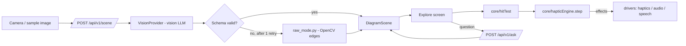

# Design Document

## Overview
Ghost Touch is a React PWA (Chrome on Android) backed by a FastAPI service. The backend turns an image into a validated, normalized `DiagramScene`. The frontend turns finger movement over that scene into vibration, speech, and tone **effects** through a pure haptic engine. Browser APIs are isolated in drivers so the engine can be property-tested and the web vibration driver can later be swapped for Capacitor.



## Components and Interfaces

### Backend
| Module | Responsibility |
|---|---|
| `schema.py` | Pydantic `DiagramScene` (source of truth). Exports JSON Schema for TS generation. |
| `vision/base.py` | `class VisionProvider(Protocol): async def extract(image: bytes) -> dict` |
| `vision/<provider>.py` | Concrete provider; prompt asks for JSON matching the schema; model from env. |
| `validate.py` | Parse, normalize, enforce invariants (unique ids, valid references, coords in [0,1]); repair trivial issues (clamp ±0.02 overshoot, drop dangling segments). |
| `raw_mode.py` | Grayscale → blur → Canny → contours → Douglas–Peucker simplification → ≤300 normalized segments. |
| `ask.py` | Answers a question from scene JSON only; must reply "I don't know" when the scene lacks the information. |
| `main.py` | Routes, 15 s timeout, CORS for the Vercel origin. |

**API**
- `POST /api/v1/scene` — multipart `image` → `{ scene: DiagramScene, mode: "ai" | "raw", reason?: "invalid" | "timeout" | "error" }`
- `POST /api/v1/ask` — `{ scene, question, lang }` → `{ answer: string }`
- `GET /api/v1/health`

### Frontend core (pure, property-tested)
```ts
// geometry.ts
toScreen(p: NormPoint, view: Viewport): ScreenPoint
toNorm(p: ScreenPoint, view: Viewport): NormPoint
distToSegment(p, a, b): number

// hitTest.ts
type Target =
  | { kind: 'vertex'; id: string; label?: string }
  | { kind: 'line'; id: string; elementKind: 'segment' | 'polyline' | 'axis' }
  | { kind: 'bar'; id: string; label: string; value: number }
  | { kind: 'none' };
hitTest(scene: DiagramScene, finger: ScreenPoint, view: Viewport, radii: Radii): Target
// priority: vertex > bar edge/line > bar interior > none

// pitch.ts
pitchForY(yNorm: number): number          // 0 = top -> 1000 Hz, 1 = bottom -> 200 Hz
pitchForValue(v: number, max: number): number

// hapticEngine.ts
type Input =
  | { kind: 'move'; t: number; target: Target; yNorm: number }
  | { kind: 'lift'; t: number };
type Effect =
  | { kind: 'vibrate'; pattern: number | number[] }
  | { kind: 'speak'; text: string }
  | { kind: 'tone'; hz: number | null };
step(state: EngineState, input: Input, cfg: HapticConfig): { state: EngineState; effects: Effect[] }

// correct.ts
movePoint(scene: DiagramScene, pointId: string, x: number, y: number): DiagramScene
renameLabel(scene: DiagramScene, elementId: string, newLabel: string): DiagramScene
deletePoint(scene: DiagramScene, pointId: string): DiagramScene
deleteSegment(scene: DiagramScene, segmentId: string): DiagramScene
historyReducer(state: HistoryState, action: HistoryAction): HistoryState
```

**Engine rules** (mirrors the tuned prototype):
1. Enter a new vertex → `vibrate(cornerPattern)`, `speak(label)`, `tone(null)`; set `quietUntil = t + quietMs`.
2. Same vertex as last step → no effects.
3. On a line, `t ≥ quietUntil` and `t − lastBuzz > retriggerMs` → `vibrate(lineMs)`.
4. On a curve → also `tone(pitchForY(yNorm))`.
5. Leave all lines → `vibrate(0)` only if `t ≥ quietUntil`; `tone(null)`.
6. Lift → `vibrate(0)`, `tone(null)`; reset state.

`HapticConfig` defaults: `lineMs 80, retriggerMs 70, cornerPattern [50,90,50], quietMs 450, vertexRadius 22, lineRadius 14` (values live in `tech.md`).

### Frontend drivers
- `HapticDriver { vibrate(pattern): boolean; stop(): void }` — `WebHapticDriver` now, `CapacitorHapticDriver` later.
- `AudioDriver { setTone(hz | null) }` — one sine oscillator with smoothed frequency and gain.
- `SpeechDriver { speak(text, lang); listen(lang): Promise<string> }` — every `speak` cancels the previous utterance.
- `DiagramStore { list(): Promise<StoreResult<SavedDiagram[]>>; get(id): Promise<StoreResult<SavedDiagram|undefined>>; put(entry): Promise<StoreResult<void>>; delete(id): Promise<StoreResult<void>> }` where `StoreResult<T> = { ok: true; value: T } | { ok: false; error: string }` — `IDBDiagramStore` backed by IndexedDB; `MemoryDiagramStore` in-memory fake for tests. Every call wrapped in try/catch; errors surfaced via return value, never thrown. A write counts as successful only after the IndexedDB transaction completes, not when the request succeeds (a quota error is reported at commit; see task 20.1).

### Screens
`Start` → `Capture` → (`Explore` ⇄ `Ask`) ; `SavedDiagrams` ← Capture ; `Correct` (Kiroween, sighted mode).

## Data Models
```python
class Point(BaseModel):    id: str; x: float; y: float; label: str | None = None
class Segment(BaseModel):  id: str; a: str; b: str; label: str | None = None   # point ids
class Polyline(BaseModel): id: str; points: list[tuple[float, float]]; label: str | None = None
class Bar(BaseModel):      id: str; x0: float; x1: float; y_top: float; y_base: float; label: str; value: float
class Axes(BaseModel):     x_axis_y: float | None = None; y_axis_x: float | None = None
class DiagramScene(BaseModel):
    version: Literal[1] = 1
    kind: Literal["geometry", "function_graph", "bar_chart", "unknown"]
    title: str | None = None
    points: list[Point] = []
    segments: list[Segment] = []
    polylines: list[Polyline] = []
    bars: list[Bar] = []
    axes: Axes | None = None
    facts: list[str] = []   # e.g. "AB = 5 cm", "angle C = 90°" — used by Ask
```
All `x`, `y` values are in [0, 1], origin top-left. Aspect ratio is kept in `Viewport` (letterboxed), never stretched.

### Saved diagram entry (TypeScript, frontend only)
```ts
// core/savedDiagrams.ts
interface SavedDiagram {
  id: string;                 // generated from clock + rng, injected for testability
  createdAt: number;          // Date.now() ms, used for eviction ordering
  title: string;              // spoken title: scene.title ?? kind + first labelled points
  thumbnailDataUrl: string;   // canvas.toDataURL('image/jpeg', 0.7) after first render
  scene: DiagramScene;        // full scene; offline exploration works without the network
  pinned: boolean;            // if true, immune to automatic eviction
}

// Pure core — no browser APIs
savedTitle(scene: DiagramScene, lang: string): string
makeId(nowMs: number, rng: () => number): string
chooseEviction(entries: SavedDiagram[]): SavedDiagram | undefined  // oldest unpinned, or undefined
capExceeded(count: number, cap: number): boolean
orderForDisplay(entries: SavedDiagram[]): SavedDiagram[]  // newest-first
```

Cap: 20 entries. Eviction target: oldest by `createdAt` among unpinned entries.
Storage unavailability is handled gracefully: the app keeps working and speaks a short explanation.

## Error Handling
Each property maps to requirements and runs with fast-check (frontend) or Hypothesis (backend), ≥200 cases.

| # | Property | Validates |
|---|---|---|
| P1 | **Every point is reachable:** for any valid scene and viewport, `hitTest` at a point's screen position returns that vertex. | 4.3, 4.6 |
| P2 | **Vertex beats line:** any finger position within the vertex radius of a point is never classified as `line`. | 4.6 |
| P3 | **Corner pulse is never merged:** for any input sequence, no `vibrate(lineMs)` or `vibrate(0)` effect is emitted within `quietMs` after a corner pattern. | 4.5, 4.2 |
| P4 | **No repeated corner:** consecutive moves on the same vertex emit the corner pattern exactly once. | 4.4 |
| P5 | **Continuous line buzz:** while every input is on a line and the quiet window has passed, the gap between line vibrate effects never exceeds `retriggerMs + one input interval`. | 4.1 |
| P6 | **Lift silences everything:** after `lift`, the effect list contains `vibrate(0)` and `tone(null)`. | 4.7 |
| P7 | **Pitch is monotonic:** `y1 < y2 ⇒ pitchForY(y1) > pitchForY(y2)`, and output is always in [200, 1000]. | 5.1, 5.2 |
| P8 | **Coordinate round-trip:** `toNorm(toScreen(p)) ≈ p` within 1e-9 for any viewport. | 3.2 |
| P9 | **Validator invariants:** any scene accepted by `validate.py` has unique ids, valid point references, and all coordinates in [0, 1]. Garbage input never raises an unhandled exception. | 3.2, 3.3, 3.5 |
| P10 | **Raw Mode bound:** for any image, `raw_mode` returns ≤300 segments, all normalized. | 8.2 |
| P11 | **Bar pitch order:** bars with larger values never get a lower pitch. | 6.2 |
| P12 | **Explore gesture events reach the engine:** an integration test with synthetic pointer events through hitTest, step and runEffects, including a lift, produces the expected effects at each stage. | 13.2 |
| P13 | **Validator rejects colour- or shape-only labels:** labels made only of words from the colour/shape list are rejected; labels with any other word are accepted. | 3.6 |
| P14 | **Serialise round-trip:** `deserialise(serialise(entry))` returns an identical `DiagramScene` for any valid scene (all coordinate values preserved, kind preserved, no data loss). | 11.1 |
| P15 | **Eviction invariants:** after any sequence of saves on a store that was at the cap, the count never exceeds the cap, no pinned entry is ever evicted, and the entry removed is always the oldest unpinned one. | 11.5, 11.6 |
| P16 | **Correct edit invariants:** any sequence of valid edits on a valid scene yields a scene that either satisfies the invariants (unique ids, no dangling segment references, all coordinates in [0, 1]) or is explicitly rejected. | 9.2, 9.3 |
| P17 | **Undo/Redo round-trip:** undo after any edit restores the previous scene exactly; redo re-applies it. | 9.2 |
| P18 | **Alive animation bound and flash frequency:** for any keyframe or animation in `frontend/src/styles/explore.css` and `Spark.tsx`, declared duration is <= 1.2 s and pulse frequency is <= 3 flashes per second. | 14.5 |
| P19 | **CSS @import ordering and stylesheet integrity:** in all stylesheets under `frontend/src/styles/`, every `@import` statement must precede all other CSS style rules, and every referenced stylesheet must exist on disk. | 14.1, 14.6 |
| P20 | **Design token color conformance:** every color declaration in component and screen stylesheets (excluding canvas 2D contexts and brand SVGs) must consume CSS custom properties (`var(--gt-*)`) or allowed token fallbacks, prohibiting unmanaged bare hex literals. | 14.1, 14.6 |
| P21–P24 | **Image header parsing (backend, `test_infra_props.py`, agy):** dimension sniffing never raises; PNG and JPEG headers decode to their exact size; EXIF orientations 5–8 swap width and height. | 15 |
| P25–P28 | **Scene cache (backend, `test_infra_props.py`, agy):** same bytes give the same key; the cache never exceeds `max_entries`; a get after a put returns the entry unless evicted; expiry is monotonic. | 15 |
| P29–P30 | **Rate limiter (backend, `test_infra_props.py`, agy):** a new client is always granted its first request; never more than `per_minute` requests in any 60 s window. | 15 |
| P31 | **Edit operations are total, local and bounded (Kiro):** for any scene and any numeric input including NaN and Infinity, `movePoint` never throws, keeps coordinates in [0, 1], changes only its target, and never mutates its input; `renameLabel` changes exactly one label (trimmed) and rejects blank labels with an `Error`; `deletePoint` removes the point and exactly its incident segments; `deleteSegment` removes only that segment. | 9.2 |
| P32 | **The invariant checker catches every violation (Kiro):** `validateSceneInvariants` accepts every well-formed scene (points, segments, polylines, bars, axes) and rejects a well-formed scene after any single injected violation: duplicate id, dangling reference, or a coordinate outside [0, 1] including NaN and Infinity. | 9.2, 9.3 |
| P33 | **List order and spoken title (Kiro):** `orderForDisplay` is a newest-first permutation that does not mutate its input; `savedTitle` is never blank and is the trimmed scene title, otherwise the kind followed by at most three trimmed point labels. | 11.1, 11.3 |
| P34 | **Re-saving or pinning an existing entry never evicts (Kiro):** `applyAdd` with a stored id replaces it in place; count, order and all other entries are unchanged, even in a full store of pinned entries. | 11.5, 11.6 |
| P35 | **Corrupt storage never crashes the reader (Kiro):** `deserialise` never throws on any input; it returns `undefined` or a fully typed entry; an entry with a missing or mistyped required field is rejected. | 11.7 |
| P36 | **Centre tick fires once per excursion (Kiro):** the tick fires only inside the centre radius, and between two ticks the cursor must leave the 1.5× re-arm radius; a hold that stays at the centre ticks exactly once. | 13.3 |
| P37 | **Centre tick never merges with a corner (Kiro):** a tick never fires inside the corner quiet window or in a step that emits the corner pattern; "Centre." is spoken at most once; the engine never emits the centre-tick pattern, which stays shorter than every line and corner pulse. | 13.3, 4.5 |
| P38 | **Exit swipe is unambiguous (Kiro):** the two-finger exit swipe fires exactly for fast, downward, mostly vertical motion of both fingers, and never together with the Ask long-press. | 13.5, 13.6 |
| P47 | **A scene built from its own facts is never flagged (agy; spec written after the code by Kiro):** a triangle whose three length facts are its own drawn side lengths times any scale (1 to 50), and a bar chart whose bar facts are its own bar heights times any scale (2 to 100), give `consistent` with no findings. Kiro added the same for scenes with `aspect` ≠ 1 and for mixed units (Requirement 18.6, 18.7). | 18.3, 18.6, 18.7 |
| P48 | **Invariant under uniform scale and translation (agy):** scaling and translating every point of a scene (an honest and a forged triangle) does not change the status, the number of findings, the first finding's segment or its message. | 18.9 |
| P49 | **Unsure means silent (agy):** prose-only facts, any "not to scale" / "not drawn to scale" fact (even next to wildly wrong lengths), and fewer than two matched lengths all give `silent` with no findings. | 18.5 |
| P50 | **Order does not matter (agy):** any permutation of the facts and of the segments of the forged triangle gives the same status, finding count, first segment and message. | 18.9 |
| P51 | **An unlabelled corner is spoken in the active language (Kiro, task 31):** the engine emits `speakKey('vertex.unlabelled', { id })` for a missing or blank label and `speak(label)` otherwise, never English text of its own; `runEffects` and `mergeAnnouncements` word the key in en, hi and gu, joined after any axis crossings; the corner pattern and quiet window are unchanged. | 4.3, 10.1 |
| P52 | **The optimised hit test gives exactly the previous answer (Kiro, task 32, PERF-01):** on random scenes (NaN and out-of-range coordinates, dangling segments, duplicate ids, a 2000-point polyline), random letterboxed viewports, random radii and fingers aimed at the radius band, `hitTest` deep-equals a frozen copy of the previous implementation, ties included. | 4.1, 4.6 |
| P53 | **A bar with a non-finite value is never announced (Kiro, task 32, R3-07):** a finger inside such a bar never gets a bar target for it; finite bars next to it still answer with a finite `maxValue`; no bar target ever carries NaN or Infinity. | 6.1, 6.2 |
| P54 | **Adding a point keeps the scene valid (Kiro, task 34):** for any valid scene, any finite x and y (including huge and negative values), any optional label and any optional id (free, taken or blank), `addPoint` returns a scene that passes `validateSceneInvariants`, has exactly one more point with a fresh id and clamped coordinates, leaves every other element equal, and does not mutate its input. | 19.1, 19.3 |
| P55 | **Adding a segment keeps the scene valid, or changes nothing (Kiro, task 34):** for any valid scene and two distinct existing point ids with no segment between them, `addSegment` returns a valid scene with exactly one more segment from a to b and a fresh id; for an unknown endpoint, a == b, or an existing pair in either direction it returns the same scene object. | 19.2, 19.3 |
| P56 | **Add then undo is exact (Kiro, task 34):** applying `addPoint` or `addSegment` through `historyReducer` and then undoing gives back the previous scene object; redo gives back the edited one. | 19.5 |
| P57 | **Bad coordinates never make a bad scene (Kiro, task 34):** for coordinates drawn from NaN, ±Infinity, huge, negative and ordinary values, `addPoint` returns either the same scene (NaN or infinite input) or a scene that passes `validateSceneInvariants`. | 19.3, 19.4 |
| P58 | **Add point outcome (spec by Kiro, task 36, to be built by agy):** for any scene, any x, y (including NaN, ±Infinity, huge and negative) and any label, `planAddPoint` returns `added` exactly when x and y are finite and the scene has fewer points than the cap; then its scene equals `addPoint(scene, x, y, label)` with the label trimmed and cut to 60 characters, and its `id` and `label` are those of the new last point. Otherwise it returns `limit` or `badCoords` with the same scene object. The result never has more points than the cap. | 20.2, 20.5 |
| P59 | **Add edge outcome and reason (task 36):** for any scene and any two strings, `planAddSegment` returns `samePoint` when a === b, `unknownPoint` when either is not a point id, `alreadyJoined` when a segment joins them in either direction, `limit` at the segment cap (checked in that order), each with the same scene object; otherwise `added`, with a scene equal to `addSegment(scene, a, b)`. | 20.3.3, 20.5 |
| P60 | **Undo names what it removes (task 36):** for any scene and any successful add, `describeUndo(after, before)` names the added point's id, or both endpoints of the added edge; for a move, rename or delete it returns `undefined`, so the existing undo wording is used. | 20.4 |
| P61 | **New strings are complete and honest (task 36):** every key in `GHOSTWRITER_KEYS` exists in `en`, `hi` and `gu`, is not blank, has the same `{placeholders}` in all three, has Hindi and Gujarati values that differ from English, and its English value contains none of "verified", "correct", "checked", "approved" (case-insensitive). Run over random placeholder values (200+ runs) through `tf()`. | 20.6, 20.7 |
| P62 | **Deleting a curve or a bar keeps the scene valid and removes exactly one element (Kiro, task 37.1):** for any valid scene and the id of one of its polylines (or bars), `deletePolyline` (or `deleteBar`) returns a scene that passes `validateSceneInvariants`, has exactly one polyline (or bar) fewer, has no element with that id, keeps the remaining polylines (or bars) in order, and does not mutate its input. | 21.1, 21.2, 21.4, 21.5 |
| P63 | **An unknown id changes nothing (Kiro, task 37.1):** for any valid scene and any id that is not a polyline id (or not a bar id), including the ids of points, segments and the other kind, the function returns the same scene object. | 21.3 |
| P64 | **Delete then undo is exact (Kiro, task 37.1):** applying either deletion through `historyReducer` and undoing gives back the previous scene object, and redo gives back the edited one. A no-op leaves the history unchanged. | 21.6 |
| P65 | **Other kinds are untouched (Kiro, task 37.1):** after either deletion, `points`, `segments`, `axes`, `facts`, `title`, `kind`, `aspect` and the other element kind are the same references as before. | 21.1, 21.2 |
| P66 | **Sanitised share text never begins with a badge (Kiro, task 38):** for any string mixed from badge words (English in any case, Hindi, Gujarati), check marks with or without U+FE0F, invisible marks, whitespace, connectors and ordinary text, `sanitizeShareName` and `sanitizeShareTitle` return a string that does not begin with a badge word, a check mark, an invisible mark or whitespace. 300 runs. | 22.1 |
| P67 | **Only badges sanitise to nothing (Kiro, task 38):** for any non-empty mix of badge words, check marks, invisible marks, whitespace and connectors with at least one badge, both functions return the empty string. 300 runs. | 22.2 |
| P68 | **Sanitising is idempotent (Kiro, task 38):** for any mix as in P66, `f(f(x))` equals `f(x)` for both functions. 300 runs. | 22.3 |
| P69 | **No connector is left over and the name is kept (Kiro, task 38):** for a badge prefix (with connectors) followed by ordinary text that has no "and" and no "&", the result ends with that text and contains neither the word "and" nor "&". 300 runs. | 22.4 |
| P70 | **Ordinary text is not over-stripped (Kiro, task 38):** for names such as Andrew, Verity, Verifiedcity, Certifiedx, Hindi and Gujarati names, joined by single spaces, both functions return the input unchanged. 300 runs. | 22.5 |
| P71 | **A name or title with `$` patterns appears exactly once (Kiro, task 38):** for any language in en, hi, gu and any name and title built from words and the patterns `$`, `$&`, `$'`, `` $` ``, `$1`, `$$`, `honestSharedByLabel`, `formatShareTitleAnnouncement` (both announcement shapes), `exploreAnnouncement` (shared, `honestTitle`) and `buildHonestShareAnnouncement` contain the name or title exactly once and no literal `{name}` or `{title}`. 300 runs. | 22.6 |
| P72 | **The saved store never ends above its cap (Kiro, task 38):** for any sequence of saves, pins, unpins and one-shot put and delete failures, on a store with and without `putWithEviction`, and any cap in 2, 3, 5, `SAVED_DIAGRAMS_CAP`, the store holds at most `cap` entries after every `saveDiagramWithEviction`, whatever it returned. 300 runs. | 22.7 |
| P73 | **A pinned entry is never evicted (Kiro, task 38):** over the same sequences, every id that was pinned before a save is still in the store after it. 300 runs. | 22.8 |
| P74 | **A failed delete never reports success over the cap (Kiro, task 38):** over the same sequences plus a persistent delete failure, whenever `saveDiagramWithEviction` returns `ok: true` the store holds at most `cap` entries. 300 runs. | 22.9 |
| P75 | **Saving an existing id updates it in place (Kiro, task 38):** a successful save of an id that is already stored keeps the entry count, removes no other entry, evicts nothing and stores the new title, thumbnail and scene; a failed one leaves the store as it was. 300 runs. | 22.10 |
| P76 | **Updating in place keeps pinned and createdAt (Kiro, task 38):** a successful save of an id that is already stored keeps the stored `pinned` and `createdAt` even when the entry passed in has other values. 300 runs. | 22.11 |
| P77 | **No share string claims verification (Kiro, task 38):** for every `share.` key and each of en, hi, gu (every pair is run as an explicit example, then 300 random pairs), the string contains no "verified" (any case), "सत्यापित" or "પ્રમાણિત". | 22.12 |
| P78 | **The honest "not checked" strings stay (Kiro, task 38):** for each of en, hi, gu, `share.sharedBy` and `share.sharedUnnamed` exist, say "not checked" in that language, and still contain the `{name}` placeholder where they had it. 200 runs. | 22.12 |
| P85 | **Buzz timing matches the vibration pattern (Kiro, task 41; helper by Antigravity, W3):** for any number or array, including zero, negative, NaN and infinite entries, `patternToBuzzes` (`drivers/haptics.ts`) gives one buzz per positive finite ON (even-index) entry, with that entry's duration, at the running sum of every earlier positive finite entry, in order. Nothing else gives a buzz, so there are never more than ceil(length / 2) buzzes. A number n > 0 gives `[{ atMs: 0, durationMs: n }]` and anything else gives `[]`. Example: `DEFAULT_HAPTICS.cornerPattern` [50, 90, 50] gives buzzes at 0 and 140 ms, 50 ms each. | 1.4, 1.5 |
| P39 | **Validation is a fixed point (Kiro, Hypothesis, backend):** a well-formed scene passes `validate_scene` unchanged, and validating an accepted scene's own output returns the same scene. | 9.3 |
| P40 | **Rate-limit identity resists spoofing (Kiro, Hypothesis, backend):** for any `X-Forwarded-For` the client forges, the client key equals the key of the same peer without forgery; with zero trusted hops the key is the peer address. | 16.1 |
| P41 | **Rate-limit state is bounded (Kiro, Hypothesis, backend):** after any sequence of requests and clock advances, the limiter holds no empty window and no more keys than clients active in the last window; the limit itself never admits more than `per_minute` requests. | 16.2 |
| P42 | **Guards are path-normalisation invariant (Kiro, Hypothesis, backend):** every guarded route has the same body limit and rate limit under any number of trailing or repeated slashes. | 16.5 |
| P43 | **Back navigation is total and spoken (Kiro, fast-check):** for every screen and dirty flag, Back leads to a defined screen, always carries a non-empty announcement, and never discards unsaved Teacher edits without a confirmation step. | 17.1 |
| P44 | **Announcements join in order without loss (Kiro, fast-check):** joining any list of announcements keeps every non-blank part, in the given order, as one utterance; axis crossings come before the vertex. | 17.2 |
| P45 | **Fact answers are bounded (Kiro, Hypothesis, backend):** for any facts, the clamped answer has at most two sentences and at most the answer character limit, and clamping twice equals clamping once. | 16.10 |
| P46 | **"Don't know" ignores trailing punctuation (Kiro, Hypothesis, backend):** adding any of `.`, `।`, `॥` or spaces after a "don't know" phrase in any language does not change `is_dont_know`. | 16.10 |

## Error Handling
| Failure | Behavior |
|---|---|
| Vibration unsupported | Announce, continue with audio-only (Req 1.3) |
| LLM invalid twice / timeout / provider error | Raw Mode scene + spoken explanation (Req 3.3, 3.4, 8.1) |
| Network offline | Offer samples and saved diagrams |
| Speech recognition unavailable | Text input (Req 7.4) |
| Image too large | Downscale client-side to 1600 px longest side before upload |
| IndexedDB unavailable | Speak "Saving is unavailable on this device"; app continues without saving (Req 11.7) |
| Storage full / all entries pinned | Speak "Could not save: all slots are pinned"; app continues (Req 11.5, 11.7) |

## Testing Strategy
- **Property tests:** P1–P57 as above (P58–P61 are specified for task 36 and not built yet), each with at least 200 cases; these are the headline of the Kiro write-up. P31–P39 were added by Kiro in review (Task 19). A property that has never failed is checked by mutation: P34, P36 and P16/P31 were each confirmed to fail when the code under test was deliberately broken.
- **Unit tests:** fixtures for the three sample diagrams; provider mocked with recorded responses.
- **Device test checklist (manual, on Nord CE6 + one budget phone):** distinguish line vs. corner with eyes closed; trace a triangle and name it; identify the highest bar; follow a sine curve and count peaks.
- **User test (Kiroween):** at least one session with a blind student or a school for the blind, recorded with consent for the demo.

## Security and Robustness, round 2 (Requirements 16 and 17)

### Backend
| Concern | Design |
|---|---|
| Client identity (16.1) | One pure function, `client_key(peer, forwarded_for, trusted_hops)` in `limits.py`. With `trusted_hops = 0` it returns `peer`. With `n >= 1` it splits `X-Forwarded-For`, and uses the n-th entry from the right (the one the trusted proxy appended); if the header has fewer than n entries it falls back to `peer`. Everything the client wrote sits to the left and is never read. `TRUSTED_PROXY_HOPS` sets n; unset means 1 when `RENDER` is set, otherwise 0. |
| Limiter state (16.2) | `_allow` pops expired timestamps; when a window is empty after popping, its key is deleted. Memory is bounded by clients active in the last window. |
| Ask concurrency (16.3, 16.9) | `get_ask_semaphore()` beside `get_scene_semaphore()`; `ASK_MAX_CONCURRENCY` (default 4) and `ASK_QUEUE_WAIT_SECONDS` (default 2). Busy gives 503 with `Retry-After`. A disconnect while waiting gives 499. |
| Path normalisation (16.5) | One pure function, `normalize_path(path)`, collapses repeated slashes and strips trailing slashes (the root stays `/`). The middleware looks up limits and rates by the normalised path. |
| Headers (16.4, 16.6) | `SecurityHeadersMiddleware` adds `Content-Security-Policy: default-src 'none'; frame-ancestors 'none'` and `X-Frame-Options: DENY` to API responses. `frontend/vercel.json` adds the CSP below, HSTS and Permissions-Policy. |
| Streamed overflow (16.8) | A body that grows past its limit while streaming is answered 413 by the middleware; it never surfaces as a 500. |
| WebP and Raw Mode (16.7) | `sniff_image_dimensions` walks RIFF chunks (FourCC plus little-endian size, padded to even) until a `VP8 `, `VP8L` or `VP8X` chunk. Raw Mode keeps the longest 1000 candidate segments before it de-duplicates, since only 300 are ever kept. |
| Ask answers (16.10) | `facts_lookup` output goes through `clamp_answer`. `parse_ai_reply` accepts only a string `answer`. `is_dont_know` strips `.`, `।`, `॥` on both sides. A lone unit token never selects a fact. The identifier "A" is an article only when no point has id `A`. |
| Scene limits (16.11) | `MAX_POLYLINE_POINTS = 2000` for `/ask` (matches `frontend/src/share/limits.ts`). `/validate` keeps its own stricter structural limits (500 points, 1000 segments). |

### Content-Security-Policy (frontend host)
`default-src 'self'; script-src 'self'; style-src 'self' 'unsafe-inline'; img-src 'self' data: blob:; font-src 'self' data:; connect-src 'self' <API origin> ; worker-src 'self' blob:; media-src 'self' blob:; object-src 'none'; base-uri 'self'; frame-ancestors 'none'`. The API origin is the Render service. `style-src 'unsafe-inline'` is kept because React sets inline styles and the lab theme uses them; scripts stay strict. The policy is checked by building and previewing the production bundle and watching the console.

### Frontend (flow layer; pure and unit tested)
| Concern | Design |
|---|---|
| Back navigation (17.1) | `flow/navigation.ts` gains a pure `backTransition(screen, dirty)` returning `{ next, announceKey, needsConfirm }`. Every screen has an announcement key. A dirty Teacher screen returns `needsConfirm: true` and `next` stays `teach` until the user confirms. |
| Announcement join (17.2) | `flow/explore.ts` gains `joinAnnouncements(parts)`: drops blank parts, keeps order, joins with `. `. The Explore move handler builds `[...axisCrossings, vertexText]` and speaks once. The engine's own `speak` effect text is used as the last part. |
| Unmount safety (17.3) | `SavedDiagrams` guards its async load with an `active` flag cleared in the effect cleanup. |
| Delete and focus (17.4) | One combined message; focus moves to the heading. |
| Pointer capture (17.5) | `setPointerCapture` is wrapped in try/catch in Explore; the Teacher canvas handles `onLostPointerCapture` like pointer up. |
| Voice notice (17.6) | The `speech.noVoiceNotice` key already exists in the `en`, `hi` and `gu` tables; the driver reads it with `t()` and fills in `{lang}`, and holds no English. Whether a device's default voice can pronounce the Hindi or Gujarati sentence is for the phone test (step 12.3). |

Contract decisions A2 SEC-01, A2 SEC-04 and A5-05 are not changed by this round.

## Spec Ghost: facts against the drawing (Requirement 18, spec after code)
Built by Antigravity (module, first tests P47-P50, wiring in lane k1); this section was written by Kiro after the code, from what the code does, and records Kiro's changes from the review separately.

### Module
`frontend/src/core/verify.ts` (moved by Kiro from `frontend/src/verify/verify.ts`, which now only re-exports it so existing imports keep working). Pure: no browser API, no React, no i18n; English wording constants only, translated by the callers.
- `parseFacts(facts, scene?)` recognises: `XY = n [unit]`, `length of (side|hypotenuse) XY is n [unit]`, `Side XY is n [unit]` / `has a length of n`, `XY: n` (a segment when the name is two letters or matches a segment), `label: n` and `label has a value of n` (bars), `angle X = n°|degrees`, `angle at (vertex) X is n°`, `m∠X`, `∠X`, three-letter angles such as `ADC`, `X is a right angle`, and `not (drawn) to scale`. Everything else is ignored.
- `verifyScene(scene, { mode })` → `{ status: 'consistent' | 'disagree' | 'silent', findings }`. Steps: silent without facts or with "not to scale"; match each length fact to a segment by id, label, endpoint ids or endpoint labels, in either order; match bar facts by label or id; silent when fewer than two lengths are matched (segments, else bars); compare ratios (two matched lengths: their scales against each other; three or more: each scale against the median); then angles at a vertex with exactly two incident segments, or a three-letter angle.
- Tolerances: 15 % for lengths (25 % when `mode` is `'ai'`), 8 degrees for angles.
- Wording: `VERIFY_WORDING.disagree(name)` = "Facts and drawing disagree on {name}. I can't tell which is right."; the i18n key `verify.disagree` carries the same sentence in en, hi, gu.
- Angle names (M4-10, Kiro): the English `message` keeps "angle B" (18.2 unchanged). An angle finding also carries `angleVertex` ("B"). The pure helper `localizedFindingTarget(finding, angleName)` returns `angleName(angleVertex)` for an angle finding and `getFindingTarget(finding)` otherwise; the core stays language-free because the caller passes `angleName`. `flow/navigation.ts` and `flow/ask.ts` pass `v => tf('verify.angleName', { vertex: v })`, with `verify.angleName` = "angle {vertex}" (en), "कोण {vertex}" (hi), "ખૂણા {vertex}" (gu, the form used before પર). Question matching in Ask still uses the English target and the bare vertex.
- Kiro's changes (task 29): drawn x distances are multiplied by `scene.aspect` (default 1, ignored unless finite and positive), the rule `semantic.py` already uses; matched lengths in different known units are converted to millimetres first, and an unknown unit among differing units means silent.

### Wiring (lane k1, not changed by Kiro)
- `flow/navigation.ts` `verifyCaveatForScene` and `exploreAnnouncement` add the sentence (first finding only) to the entry announcement with `joinAnnouncements`, so it is one utterance; `App.tsx` uses them for photos, samples, saved diagrams, shared links and after Correct mode.
- `flow/ask.ts` `caveatForQuestion` puts the sentence in front of an answer whose question names a disputed element (either letter order, whole words only).

### Known limits (not changed)
- A bar chart whose value axis does not start at 0 draws bar heights that are not proportional to the values; such a chart can be flagged. Nothing in `DiagramScene` says where the axis starts.
- With exactly two matched lengths the check cannot tell which side is wrong; it names the first one in the announcement.
- The Explore renderer draws the unit square without `aspect`, so on a scene with `aspect` ≠ 1 the shape felt is stretched even when the check (correctly) stays silent.

## Ghostwriter: add what the AI missed (Requirement 19)
Written by Kiro before the code. Two pure edits join the existing ones in `frontend/src/core/correct.ts`; the Teach screen hook-up is a later Antigravity lane.

### Functions
- `addPoint(scene, x, y, label?, id?) → DiagramScene`
  - NaN or infinite x or y: return `scene` itself (19.4).
  - Otherwise x and y go through `clamp01` (19.1).
  - Id: `id` is used as given (trimmed) when it is not blank and not used by any point, segment, polyline or bar. Otherwise the first free id in the order `A` … `Z`, then `P1`, `P2`, … is used. Ids are unique across all element kinds because `validateSceneInvariants` checks them that way.
  - Label: trimmed; a blank or missing label is left out of the new point (an unlabelled corner is spoken through `vertex.unlabelled`, Requirement 4).
  - Result: `{ ...scene, points: [...points, newPoint] }`. Nothing else is copied or changed.
- `addSegment(scene, a, b, id?) → DiagramScene`
  - Return `scene` itself when a or b is not a point id, when a === b, or when a segment already joins a and b in either direction (19.2).
  - Id: `id` (trimmed) when it is not blank and free; otherwise `${a}${b}`, and if that is taken `${a}${b}2`, `${a}${b}3`, … (first free).
  - Result: `{ ...scene, segments: [...segments, { id, a, b }] }`. No label: a segment is named by its endpoints.
- No new history action: the caller does `historyReducer(state, { type: 'apply', scene: addPoint(...) })`. A no-op returns the same object, so `applyEdit` leaves the history unchanged and undo is never offered for nothing (19.5).

### Spec Ghost after an edit (19.6)
Checked, not changed. `verifyScene` builds every sentence from `VERIFY_WORDING.disagree(name)`, where `name` comes from the printed facts (the target of a length fact, `angle X`, or a bar label), never from a point or segment label the teacher typed. A consistent result adds nothing. So no path after an add can make Spec Ghost say "verified" or "correct", and no extra test was added. Adding a missing point or segment can make a fact match a drawn element, so a scene that was silent may now report a disagreement; that is the intended behaviour. The separate "Verified by …" line on shared links (owner decision R1) is not Spec Ghost wording and is out of scope here.

## Ghostwriter in Teach mode (Requirement 20)
Spec by Kiro, written before the code; to be built by the Antigravity lane g1. Teach screen only (`screens/Teach.tsx`); Explore is not touched.

### Pure module: `frontend/src/flow/ghostwriter.ts`
No React, no browser API. Speech text is produced with `tf()` so the screen only speaks what it is given.
- `GHOSTWRITER_POINT_CAP = Math.min(LIMITS.maxPoints, 500)` and `GHOSTWRITER_SEGMENT_CAP = Math.min(LIMITS.maxSegments, 1000)`. The 500 and 1000 mirror the backend `MAX_SCENE_POINTS` and `MAX_SCENE_SEGMENTS` (`backend/app/validate.py`); a comment says so. Today the caps are 300 and 300, set by sharing.
- `type GhostwriterMode = { kind: 'idle' } | { kind: 'addPoint' } | { kind: 'addEdgeFirst' } | { kind: 'addEdgeSecond'; first: string }`.
- `planAddPoint(scene, x, y, label?) → { kind: 'added'; scene; id; label? } | { kind: 'limit' | 'badCoords'; scene }`. The checks run in order: non-finite coordinates give `badCoords`, then `points.length >= GHOSTWRITER_POINT_CAP` gives `limit`, otherwise `addPoint(scene, x, y, cleanLabel(label))`. `cleanLabel` trims, cuts to `LIMITS.maxLabel` characters and turns blank into `undefined`.
- `planAddSegment(scene, a, b) → { kind: 'added'; scene; id; a; b } | { kind: 'samePoint' | 'unknownPoint' | 'alreadyJoined' | 'limit'; scene }`, checked in that order, then `addSegment(scene, a, b)`.
- `describeUndo(present, previous) → { kind: 'point'; id } | { kind: 'segment'; a; b } | undefined`. It returns a value only when `present` is `previous` plus exactly one appended point or segment, with nothing else changed (same lengths otherwise and the same leading elements).
- `ghostwriterSpeech(outcome) → string`, `undoSpeech(description) → string`, and `nextMode(mode, event) → { mode, speech? }`. The events are `pressAddPoint`, `pressAddEdge`, `canvasTap { x, y, pointId? }`, `pickPoint { id }` and `escape`. `nextMode` encodes 20.2.2, 20.2.3, 20.3.2 and 20.3.5. It does not touch the scene; the screen calls `planAddPoint` / `planAddSegment` when `nextMode` says so (`action: { kind: 'addPoint', x, y } | { kind: 'addSegment', a, b }`).

### Screen wiring (`screens/Teach.tsx`)
- The existing "Add vertex" button and `handleAddVertex` become "Add point", driven by `nextMode`. `flow/teach.ts` `addVertex` / `generateUniquePointId` are no longer used by Teach for adding (20.2.6); the lane may keep them for other callers or remove them and their tests. The lane says which in its report.
- Canvas taps already go through `pointerToScene` (`flow/correctCanvas.ts`) and the point hit test in `flow/correct.ts`; the lane reuses both.
- Apply: `outcome.kind === 'added'` → `applySceneEdit(outcome.scene)` (the existing helper, which uses `applyEdit`), then speak `ghostwriterSpeech(outcome)`. Any other outcome → speak only; no history change.
- Undo: before undoing, compute `describeUndo(history.present, history.past.at(-1))`. Speak `undoSpeech(d)` when it is defined, otherwise the existing `teach.undo`.
- Spec Ghost: no call is added. The edited scene is checked where edited scenes already are: when a shared link is opened (`exploreAnnouncement(scene, 'shared')`, Requirement 18.1).

### New i18n keys (`GHOSTWRITER_KEYS`, en shown; hi and gu by the lane, marked for native review)
| Key | English |
|---|---|
| `teach.addPoint` | Add point |
| `teach.addPointArmed` | Tap the drawing where the new point goes, or press Add point again to put it in the centre. |
| `teach.pointAddedUnlabelled` | Added {point}. (`{point}` = `tf('vertex.unlabelled', { id })`) |
| `teach.pointAddedLabelled` | Added point {id}, labelled {label}. |
| `teach.pointLimit` | This diagram already has {max} points, the most that can be shared. |
| `teach.pointBadCoords` | That spot is outside the drawing. Try again. |
| `teach.addEdge` | Add edge |
| `teach.addEdgeFirst` | Choose the first point. |
| `teach.addEdgeSecond` | {id} chosen. Choose the second point. |
| `teach.edgeAdded` | Joined {a} and {b}. |
| `teach.edgeSamePoint` | That is the same point. Choose a different second point. |
| `teach.edgeAlreadyJoined` | {a} and {b} are already joined. |
| `teach.edgeUnknownPoint` | That point is no longer in the diagram. |
| `teach.edgeLimit` | This diagram already has {max} edges, the most that can be shared. |
| `teach.addCancelled` | Adding cancelled. |
| `teach.undidAddPoint` | Undone: point {id} removed. |
| `teach.undidAddEdge` | Undone: edge from {a} to {b} removed. |
After `teach.edgeSamePoint` the mode stays `addEdgeSecond` with the same first point, so the teacher can pick again. After every other add-edge outcome the mode returns to `idle`.

### Tests the lane writes
- `tests/ghostwriter.prop.test.ts`: P58-P61, 200 runs or more each.
- `tests/ghostwriter.teach.test.tsx` (jsdom, like `teach.canvas.pointer.test.tsx`), one test each:
  - both controls have an accessible name and are at least 48 × 48 CSS px;
  - add point by tap and by a second press;
  - add edge;
  - each no-op reason is spoken;
  - undo of each add is spoken;
  - the point cap;
  - Explore renders no add control.
- An example for 20.6: a triangle whose facts give a length for `CD` while `D` and `CD` are missing is silent. After adding `D` and `CD` in Teach, `exploreAnnouncement(scene, 'shared')` contains the unchanged `verify.disagree` sentence when the drawn `CD` does not match.

## Correct mode: delete curves and bars (Requirement 21)
Written by Kiro before the code (task 37.1).

### Core (`frontend/src/core/correct.ts`)
- `deletePolyline(scene, id)` and `deleteBar(scene, id)` follow the shape of `deleteSegment`, with one difference: they return `scene` itself when no element of that kind has the id (21.3). That lets `applyEdit` skip a history entry for a no-op.
- The result is `{ ...scene, polylines: polylines.filter(p => p.id !== id) }` (or `bars`). Nothing else is copied.
- An empty `polylines` or `bars` array is kept as `[]`; it is not removed. Removing the last drawable element is allowed (21.7).

### What the later UI lane must add (not built here; `Correct.tsx` and `flow/` were not edited)
- **Selection:** `flow/correct.ts` `CorrectSelection` gains `{ kind: 'polyline'; id }` and `{ kind: 'bar'; id }`. `hitTestCorrect` gains, after points and segments:
  - a polyline hit within `HIT_SEGMENT_RADIUS_PX` of any piece;
  - a bar hit inside the bar's rectangle.
  
  The priority is point > segment > polyline > bar. `getSelectedLabel` and `getSelectionAnnouncement` name the curve or bar by label, otherwise by id.
- **Controls:** the existing Delete button (`correct.delete`, at least 48 × 48 CSS px, accessible name) deletes the selected polyline or bar too. It needs no new button. The keyboard Delete shortcut follows the same path.
- **History:** apply through `applyEdit`; Undo speaks the existing `correct.undo`.
- **New i18n keys** (en given; hi and gu by the lane, listed in `docs/user-test/translation-review.csv` and `.md` for native review):

  | Key | English |
  |---|---|
  | `correct.selectedPolyline` | Selected curve |
  | `correct.selectedBar` | Selected bar |
  | `correct.polylineDeleted` | Deleted curve |
  | `correct.barDeleted` | Deleted bar |
  | `correct.nothingLeft` | Nothing is left to feel in this diagram. Undo brings it back. |

  `correct.nothingLeft` is spoken after a delete leaves no point, segment, polyline or bar.
- **Tests the lane writes:** selection and hit priority for curves and bars; deleting each kind from the screen; the spoken text in en, hi and gu; and undo after a curve or bar delete.

## Round-5 audit invariants as property tests (Requirement 22)
Written by Kiro before the tests (task 38). Tests only: no file under `frontend/src/` changes. Lanes p2 and p3 had already merged into `main` (2d108ca) when these first ran, so they test the fixed code. Files, all new and all `*.prop.test.ts` so the agy lanes cannot edit them (AGENTS.md rule 1):

| File | Properties | Pins |
|---|---|---|
| `frontend/tests/share.sanitize.prop.test.ts` | P66-P70 | `sanitizeShareName`, `sanitizeShareTitle` (`flow/share.ts`); audit R5-01 |
| `frontend/tests/share.template.prop.test.ts` | P71 | the four announcement builders in `flow/share.ts` and `flow/navigation.ts`; audit R5-06 |
| `frontend/tests/saved.eviction.prop.test.ts` | P72-P76 | `saveDiagramWithEviction` (`flow/saved.ts`); audit R5-06 and the pinning and in-place rules of brief p2 |
| `frontend/tests/share.honesty.prop.test.ts` | P77-P78 | the `share.` keys of `tables` in `i18n/index.ts`; audit R5-02 |

### Sanitising oracle (P66-P70)
- Input is built from items, each either a word-like item (badge word, "and", an ordinary name) or a mark-like item (check mark, invisible mark, whitespace, "&"). Two word-like items are always joined by a separator (a space or one of `: , . -`), so the generator never makes "verifiedcertified" and then calls it a badge. A word-like item may be followed directly by a mark-like item, and the other way round: "Verified✅ Name" and "✅Verified Name" are the spoofs the properties exist for.
- "Begins with" is checked with regular expressions on the output only; the sanitiser's own regular expressions are never reused. A badge word counts only when the next character is not a letter, a combining mark or a number, so "Verifiedcity" is a legitimate name and is checked as one by P70.
- Counterexamples are shown with non-ASCII characters escaped as `\u{..}`, because the interesting ones are invisible.
- Decision: P66 and P67 include the case where a badge word is directly followed by a mark ("verified✓"). The audit lists check marks before a badge word, not after it, but the mark-after form is the same spoof: "✅Verified✅ Mrs Sharma" is still shown as "Verified✅ Mrs Sharma" by the merged fix. It is in scope.

### Template oracle (P71)
- The name is `Mr <word><patterns><word>` and the title `Fig <word><patterns><word>`, so they differ and neither contains the other. "Exactly once" is a count of non-overlapping occurrences. The patterns are the five the brief lists plus `$$`, which `String.prototype.replace` also treats specially. Braces never occur in generated text, so a literal `{name}` can only come from a failed substitution.
- The scene for `exploreAnnouncement` is `{ kind: 'unknown', title }`, which `verifyScene` stays silent on, so the announcement is the title line only.
- The language is switched with `setLang` and restored in `finally`.

### Fake store (P72-P76)
`makeFake(atomic)` returns a `DiagramStore` over a `Map`. It has `list`, `get`, `put`, `delete`, and `putWithEviction` only when `atomic` is true, so both branches of `saveDiagramWithEviction` run.
- Failures are armed by sequence steps: `failPut` and `failDelete` fail the next `put` (or `putWithEviction`) and the next `delete` once; `breakDeletes` and `healDeletes` (P74 only) make every `delete` fail until healed. A one-shot failure hits at most one call per save, so a correct implementation can always roll back and the cap properties are satisfiable. With `putWithEviction`, an armed failure aborts the whole call and nothing changes, like the IndexedDB transaction.
- Steps: `save` (a slot in a pool of twice the cap, an arbitrary `createdAt`, an arbitrary `pinned`), `pin` (set or clear `pinned` on an existing entry, written straight into the map as the UI does), `failPut`, `failDelete`. The store passed as `existing` is its real list at that moment, as `App.tsx` does.
- Each save records the store before and after, the entry and the result. P72 to P76 are checks on those records.

### Honesty oracle (P77-P78)
- Keys are the union of the `share.` keys of the three tables. The effective string of a key missing in one language is the English one, as `t()` falls back to it.
- Every pair (language, key) is also passed to `fc.assert` as an explicit example, so the check is exhaustive and does not depend on the random draw reaching it.
- The rule is stricter than the audit's suggested replacement: a negation ("has not verified it", "सत्यापित नहीं") also fails. The only exception the rule needs is the existing "not checked" wording, and that wording uses other words, so no exemption list exists.

### Not pinned here, and why
Three groups of round-5 findings are not covered by P66-P78. They are listed with the same wording in `docs/reviews/kiro-round5.md`.
- **Behind React or `App.tsx`, no pure seam:** saved audit R5-01 (Explore status text), R5-03 and R5-05 (concurrent saves and matching by JSON in `App.tsx`), R5-04, R5-07 and R5-08 (the Correct screen); share audit R5-04, R5-05, R5-08, R5-09, R5-10, R5-11 (components) and R5-12 (a default in `App.tsx`).
- **Needs a different fake:** saved audit R5-02 (`IDBDiagramStore.putWithEviction` puts before it deletes) needs a quota-aware fake `IDBFactory`; it is the next candidate after this task.
- **Pure, but outside the brief's list:** share audit R5-07 (`sceneName` falls back to the raw `scene.kind`, which is an English code word spoken in Hindi and Gujarati).

## Round-5 core fixes (Requirement 23, task 39)
Written by Kiro before the code.
- `core/correct.ts` exports `RESERVED_ELEMENT_IDS` (a `ReadonlySet<string>`, lower case) and `isReservedId(id)` (trim, lower-case, look up). `freeRequestedId` rejects reserved ids. The generated segment id (`${a}${b}`, `${a}${b}2`, …) skips reserved ids as well as taken ones. Generated point ids (`A`…`Z`, `P1`, …) can never be reserved.
- `validateSceneInvariants` adds `Reserved ID: '<id>'` for any point, segment, polyline or bar whose id is reserved.
- `share/validate.ts` imports `isReservedId` instead of keeping its own set; the set is the same, so share behaviour does not change (checked by the parity fixture and the share tests).
- Point cap: none in core (23.4). `tests/caps.agree.test.ts` reads `MAX_SCENE_POINTS` and `MAX_SCENE_SEGMENTS` from `backend/app/validate.py` and checks `GHOSTWRITER_POINT_CAP === Math.min(LIMITS.maxPoints, MAX_SCENE_POINTS)`, and likewise for segments.
- `core/verify.ts` `localizedFindingTarget`: with no `angleVertex`, a target matching `/^angle\s+(\S+)$/i` is worded by `angleName(vertex)`.
- Coincident points: `addPoint` computes the clamped spot, then, when a point is within `COINCIDENT_EPSILON` of it, walks the nudge order of 23.6 and takes the first free in-range candidate. `COINCIDENT_EPSILON` and `NUDGE_STEP` are exported. With `NUDGE_STEP` 0.04 a nudged point is about 16 CSS px away on a 400 px canvas; `hitTestPoint` picks the nearest point, so each one is selected by tapping on it.
- **For the Ghostwriter UI lane (not built here):** after an add, if the new point's position differs from the tapped (clamped) spot, speak a new key `teach.pointNudged`: "Added {point} next to {other}, so it does not cover it." (`{point}` as in `teach.pointAddedUnlabelled`, `{other}` the point that was there), in en, hi and gu. `planAddPoint` would need to return the nudge (for example `nudgedFrom: otherId`); that is a `flow/` change.

| Property | Statement | Req |
|---|---|---|
| P79 | **Reserved ids are never used (Kiro, task 39.1):** for any valid scene and any requested id, including every reserved id in random case and with spaces, `addPoint` and `addSegment` never produce an element whose id is reserved, and the result passes `validateSceneInvariants`; endpoints whose concatenation is reserved still get a non-reserved segment id. A scene that already holds a reserved id fails `validateSceneInvariants`. | 23.1-23.3 |
| P80 | **Angle wording does not depend on `angleVertex` (Kiro, task 39.3):** for any vertex name and language, a finding with `angleVertex` and the same finding without it are worded the same, and neither contains the English word "angle" in hi or gu. | 23.5 |
| P81 | **Non-English facts are silent (Kiro, task 39.3):** for scenes whose facts are Hindi or Gujarati sentences built from random lengths and angles, `verifyScene` returns `silent` with no findings. | 18.10 |
| P82 | **No two points share a position (Kiro, task 39.5):** starting from any valid scene without coincident points, any sequence of `addPoint` calls with any finite coordinates gives a scene where no two points are within `COINCIDENT_EPSILON`, all coordinates are in [0, 1], existing points are unchanged, and a non-coincident add keeps the clamped spot exactly. | 23.6 |

## Round-6 decisions (Requirement 24 and 22.14, task 40)
Written by Kiro before the tests. The code changes are for Antigravity lanes, because `flow/` and the validators are being edited by them; Kiro's tests go in first and are red until those lanes merge (listed in `docs/reviews/kiro-round6.md`).

### Back from Correct (24.1, decision (a))
Chosen over (b) because the policy table is the only place a test can see Back's behaviour; with (b), P43 would keep describing an app that no longer exists. Exact signature for the lane:
```ts
export interface BackContext {
  /** The Teacher editor holds changes that were not saved or shared. */
  dirty: boolean;
  /** The Correct screen holds corrections that were not saved. Default false. */
  correctDirty?: boolean;
  fromShare: boolean;
  hasScene?: boolean;
}
export function leaveByBack(screen: ScreenName, ctx: BackContext): BackStep;
// needsConfirm === (screen === 'teach' && ctx.dirty) || (screen === 'correct' && ctx.correctDirty === true)
```
`next` and `announceKey` for `correct` are unchanged (`explore`, `explore.gestureHint`). `App.tsx` passes the Correct screen's dirty state as `correctDirty`. P43 is amended to this formula over all screens and all three flags; it must still fail on a policy that ignores either flag.

### Failed saves never lose entries (22.14)
Evidence, measured by P83:
- **The audit's literal case (`entry.id === evictedId`) is not reachable through `saveDiagramWithEviction`**, because victims are filtered with `e.id !== entryToSave.id`.
- The prompt's "delete succeeds, then put fails" order is not reachable either: both paths put before they delete, and `MemoryDiagramStore` checks for failure once, before it changes anything.
- **A real loss does happen on the fallback path with two or more victims.** That path is taken by every store, the memory store included, when `evictedIds.length > 1`, which happens after an earlier save left the store over the cap. The sequence is:
  1. The put succeeds.
  2. The first victim delete succeeds.
  3. The second victim delete fails.
  4. The rollback removes only the new entry, so the first victim is gone and the save reports `ok: false`.

Fix for the saved-diagrams lane (`flow/saved.ts`, not Kiro's): on a failed victim delete, re-put every victim already deleted before rolling back the new entry (or delete no victim until all deletes are known to succeed, for example one `putWithEviction` per victim). `MemoryDiagramStore.putWithEviction` is changed by Kiro to delete the victim before it stores the entry, and to skip the delete when `evictedId === entry.id`, matching `IDBDiagramStore` (audit R6 LOW).

| Property | Statement | Req |
|---|---|---|
| P43 (amended, task 40.1) | For every screen and every `dirty`, `correctDirty`, `fromShare`, `needsConfirm` equals `(teach && dirty) or (correct && correctDirty)`. | 24.1 |
| P83 (task 40.2) | For the real `MemoryDiagramStore` and a fallback store without `putWithEviction`, any starting contents (also over the cap), any new or existing entry, any cap in {2, 3, 5} and any single failing mutating call: when the save returns `ok: false`, every entry that was in the store before is still there with the same content. Also, `MemoryDiagramStore.putWithEviction(e, e.id)` keeps `e`. | 22.14 |
| P84 (task 40.3) | For random scenes whose ids mix reserved ids in any case, `el_`-prefixed ids and ordinary ids, `validateShareScene` accepts; the result has no reserved id, unique ids, no dangling segment, the same number of segments, and every segment joins the same two points (matched by position). | 24.2, 24.3 |

The parity fixture gains `reserved_*` cases with `"structural": true`; both parity tests then also check the output scene against 24.2.

## Halloween Presentation Layer
Dark background, glowing green strokes, a small "creature" mascot assembled from phone parts on the start screen, and the theremin as the signature sound. The theme never touches the users themselves (see `product.md`).

## Frankenstein's Laboratory Visual System
*(Note: Written by Antigravity (agy) on the owner's instruction, awaiting Kiro review; documents the lab visual system implemented by Antigravity).*

The visual and sensory presentation is structured as a modular design token architecture with isolated decorative primitives and strict tactile canvas purity.

### Design Token Architecture (`frontend/src/styles/tokens.css`)
- **Surfaces & Backgrounds:** Lab charcoal base (`--gt-bg: #0b0e0c`), elevated surfaces (`--gt-surface: #141c17`, `--gt-surface-card: #121814`, `--gt-surface-raised: #13271f`, `--gt-surface-sunken: #0d1a15`), radial green glow background (`--gt-bg-radial`).
- **Accents:** Creature life green (`--gt-green: #39ff88`, `--gt-line: #39ff88`, `--gt-green-dim: #25a357`), voltage cyan spark discharges (`--gt-cyan: #00f0ff`, `--gt-voltage-cyan: #00f0ff`), aged copper/brass hardware (`--gt-copper: #c88a4b`, `--gt-brass: #d4a359`, `--gt-border-copper: #c88a4b`), bone/parchment stitches (`--gt-bone: #ded6c4`, `--gt-stitch: #ded6c4`).
- **High-Contrast Typography (WCAG AAA >= 7:1):** `--gt-text` (#eafff5, >18:1 contrast on dark bg), `--gt-text-primary` (#f5fff8, >18:1), `--gt-text-secondary` (#ded6c4, >13:1), `--gt-text-muted` (#a8c5b5, >10:1). Self-hosted Atkinson Hyperlegible woff2 font files in `frontend/src/assets/fonts/` with Indian script fallbacks.
- **Touch Target Invariant:** Minimum interactive control size enforced globally via `--gt-target: 48px` (Requirement 12.1 / 14.2).

### Decorative Primitives (`frontend/src/components/lab/`)
All decorative primitives are strictly non-interactive (`pointer-events: none`) and hidden from assistive technology (`aria-hidden="true"`, `role="presentation"`):
- **`Seam` (`Seam.tsx`):** Horizontal dashed surgical suture divider with cross stitches in bone/parchment token (`--gt-stitch`).
- **`Rivets` (`Rivets.tsx`):** 4-corner aged copper/brass hardware bolts positioned at card perimeters.
- **`LabCard` (`LabCard.tsx`):** Composable card container with dashed stitched border and optional corner rivets.
- **`Spark` (`Spark.tsx`):** One-shot "IT'S ALIVE" voltage arc discharge and ambient radial glow. Governed by `--gt-spark-duration: 950ms` (strictly < 1.2s) with 2 pulse peaks (~2.1 Hz, strictly <= 3 Hz WCAG 2.3.1). Under `prefers-reduced-motion: reduce`, animations are completely disabled and replaced with an immediate non-flashing static frame.

### LabSettings Modal Bottom Sheet (`frontend/src/components/LabSettings.tsx`)
- WAI-ARIA compliant modal dialog (`role="dialog"`, `aria-modal="true"`, focus trapped, escape key dismiss, restore focus on close).
- Appears as a bottom sheet on mobile viewports and a centered card on desktop (`styles/settings.css`).
- Hosts language selection (English, Hindi, Gujarati) and speech rate selection (0.75× to 1.75×) with spoken transition announcements.

### Specimen Table Frame & Tactile Canvas Purity
- **Explore Specimen Frame (`styles/explore.css`):** Surrounds the Explore canvas with a copper border, 4 corner rivets, perimeter stitched suture border, and HUD status chip.
- **Tactile Canvas Purity (Requirement 14.6):** The drawing canvas interior (`.gt-explore__canvas`) is strictly quarantined from decorative overlays. It maintains pure glowing green strokes on pure near-black (`#0b0e0c`) with NO textures, grids, stitches, or rivets inside the interactive touch area, ensuring unambiguous tactile exploration.
