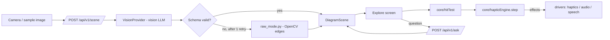

# Design Document

## Overview
Ghost Touch is a React PWA (Chrome on Android) backed by a FastAPI service. The backend turns an image into a validated, normalized `DiagramScene`. The frontend turns finger movement over that scene into vibration, speech, and tone **effects** through a pure haptic engine. Browser APIs are isolated in drivers so the engine can be property-tested and the web vibration driver can later be swapped for Capacitor.



## Components and Interfaces

### Backend
| Module | Responsibility |
|---|---|
| `schema.py` | Pydantic `DiagramScene` (source of truth). Exports JSON Schema for TS generation. |
| `vision/base.py` | `class VisionProvider(Protocol): async def extract(image: bytes) -> dict` |
| `vision/<provider>.py` | Concrete provider; prompt asks for JSON matching the schema; model from env. |
| `validate.py` | Parse, normalize, enforce invariants (unique ids, valid references, coords in [0,1]); repair trivial issues (clamp ±0.02 overshoot, drop dangling segments). |
| `raw_mode.py` | Grayscale → blur → Canny → contours → Douglas–Peucker simplification → ≤300 normalized segments. |
| `ask.py` | Answers a question from scene JSON only; must reply "I don't know" when the scene lacks the information. |
| `main.py` | Routes, 15 s timeout, CORS for the Vercel origin. |

**API**
- `POST /api/v1/scene` — multipart `image` → `{ scene: DiagramScene, mode: "ai" | "raw", reason?: "invalid" | "timeout" | "error" }`
- `POST /api/v1/ask` — `{ scene, question, lang }` → `{ answer: string }`
- `GET /api/v1/health`

### Frontend core (pure, property-tested)
```ts
// geometry.ts
toScreen(p: NormPoint, view: Viewport): ScreenPoint
toNorm(p: ScreenPoint, view: Viewport): NormPoint
distToSegment(p, a, b): number

// hitTest.ts
type Target =
  | { kind: 'vertex'; id: string; label?: string }
  | { kind: 'line'; id: string; elementKind: 'segment' | 'polyline' | 'axis' }
  | { kind: 'bar'; id: string; label: string; value: number }
  | { kind: 'none' };
hitTest(scene: DiagramScene, finger: ScreenPoint, view: Viewport, radii: Radii): Target
// priority: vertex > bar edge/line > bar interior > none

// pitch.ts
pitchForY(yNorm: number): number          // 0 = top -> 1000 Hz, 1 = bottom -> 200 Hz
pitchForValue(v: number, max: number): number

// hapticEngine.ts
type Input =
  | { kind: 'move'; t: number; target: Target; yNorm: number }
  | { kind: 'lift'; t: number };
type Effect =
  | { kind: 'vibrate'; pattern: number | number[] }
  | { kind: 'speak'; text: string }
  | { kind: 'tone'; hz: number | null };
step(state: EngineState, input: Input, cfg: HapticConfig): { state: EngineState; effects: Effect[] }

// correct.ts
movePoint(scene: DiagramScene, pointId: string, x: number, y: number): DiagramScene
renameLabel(scene: DiagramScene, elementId: string, newLabel: string): DiagramScene
deletePoint(scene: DiagramScene, pointId: string): DiagramScene
deleteSegment(scene: DiagramScene, segmentId: string): DiagramScene
historyReducer(state: HistoryState, action: HistoryAction): HistoryState
```

**Engine rules** (mirrors the tuned prototype):
1. Enter a new vertex → `vibrate(cornerPattern)`, `speak(label)`, `tone(null)`; set `quietUntil = t + quietMs`.
2. Same vertex as last step → no effects.
3. On a line, `t ≥ quietUntil` and `t − lastBuzz > retriggerMs` → `vibrate(lineMs)`.
4. On a curve → also `tone(pitchForY(yNorm))`.
5. Leave all lines → `vibrate(0)` only if `t ≥ quietUntil`; `tone(null)`.
6. Lift → `vibrate(0)`, `tone(null)`; reset state.

`HapticConfig` defaults: `lineMs 80, retriggerMs 70, cornerPattern [50,90,50], quietMs 450, vertexRadius 22, lineRadius 14` (values live in `tech.md`).

### Frontend drivers
- `HapticDriver { vibrate(pattern): boolean; stop(): void }` — `WebHapticDriver` now, `CapacitorHapticDriver` later.
- `AudioDriver { setTone(hz | null) }` — one sine oscillator with smoothed frequency and gain.
- `SpeechDriver { speak(text, lang); listen(lang): Promise<string> }` — every `speak` cancels the previous utterance.
- `DiagramStore { list(): Promise<StoreResult<SavedDiagram[]>>; get(id): Promise<StoreResult<SavedDiagram|undefined>>; put(entry): Promise<StoreResult<void>>; delete(id): Promise<StoreResult<void>> }` where `StoreResult<T> = { ok: true; value: T } | { ok: false; error: string }` — `IDBDiagramStore` backed by IndexedDB; `MemoryDiagramStore` in-memory fake for tests. Every call wrapped in try/catch; errors surfaced via return value, never thrown. A write counts as successful only after the IndexedDB transaction completes, not when the request succeeds (a quota error is reported at commit; see task 20.1).

### Screens
`Start` → `Capture` → (`Explore` ⇄ `Ask`) ; `SavedDiagrams` ← Capture ; `Correct` (Kiroween, sighted mode).

## Data Models
```python
class Point(BaseModel):    id: str; x: float; y: float; label: str | None = None
class Segment(BaseModel):  id: str; a: str; b: str; label: str | None = None   # point ids
class Polyline(BaseModel): id: str; points: list[tuple[float, float]]; label: str | None = None
class Bar(BaseModel):      id: str; x0: float; x1: float; y_top: float; y_base: float; label: str; value: float
class Axes(BaseModel):     x_axis_y: float | None = None; y_axis_x: float | None = None
class DiagramScene(BaseModel):
    version: Literal[1] = 1
    kind: Literal["geometry", "function_graph", "bar_chart", "unknown"]
    title: str | None = None
    points: list[Point] = []
    segments: list[Segment] = []
    polylines: list[Polyline] = []
    bars: list[Bar] = []
    axes: Axes | None = None
    facts: list[str] = []   # e.g. "AB = 5 cm", "angle C = 90°" — used by Ask
```
All `x`, `y` values are in [0, 1], origin top-left. Aspect ratio is kept in `Viewport` (letterboxed), never stretched.

### Saved diagram entry (TypeScript, frontend only)
```ts
// core/savedDiagrams.ts
interface SavedDiagram {
  id: string;                 // generated from clock + rng, injected for testability
  createdAt: number;          // Date.now() ms, used for eviction ordering
  title: string;              // spoken title: scene.title ?? kind + first labelled points
  thumbnailDataUrl: string;   // canvas.toDataURL('image/jpeg', 0.7) after first render
  scene: DiagramScene;        // full scene; offline exploration works without the network
  pinned: boolean;            // if true, immune to automatic eviction
}

// Pure core — no browser APIs
savedTitle(scene: DiagramScene, lang: string): string
makeId(nowMs: number, rng: () => number): string
chooseEviction(entries: SavedDiagram[]): SavedDiagram | undefined  // oldest unpinned, or undefined
capExceeded(count: number, cap: number): boolean
orderForDisplay(entries: SavedDiagram[]): SavedDiagram[]  // newest-first
```

Cap: 20 entries. Eviction target: oldest by `createdAt` among unpinned entries.
Storage unavailability is handled gracefully: the app keeps working and speaks a short explanation.

## Error Handling
Each property maps to requirements and runs with fast-check (frontend) or Hypothesis (backend), ≥200 cases.

| # | Property | Validates |
|---|---|---|
| P1 | **Every point is reachable:** for any valid scene and viewport, `hitTest` at a point's screen position returns that vertex. | 4.3, 4.6 |
| P2 | **Vertex beats line:** any finger position within the vertex radius of a point is never classified as `line`. | 4.6 |
| P3 | **Corner pulse is never merged:** for any input sequence, no `vibrate(lineMs)` or `vibrate(0)` effect is emitted within `quietMs` after a corner pattern. | 4.5, 4.2 |
| P4 | **No repeated corner:** consecutive moves on the same vertex emit the corner pattern exactly once. | 4.4 |
| P5 | **Continuous line buzz:** while every input is on a line and the quiet window has passed, the gap between line vibrate effects never exceeds `retriggerMs + one input interval`. | 4.1 |
| P6 | **Lift silences everything:** after `lift`, the effect list contains `vibrate(0)` and `tone(null)`. | 4.7 |
| P7 | **Pitch is monotonic:** `y1 < y2 ⇒ pitchForY(y1) > pitchForY(y2)`, and output is always in [200, 1000]. | 5.1, 5.2 |
| P8 | **Coordinate round-trip:** `toNorm(toScreen(p)) ≈ p` within 1e-9 for any viewport. | 3.2 |
| P9 | **Validator invariants:** any scene accepted by `validate.py` has unique ids, valid point references, and all coordinates in [0, 1]. Garbage input never raises an unhandled exception. | 3.2, 3.3, 3.5 |
| P10 | **Raw Mode bound:** for any image, `raw_mode` returns ≤300 segments, all normalized. | 8.2 |
| P11 | **Bar pitch order:** bars with larger values never get a lower pitch. | 6.2 |
| P12 | **Explore gesture events reach the engine:** an integration test with synthetic pointer events through hitTest, step and runEffects, including a lift, produces the expected effects at each stage. | 13.2 |
| P13 | **Validator rejects colour- or shape-only labels:** labels made only of words from the colour/shape list are rejected; labels with any other word are accepted. | 3.6 |
| P14 | **Serialise round-trip:** `deserialise(serialise(entry))` returns an identical `DiagramScene` for any valid scene (all coordinate values preserved, kind preserved, no data loss). | 11.1 |
| P15 | **Eviction invariants:** after any sequence of saves on a store that was at the cap, the count never exceeds the cap, no pinned entry is ever evicted, and the entry removed is always the oldest unpinned one. | 11.5, 11.6 |
| P16 | **Correct edit invariants:** any sequence of valid edits on a valid scene yields a scene that either satisfies the invariants (unique ids, no dangling segment references, all coordinates in [0, 1]) or is explicitly rejected. | 9.2, 9.3 |
| P17 | **Undo/Redo round-trip:** undo after any edit restores the previous scene exactly; redo re-applies it. | 9.2 |
| P18 | **Alive animation bound and flash frequency:** for any keyframe or animation in `frontend/src/styles/explore.css` and `Spark.tsx`, declared duration is <= 1.2 s and pulse frequency is <= 3 flashes per second. | 14.5 |
| P19 | **CSS @import ordering and stylesheet integrity:** in all stylesheets under `frontend/src/styles/`, every `@import` statement must precede all other CSS style rules, and every referenced stylesheet must exist on disk. | 14.1, 14.6 |
| P20 | **Design token color conformance:** every color declaration in component and screen stylesheets (excluding canvas 2D contexts and brand SVGs) must consume CSS custom properties (`var(--gt-*)`) or allowed token fallbacks, prohibiting unmanaged bare hex literals. | 14.1, 14.6 |
| P21–P24 | **Image header parsing (backend, `test_infra_props.py`, agy):** dimension sniffing never raises; PNG and JPEG headers decode to their exact size; EXIF orientations 5–8 swap width and height. | 15 |
| P25–P28 | **Scene cache (backend, `test_infra_props.py`, agy):** same bytes give the same key; the cache never exceeds `max_entries`; a get after a put returns the entry unless evicted; expiry is monotonic. | 15 |
| P29–P30 | **Rate limiter (backend, `test_infra_props.py`, agy):** a new client is always granted its first request; never more than `per_minute` requests in any 60 s window. | 15 |
| P31 | **Edit operations are total, local and bounded (Kiro):** for any scene and any numeric input including NaN and Infinity, `movePoint` never throws, keeps coordinates in [0, 1], changes only its target, and never mutates its input; `renameLabel` changes exactly one label (trimmed) and rejects blank labels with an `Error`; `deletePoint` removes the point and exactly its incident segments; `deleteSegment` removes only that segment. | 9.2 |
| P32 | **The invariant checker catches every violation (Kiro):** `validateSceneInvariants` accepts every well-formed scene (points, segments, polylines, bars, axes) and rejects a well-formed scene after any single injected violation: duplicate id, dangling reference, or a coordinate outside [0, 1] including NaN and Infinity. | 9.2, 9.3 |
| P33 | **List order and spoken title (Kiro):** `orderForDisplay` is a newest-first permutation that does not mutate its input; `savedTitle` is never blank and is the trimmed scene title, otherwise the kind followed by at most three trimmed point labels. | 11.1, 11.3 |
| P34 | **Re-saving or pinning an existing entry never evicts (Kiro):** `applyAdd` with a stored id replaces it in place; count, order and all other entries are unchanged, even in a full store of pinned entries. | 11.5, 11.6 |
| P35 | **Corrupt storage never crashes the reader (Kiro):** `deserialise` never throws on any input; it returns `undefined` or a fully typed entry; an entry with a missing or mistyped required field is rejected. | 11.7 |
| P36 | **Centre tick fires once per excursion (Kiro):** the tick fires only inside the centre radius, and between two ticks the cursor must leave the 1.5× re-arm radius; a hold that stays at the centre ticks exactly once. | 13.3 |
| P37 | **Centre tick never merges with a corner (Kiro):** a tick never fires inside the corner quiet window or in a step that emits the corner pattern; "Centre." is spoken at most once; the engine never emits the centre-tick pattern, which stays shorter than every line and corner pulse. | 13.3, 4.5 |
| P38 | **Exit swipe is unambiguous (Kiro):** the two-finger exit swipe fires exactly for fast, downward, mostly vertical motion of both fingers, and never together with the Ask long-press. | 13.5, 13.6 |
| P39 | **Validation is a fixed point (Kiro, Hypothesis, backend):** a well-formed scene passes `validate_scene` unchanged, and validating an accepted scene's own output returns the same scene. | 9.3 |
| P40 | **Rate-limit identity resists spoofing (Kiro, Hypothesis, backend):** for any `X-Forwarded-For` the client forges, the client key equals the key of the same peer without forgery; with zero trusted hops the key is the peer address. | 16.1 |
| P41 | **Rate-limit state is bounded (Kiro, Hypothesis, backend):** after any sequence of requests and clock advances, the limiter holds no empty window and no more keys than clients active in the last window; the limit itself never admits more than `per_minute` requests. | 16.2 |
| P42 | **Guards are path-normalisation invariant (Kiro, Hypothesis, backend):** every guarded route has the same body limit and rate limit under any number of trailing or repeated slashes. | 16.5 |
| P43 | **Back navigation is total and spoken (Kiro, fast-check):** for every screen and dirty flag, Back leads to a defined screen, always carries a non-empty announcement, and never discards unsaved Teacher edits without a confirmation step. | 17.1 |
| P44 | **Announcements join in order without loss (Kiro, fast-check):** joining any list of announcements keeps every non-blank part, in the given order, as one utterance; axis crossings come before the vertex. | 17.2 |
| P45 | **Fact answers are bounded (Kiro, Hypothesis, backend):** for any facts, the clamped answer has at most two sentences and at most the answer character limit, and clamping twice equals clamping once. | 16.10 |
| P46 | **"Don't know" ignores trailing punctuation (Kiro, Hypothesis, backend):** adding any of `.`, `।`, `॥` or spaces after a "don't know" phrase in any language does not change `is_dont_know`. | 16.10 |

## Error Handling
| Failure | Behavior |
|---|---|
| Vibration unsupported | Announce, continue with audio-only (Req 1.3) |
| LLM invalid twice / timeout / provider error | Raw Mode scene + spoken explanation (Req 3.3, 3.4, 8.1) |
| Network offline | Offer samples and saved diagrams |
| Speech recognition unavailable | Text input (Req 7.4) |
| Image too large | Downscale client-side to 1600 px longest side before upload |
| IndexedDB unavailable | Speak "Saving is unavailable on this device"; app continues without saving (Req 11.7) |
| Storage full / all entries pinned | Speak "Could not save: all slots are pinned"; app continues (Req 11.5, 11.7) |

## Testing Strategy
- **Property tests:** P1–P46 as above, each with at least 200 cases; these are the headline of the Kiro write-up. P31–P39 were added by Kiro in review (Task 19). A property that has never failed is checked by mutation: P34, P36 and P16/P31 were each confirmed to fail when the code under test was deliberately broken.
- **Unit tests:** fixtures for the three sample diagrams; provider mocked with recorded responses.
- **Device test checklist (manual, on Nord CE6 + one budget phone):** distinguish line vs. corner with eyes closed; trace a triangle and name it; identify the highest bar; follow a sine curve and count peaks.
- **User test (Kiroween):** at least one session with a blind student or a school for the blind, recorded with consent for the demo.

## Security and Robustness, round 2 (Requirements 16 and 17)

### Backend
| Concern | Design |
|---|---|
| Client identity (16.1) | One pure function, `client_key(peer, forwarded_for, trusted_hops)` in `limits.py`. With `trusted_hops = 0` it returns `peer`. With `n >= 1` it splits `X-Forwarded-For`, and uses the n-th entry from the right (the one the trusted proxy appended); if the header has fewer than n entries it falls back to `peer`. Everything the client wrote sits to the left and is never read. `TRUSTED_PROXY_HOPS` sets n; unset means 1 when `RENDER` is set, otherwise 0. |
| Limiter state (16.2) | `_allow` pops expired timestamps; when a window is empty after popping, its key is deleted. Memory is bounded by clients active in the last window. |
| Ask concurrency (16.3, 16.9) | `get_ask_semaphore()` beside `get_scene_semaphore()`; `ASK_MAX_CONCURRENCY` (default 4) and `ASK_QUEUE_WAIT_SECONDS` (default 2). Busy gives 503 with `Retry-After`. A disconnect while waiting gives 499. |
| Path normalisation (16.5) | One pure function, `normalize_path(path)`, collapses repeated slashes and strips trailing slashes (the root stays `/`). The middleware looks up limits and rates by the normalised path. |
| Headers (16.4, 16.6) | `SecurityHeadersMiddleware` adds `Content-Security-Policy: default-src 'none'; frame-ancestors 'none'` and `X-Frame-Options: DENY` to API responses. `frontend/vercel.json` adds the CSP below, HSTS and Permissions-Policy. |
| Streamed overflow (16.8) | A body that grows past its limit while streaming is answered 413 by the middleware; it never surfaces as a 500. |
| WebP and Raw Mode (16.7) | `sniff_image_dimensions` walks RIFF chunks (FourCC plus little-endian size, padded to even) until a `VP8 `, `VP8L` or `VP8X` chunk. Raw Mode keeps the longest 1000 candidate segments before it de-duplicates, since only 300 are ever kept. |
| Ask answers (16.10) | `facts_lookup` output goes through `clamp_answer`. `parse_ai_reply` accepts only a string `answer`. `is_dont_know` strips `.`, `।`, `॥` on both sides. A lone unit token never selects a fact. The identifier "A" is an article only when no point has id `A`. |
| Scene limits (16.11) | `MAX_POLYLINE_POINTS = 2000` for `/ask` (matches `frontend/src/share/limits.ts`). `/validate` keeps its own stricter structural limits (500 points, 1000 segments). |

### Content-Security-Policy (frontend host)
`default-src 'self'; script-src 'self'; style-src 'self' 'unsafe-inline'; img-src 'self' data: blob:; font-src 'self' data:; connect-src 'self' <API origin> ; worker-src 'self' blob:; media-src 'self' blob:; object-src 'none'; base-uri 'self'; frame-ancestors 'none'`. The API origin is the Render service. `style-src 'unsafe-inline'` is kept because React sets inline styles and the lab theme uses them; scripts stay strict. The policy is checked by building and previewing the production bundle and watching the console.

### Frontend (flow layer; pure and unit tested)
| Concern | Design |
|---|---|
| Back navigation (17.1) | `flow/navigation.ts` gains a pure `backTransition(screen, dirty)` returning `{ next, announceKey, needsConfirm }`. Every screen has an announcement key. A dirty Teacher screen returns `needsConfirm: true` and `next` stays `teach` until the user confirms. |
| Announcement join (17.2) | `flow/explore.ts` gains `joinAnnouncements(parts)`: drops blank parts, keeps order, joins with `. `. The Explore move handler builds `[...axisCrossings, vertexText]` and speaks once. The engine's own `speak` effect text is used as the last part. |
| Unmount safety (17.3) | `SavedDiagrams` guards its async load with an `active` flag cleared in the effect cleanup. |
| Delete and focus (17.4) | One combined message; focus moves to the heading. |
| Pointer capture (17.5) | `setPointerCapture` is wrapped in try/catch in Explore; the Teacher canvas handles `onLostPointerCapture` like pointer up. |
| Voice notice (17.6) | The `speech.noVoiceNotice` key already exists in the `en`, `hi` and `gu` tables; the driver reads it with `t()` and fills in `{lang}`, and holds no English. Whether a device's default voice can pronounce the Hindi or Gujarati sentence is for the phone test (step 12.3). |

Contract decisions A2 SEC-01, A2 SEC-04 and A5-05 are not changed by this round.

## Halloween Presentation Layer
Dark background, glowing green strokes, a small "creature" mascot assembled from phone parts on the start screen, and the theremin as the signature sound. The theme never touches the users themselves (see `product.md`).

## Frankenstein's Laboratory Visual System
*(Note: Written by Antigravity (agy) on the owner's instruction, awaiting Kiro review; documents the lab visual system implemented by Antigravity).*

The visual and sensory presentation is structured as a modular design token architecture with isolated decorative primitives and strict tactile canvas purity.

### Design Token Architecture (`frontend/src/styles/tokens.css`)
- **Surfaces & Backgrounds:** Lab charcoal base (`--gt-bg: #0b0e0c`), elevated surfaces (`--gt-surface: #141c17`, `--gt-surface-card: #121814`, `--gt-surface-raised: #13271f`, `--gt-surface-sunken: #0d1a15`), radial green glow background (`--gt-bg-radial`).
- **Accents:** Creature life green (`--gt-green: #39ff88`, `--gt-line: #39ff88`, `--gt-green-dim: #25a357`), voltage cyan spark discharges (`--gt-cyan: #00f0ff`, `--gt-voltage-cyan: #00f0ff`), aged copper/brass hardware (`--gt-copper: #c88a4b`, `--gt-brass: #d4a359`, `--gt-border-copper: #c88a4b`), bone/parchment stitches (`--gt-bone: #ded6c4`, `--gt-stitch: #ded6c4`).
- **High-Contrast Typography (WCAG AAA >= 7:1):** `--gt-text` (#eafff5, >18:1 contrast on dark bg), `--gt-text-primary` (#f5fff8, >18:1), `--gt-text-secondary` (#ded6c4, >13:1), `--gt-text-muted` (#a8c5b5, >10:1). Self-hosted Atkinson Hyperlegible woff2 font files in `frontend/src/assets/fonts/` with Indian script fallbacks.
- **Touch Target Invariant:** Minimum interactive control size enforced globally via `--gt-target: 48px` (Requirement 12.1 / 14.2).

### Decorative Primitives (`frontend/src/components/lab/`)
All decorative primitives are strictly non-interactive (`pointer-events: none`) and hidden from assistive technology (`aria-hidden="true"`, `role="presentation"`):
- **`Seam` (`Seam.tsx`):** Horizontal dashed surgical suture divider with cross stitches in bone/parchment token (`--gt-stitch`).
- **`Rivets` (`Rivets.tsx`):** 4-corner aged copper/brass hardware bolts positioned at card perimeters.
- **`LabCard` (`LabCard.tsx`):** Composable card container with dashed stitched border and optional corner rivets.
- **`Spark` (`Spark.tsx`):** One-shot "IT'S ALIVE" voltage arc discharge and ambient radial glow. Governed by `--gt-spark-duration: 950ms` (strictly < 1.2s) with 2 pulse peaks (~2.1 Hz, strictly <= 3 Hz WCAG 2.3.1). Under `prefers-reduced-motion: reduce`, animations are completely disabled and replaced with an immediate non-flashing static frame.

### LabSettings Modal Bottom Sheet (`frontend/src/components/LabSettings.tsx`)
- WAI-ARIA compliant modal dialog (`role="dialog"`, `aria-modal="true"`, focus trapped, escape key dismiss, restore focus on close).
- Appears as a bottom sheet on mobile viewports and a centered card on desktop (`styles/settings.css`).
- Hosts language selection (English, Hindi, Gujarati) and speech rate selection (0.75× to 1.75×) with spoken transition announcements.

### Specimen Table Frame & Tactile Canvas Purity
- **Explore Specimen Frame (`styles/explore.css`):** Surrounds the Explore canvas with a copper border, 4 corner rivets, perimeter stitched suture border, and HUD status chip.
- **Tactile Canvas Purity (Requirement 14.6):** The drawing canvas interior (`.gt-explore__canvas`) is strictly quarantined from decorative overlays. It maintains pure glowing green strokes on pure near-black (`#0b0e0c`) with NO textures, grids, stitches, or rivets inside the interactive touch area, ensuring unambiguous tactile exploration.
