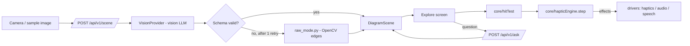

# Design Document

## Overview
Ghost Touch is a React PWA (Chrome on Android) backed by a FastAPI service. The backend turns an image into a validated, normalized `DiagramScene`. The frontend turns finger movement over that scene into vibration, speech, and tone **effects** through a pure haptic engine. Browser APIs are isolated in drivers so the engine can be property-tested and the web vibration driver can later be swapped for Capacitor.



## Components and Interfaces

### Backend
| Module | Responsibility |
|---|---|
| `schema.py` | Pydantic `DiagramScene` (source of truth). Exports JSON Schema for TS generation. |
| `vision/base.py` | `class VisionProvider(Protocol): async def extract(image: bytes) -> dict` |
| `vision/<provider>.py` | Concrete provider; prompt asks for JSON matching the schema; model from env. |
| `validate.py` | Parse, normalize, enforce invariants (unique ids, valid references, coords in [0,1]); repair trivial issues (clamp ±0.02 overshoot, drop dangling segments). |
| `raw_mode.py` | Grayscale → blur → Canny → contours → Douglas–Peucker simplification → ≤300 normalized segments. |
| `ask.py` | Answers a question from scene JSON only; must reply "I don't know" when the scene lacks the information. |
| `main.py` | Routes, 15 s timeout, CORS for the Vercel origin. |

**API**
- `POST /api/v1/scene` — multipart `image` → `{ scene: DiagramScene, mode: "ai" | "raw", reason?: "invalid" | "timeout" | "error" }`
- `POST /api/v1/ask` — `{ scene, question, lang }` → `{ answer: string }`
- `GET /api/v1/health`

### Frontend core (pure, property-tested)
```ts
// geometry.ts
toScreen(p: NormPoint, view: Viewport): ScreenPoint
toNorm(p: ScreenPoint, view: Viewport): NormPoint
distToSegment(p, a, b): number

// hitTest.ts
type Target =
  | { kind: 'vertex'; id: string; label?: string }
  | { kind: 'line'; id: string; elementKind: 'segment' | 'polyline' | 'axis' }
  | { kind: 'bar'; id: string; label: string; value: number }
  | { kind: 'none' };
hitTest(scene: DiagramScene, finger: ScreenPoint, view: Viewport, radii: Radii): Target
// priority: vertex > bar edge/line > bar interior > none

// pitch.ts
pitchForY(yNorm: number): number          // 0 = top -> 1000 Hz, 1 = bottom -> 200 Hz
pitchForValue(v: number, max: number): number

// hapticEngine.ts
type Input =
  | { kind: 'move'; t: number; target: Target; yNorm: number }
  | { kind: 'lift'; t: number };
type Effect =
  | { kind: 'vibrate'; pattern: number | number[] }
  | { kind: 'speak'; text: string }
  | { kind: 'tone'; hz: number | null };
step(state: EngineState, input: Input, cfg: HapticConfig): { state: EngineState; effects: Effect[] }
```

**Engine rules** (mirrors the tuned prototype):
1. Enter a new vertex → `vibrate(cornerPattern)`, `speak(label)`, `tone(null)`; set `quietUntil = t + quietMs`.
2. Same vertex as last step → no effects.
3. On a line, `t ≥ quietUntil` and `t − lastBuzz > retriggerMs` → `vibrate(lineMs)`.
4. On a curve → also `tone(pitchForY(yNorm))`.
5. Leave all lines → `vibrate(0)` only if `t ≥ quietUntil`; `tone(null)`.
6. Lift → `vibrate(0)`, `tone(null)`; reset state.

`HapticConfig` defaults: `lineMs 80, retriggerMs 70, cornerPattern [50,90,50], quietMs 450, vertexRadius 22, lineRadius 14` (values live in `tech.md`).

### Frontend drivers
- `HapticDriver { vibrate(pattern): boolean; stop(): void }` — `WebHapticDriver` now, `CapacitorHapticDriver` later.
- `AudioDriver { setTone(hz | null) }` — one sine oscillator with smoothed frequency and gain.
- `SpeechDriver { speak(text, lang); listen(lang): Promise<string> }` — every `speak` cancels the previous utterance.
- `DiagramStore { list(): Promise<SavedDiagram[]>; get(id): Promise<SavedDiagram|undefined>; put(entry): Promise<void>; delete(id): Promise<void> }` — `IDBDiagramStore` backed by IndexedDB; `MemoryDiagramStore` in-memory fake for tests. Every call wrapped in try/catch; errors surfaced via return value, never thrown.

### Screens
`Start` → `Capture` → (`Explore` ⇄ `Ask`) ; `SavedDiagrams` ← Capture ; `Correct` (Kiroween, sighted mode).

## Data Models
```python
class Point(BaseModel):    id: str; x: float; y: float; label: str | None = None
class Segment(BaseModel):  id: str; a: str; b: str; label: str | None = None   # point ids
class Polyline(BaseModel): id: str; points: list[tuple[float, float]]; label: str | None = None
class Bar(BaseModel):      id: str; x0: float; x1: float; y_top: float; y_base: float; label: str; value: float
class Axes(BaseModel):     x_axis_y: float | None = None; y_axis_x: float | None = None
class DiagramScene(BaseModel):
    version: Literal[1] = 1
    kind: Literal["geometry", "function_graph", "bar_chart", "unknown"]
    title: str | None = None
    points: list[Point] = []
    segments: list[Segment] = []
    polylines: list[Polyline] = []
    bars: list[Bar] = []
    axes: Axes | None = None
    facts: list[str] = []   # e.g. "AB = 5 cm", "angle C = 90°" — used by Ask
```
All `x`, `y` values are in [0, 1], origin top-left. Aspect ratio is kept in `Viewport` (letterboxed), never stretched.

### Saved diagram entry (TypeScript, frontend only)
```ts
// core/savedDiagrams.ts
interface SavedDiagram {
  id: string;                 // generated from clock + rng, injected for testability
  createdAt: number;          // Date.now() ms, used for eviction ordering
  title: string;              // spoken title: scene.title ?? kind + first labelled points
  thumbnailDataUrl: string;   // canvas.toDataURL('image/jpeg', 0.7) after first render
  scene: DiagramScene;        // full scene; offline exploration works without the network
  pinned: boolean;            // if true, immune to automatic eviction
}

// Pure core — no browser APIs
savedTitle(scene: DiagramScene, lang: string): string
makeId(nowMs: number, rng: () => number): string
chooseEviction(entries: SavedDiagram[]): SavedDiagram | undefined  // oldest unpinned, or undefined
capExceeded(count: number, cap: number): boolean
orderForDisplay(entries: SavedDiagram[]): SavedDiagram[]  // newest-first
```

Cap: 20 entries. Eviction target: oldest by `createdAt` among unpinned entries.
Storage unavailability is handled gracefully: the app keeps working and speaks a short explanation.

## Error Handling
Each property maps to requirements and runs with fast-check (frontend) or Hypothesis (backend), ≥200 cases.

| # | Property | Validates |
|---|---|---|
| P1 | **Every point is reachable:** for any valid scene and viewport, `hitTest` at a point's screen position returns that vertex. | 4.3, 4.6 |
| P2 | **Vertex beats line:** any finger position within the vertex radius of a point is never classified as `line`. | 4.6 |
| P3 | **Corner pulse is never merged:** for any input sequence, no `vibrate(lineMs)` or `vibrate(0)` effect is emitted within `quietMs` after a corner pattern. | 4.5, 4.2 |
| P4 | **No repeated corner:** consecutive moves on the same vertex emit the corner pattern exactly once. | 4.4 |
| P5 | **Continuous line buzz:** while every input is on a line and the quiet window has passed, the gap between line vibrate effects never exceeds `retriggerMs + one input interval`. | 4.1 |
| P6 | **Lift silences everything:** after `lift`, the effect list contains `vibrate(0)` and `tone(null)`. | 4.7 |
| P7 | **Pitch is monotonic:** `y1 < y2 ⇒ pitchForY(y1) > pitchForY(y2)`, and output is always in [200, 1000]. | 5.1, 5.2 |
| P8 | **Coordinate round-trip:** `toNorm(toScreen(p)) ≈ p` within 1e-9 for any viewport. | 3.2 |
| P9 | **Validator invariants:** any scene accepted by `validate.py` has unique ids, valid point references, and all coordinates in [0, 1]. Garbage input never raises an unhandled exception. | 3.2, 3.3, 3.5 |
| P10 | **Raw Mode bound:** for any image, `raw_mode` returns ≤300 segments, all normalized. | 8.2 |
| P11 | **Bar pitch order:** bars with larger values never get a lower pitch. | 6.2 |
| P12 | **Explore gesture events reach the engine:** an integration test with synthetic pointer events through hitTest, step and runEffects, including a lift, produces the expected effects at each stage. | 13.2 |
| P13 | **Validator rejects colour- or shape-only labels:** labels made only of words from the colour/shape list are rejected; labels with any other word are accepted. | 3.6 |
| P14 | **Serialise round-trip:** `deserialise(serialise(entry))` returns an identical `DiagramScene` for any valid scene (all coordinate values preserved, kind preserved, no data loss). | 11.1 |
| P15 | **Eviction invariants:** after any sequence of saves on a store that was at the cap, the count never exceeds the cap, no pinned entry is ever evicted, and the entry removed is always the oldest unpinned one. | 11.5, 11.6 |

## Error Handling
| Failure | Behavior |
|---|---|
| Vibration unsupported | Announce, continue with audio-only (Req 1.3) |
| LLM invalid twice / timeout / provider error | Raw Mode scene + spoken explanation (Req 3.3, 3.4, 8.1) |
| Network offline | Offer samples and saved diagrams |
| Speech recognition unavailable | Text input (Req 7.4) |
| Image too large | Downscale client-side to 1600 px longest side before upload |
| IndexedDB unavailable | Speak "Saving is unavailable on this device"; app continues without saving (Req 11.7) |
| Storage full / all entries pinned | Speak "Could not save: all slots are pinned"; app continues (Req 11.5, 11.7) |

## Testing Strategy
- **Property tests:** P1–P15 as above; these are the headline of the Kiro write-up.
- **Unit tests:** fixtures for the three sample diagrams; provider mocked with recorded responses.
- **Device test checklist (manual, on Nord CE6 + one budget phone):** distinguish line vs. corner with eyes closed; trace a triangle and name it; identify the highest bar; follow a sine curve and count peaks.
- **User test (Kiroween):** at least one session with a blind student or a school for the blind, recorded with consent for the demo.

## Halloween Presentation Layer
Dark background, glowing green strokes, a small "creature" mascot assembled from phone parts on the start screen, and the theremin as the signature sound. The theme never touches the users themselves (see `product.md`).
