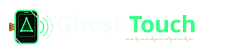
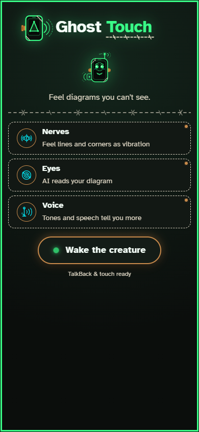
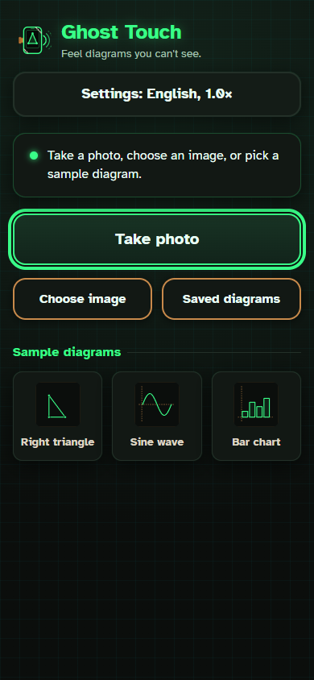
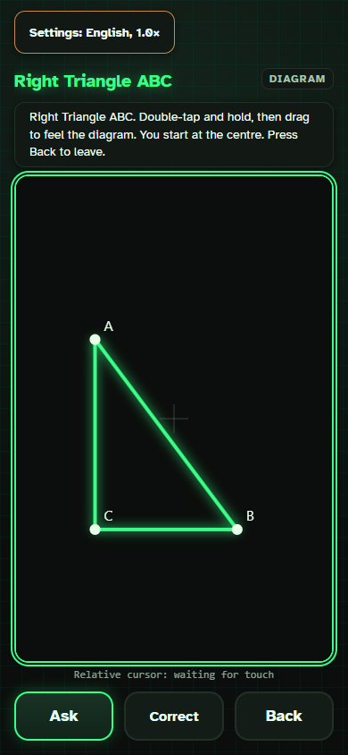
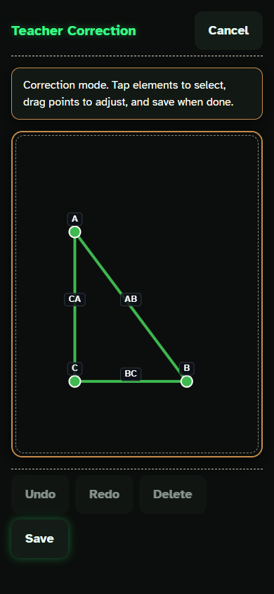

<p align="center">
  
</p>

# Ghost Touch 👻

[](https://github.com/Ratnesh-101/ghost-touch/actions/workflows/ci.yml)
[](https://github.com/Ratnesh-101/ghost-touch/actions/workflows/codeql.yml)
[](https://github.com/Ratnesh-101/ghost-touch/actions/workflows/gitleaks.yml)

Ghost Touch is a Frankenstein creature stitched from spare phone components: an inexpensive notification buzzer for tactile nerves, a vision LLM for eyes, and a Web Audio theremin synthesizer for voice. It turns photos, screenshots, or PDF pages of STEM diagrams into tactile graphics that blind and low-vision students explore by touch on an ordinary Android phone. Low-vision students use the same touch and sound; the screen has no large-print or contrast options yet. As students trace shapes on the screen, the phone vibrates along lines, pulses at corners, plays rising tones along curves, and answers spoken questions about the picture.

## Try it

### Try it in 60 seconds
1. Open the live URL ([https://ghost-touch-iota.vercel.app](https://ghost-touch-iota.vercel.app)) and tap **"Wake the creature"** (Chrome on Android recommended).
2. Pick the **Right triangle** sample diagram (loads instantly offline, no server needed).
3. On an **Android phone in Chrome**, drag a finger along a line to feel continuous vibration, and feel a double pulse at corners.
4. On a **laptop or iPhone** (no Vibration API), you will hear an audible buzz, see a pulse ring at the cursor, and hear: *"No vibration on this device. You will hear a buzz instead. Use Chrome on Android to feel it."*
5. Try the **Sine wave** sample: pitch rises and falls continuously with curve height.
6. Tap **Ask** and type *"How long is AC?"* (typed Ask is the reliable fallback if microphone is unavailable).
7. If uploading your own textbook photo, note the Render backend free tier cold start: the first photo after idle can take about 30 s.

- **Live frontend (PWA):** [https://ghost-touch-iota.vercel.app](https://ghost-touch-iota.vercel.app)
- **Live backend API:** [https://ghost-touch-api.onrender.com](https://ghost-touch-api.onrender.com)
- **Target environment:** Android Chrome (iOS does not support web vibration, so iOS is out of scope).
- **Cold-start notice:** The backend runs on the Render free tier; if idle, the first request takes 30 to 60 seconds (up to 70 seconds under heavy load) to wake up.
- **Resilience floor:** If AI providers are slow or unconfigured, the pipeline falls back to OpenCV edge detection (Raw Mode), which still gives outlines to follow when online, even if rough.

## How it feels

| Start Screen | Capture & Samples | Tactile Explore | Teacher Correction |
| :---: | :---: | :---: | :---: |
|  |  |  |  |

Haptic and auditory feedback is tuned to keep tactile sensations distinct:
- **Lines vibrate:** Tracing a line buzzes continuously (`vibrate(80)` retriggered every 70 ms).
- **Corners "bzzzz-tap":** At a corner the phone gives a double pulse and speaks the corner's label, for example "C", and enforces a 450 ms quiet period where line buzz is suppressed.
- **Curves sing:** Tracing function graphs plays a continuous theremin pitch (200–1000 Hz) that rises with visual height.
- **TalkBack pass-through:** The TalkBack double-tap-and-hold gesture worked on our prototype on a OnePlus Nord CE6 (docs/research/talkback-spike.md). It has not yet been tested in the full app.
- **Voice Q&A:** Ask questions aloud ("How long is AB?") and receive spoken answers grounded in detected diagram facts.
- **Ghostwriter in Teach mode:** Sighted teachers can add points and join edges at `#/teach` with "Add point" and "Add edge" controls (minimum 48×48 CSS px touch targets, spoken confirmations, and spoken undo), capped at 300 points and 300 segments.
- **Spec Ghost fact check:** A client-side geometric check (`frontend/src/core/verify.ts`) compares printed facts against diagram geometry. If facts contradict the drawing, it speaks a localized caveat ("Facts and drawing disagree on {name}. I can't tell which is right.", using localized angle naming such as "angle C", "कोण C", "ખૂણા C"). It stays silent when consistent or uncertain, and never claims "verified".
- **Guide my finger (Off by default in Settings):** Guide and Share ship in the live app but stay off until the user turns them on in Settings; neither has been tested on a phone. When enabled, provides directional audio/haptic guidance toward diagram elements, peaks, or Ask targets (e.g. "take me to B", "find the peak", or Ask followed by "Guide me"). Pulses accelerate as the finger approaches, Web Audio pitch indicates vertical direction, and dynamic stereo pan guides horizontal position on headphones. Phone speakers receive spoken directional hints ("left", "up-right", "here"). Cancelable at any time by voice ("stop"), Back button, or a 20-second timeout, concluding with a distinct arrival buzz. (Requires `VITE_FEATURE_GUIDE=1` and Settings toggle).
- **Teacher verify & share (Off by default in Settings):** Guide and Share ship in the live app but stay off until the user turns them on in Settings; neither has been tested on a phone. Sighted teachers can review, adjust, and stamp diagrams with their name and note at `#/teach`. Diagrams are compressed into URL fragment hashes (`#s=...`) using `lz-string` and shared via direct link or on-screen QR code. Students open shared diagrams offline via an accessible tap-to-open gate, greeted by an honest "Shared by [Name], not checked" banner and speech announcement with zero server round-trips. Names and titles are stripped of spoofed badges and checkmarks. (Requires `VITE_FEATURE_SHARE=1` and Settings toggle).
  > **Note on verification:** Ghost Touch does not verify shared diagrams: a shared link is announced as "Shared by <name>, not checked". Shared links live in the URL fragment and never reach our server.

Experimental, off by default or awaiting a phone test: corner compass, where-am-I, near-line click, graph scan, stay on line, corner heartbeat, short speech detail, page-edge cue, settings presets. Their values are proposals, not tuned.

Known limitation: A share link is capped at 12,000 characters and 200,000 decompressed characters. The decompressed cap is checked after decompression, so a crafted link can briefly use about 38 MB (about 10 ms on a laptop) before it is cleanly rejected with a too-large message. A bounded streaming decoder is planned (task 63.4, option c) and deferred until after the Kiroween submission. Teacher sharing is off by default (VITE_FEATURE_SHARE).

### Tuned haptic vocabulary

| Sensation | Physical Pattern | Sound & Speech | Tuned Purpose |
|---|---|---|---|
| Line trace | `vibrate(80)` retriggered every 70 ms | Theremin pitch on curves | Feels continuous |
| Leaving line | `vibrate(0)` | Pitch silenced | Instant feedback when stepping off an edge |
| Vertex / corner | `vibrate([50, 90, 50])` | Speaks corner's label, e.g. "C" | Distinct double pulse with 450 ms quiet window |
| Graph curve | Line buzz retriggered | 200–1000 Hz sine | Higher screen coordinate = higher pitch |
| Centre reference tick | `vibrate(25)` | Short audio tick | Crisp haptic anchor upon gesture hold start |

Hit radii: vertex 22 CSS px (priority over lines), line 14 CSS px.

## Architecture

```text
Photo / PDF ──> FastAPI Backend ──> Vision Chain (Gemini [code default] / OpenAI [Render default] ──> Nebius ──> Raw Mode)
                                           │
                                           ▼
                                   DiagramScene JSON (Normalized [0, 1])
                                           │
                                           ▼
                                 Pure Core TypeScript (geometry, hitTest, hapticEngine, pitch, correct)
                                           │
                                           ▼
                             Browser Drivers (vibration, Web Audio, speech, camera, storage)
```

- **FastAPI backend (`backend/`):** Orchestrates the multi-provider vision chain (Google Gemini primary in code default, OpenAI primary in production `render.yaml`, Nebius fallback, OpenCV Canny edge detection in `Raw Mode`), validates JSON schema invariants, and provides Q&A endpoints.
- **Pure core (`frontend/src/core/`):** Pure TypeScript decision logic free of DOM or browser APIs, handling coordinate normalization, letterboxing, hit testing, haptic sequencing, and pitch calculations.
- **Browser drivers (`frontend/src/drivers/`):** Thin isolation wrappers for `navigator.vibrate`, Web Audio API, Web Speech API, camera, and IndexedDB storage.

## Project structure

```text
ghost-touch/
├── .github/          # CI, CodeQL, Gitleaks workflows, Dependabot config
├── .kiro/            # Specs (requirements, design, tasks), steering docs, hooks
├── .kiro/agents/     # Allow-listed Kiro CLI agent configs (gt-fixer, gt-writer, gt-reviewer, gt-auditor)
├── backend/          # FastAPI, multi-provider vision pipeline, OpenCV edge detection, pytest
├── frontend/         # React 19 + Vite PWA, pure core geometry/haptics, Vitest property suites
├── prototypes/       # haptics-test.html device reference spike
├── research/         # Vision benchmarking, ground truth scoring, and test scripts
├── scripts/          # setup-dev.ps1, agy-run runner scripts, allowlist settings
├── docs/             # Briefs, handoffs, reviews, test kits, BUILD_LOG.md, DEPLOY.md
└── README.md
```

## Accessibility commitments

- **48×48 px targets:** Controls are tested for 48 px targets; state changes are spoken (see tests/a11y.*).
- **7:1 contrast (colour tokens are tested at 7:1 or more):** Laboratory color tokens exceed 7:1 contrast on deep charcoal backgrounds (`#0b0e0c`).
- **Atkinson Hyperlegible:** Self-hosted Braille Institute font optimized for low-vision character distinction.
- **Spoken state changes:** State changes are spoken and announced via speech synthesis and ARIA live regions (see tests/a11y.*).
- **Reduced motion:** Full `prefers-reduced-motion` compliance, disabling glows and animations.
- **Offline PWA:** Progressive Web App with service worker precaching; samples and saved diagrams work offline; a new photo needs the server.

## Built with Kiro, Antigravity and Claude Code

Ghost Touch was built collaboratively using three agent tools. Git log history shows 931 commits (of which 97 carry the kiro: prefix) authored under the repository owner's identity, so commit authorship does not reflect individual tool contributions. See [docs/KIRO_WRITEUP.md](docs/KIRO_WRITEUP.md), [docs/kiro-evidence/round2.md](docs/kiro-evidence/round2.md), and [docs/BUILD_LOG.md](docs/BUILD_LOG.md) for complete verifiable evidence.

| Tool | Role & Contributions | Evidence / Key Files |
|---|---|---|
| **Kiro** (IDE & CLI) | Authored the specification, steering rules, pure core mathematics, and property test suites that governed other agents; see [docs/KIRO_WRITEUP.md](docs/KIRO_WRITEUP.md). | `.kiro/specs/`<br>`.kiro/steering/`<br>`.kiro/hooks/`<br>`frontend/src/core/`<br>`docs/kiro-evidence/` |
| **Antigravity** (agy) | Built the Frankenstein Laboratory redesign, screens, browser drivers, and backend vision pipeline; see [docs/KIRO_WRITEUP.md](docs/KIRO_WRITEUP.md). | `docs/BUILD_LOG.md`<br>`frontend/src/`<br>`backend/app/`<br>`docs/reports/` |
| **Claude Code** (Anthropic) | Supervised development lanes, authored briefs, reviewed diffs, and gated integration; see [docs/KIRO_WRITEUP.md](docs/KIRO_WRITEUP.md). | `docs/briefs/`<br>`docs/reviews/`<br>`scripts/agy-run.sh` |

## Run it locally

Run the idempotent setup script from the repository root:
```powershell
powershell -ExecutionPolicy Bypass -File scripts\setup-dev.ps1
```

Or run manual commands:
```bash
# Frontend (React 19 + Vite PWA)
npm --prefix frontend install
npm --prefix frontend run dev

# Backend (Python 3.11 + FastAPI)
python -m venv backend/.venv && backend/.venv/Scripts/activate
pip install -e "backend[dev]"
uvicorn app.main:app --app-dir backend --reload --port 8000
```

## Environment variables

| Variable | Target | Purpose |
|---|---|---|
| `GEMINI_API_KEY` | Backend | Google Gemini vision API key (codebase default primary) |
| `OPENAI_API_KEY` | Backend | OpenAI vision API key (Render production primary, fallback in code) |
| `NEBIUS_API_KEY` | Backend | Nebius Token Factory fallback vision API key |
| `VISION_PROVIDERS` | Backend | Provider fallback order (codebase default: `gemini,openai,nebius`; Render production: `openai,gemini,nebius`) |
| `GEMINI_MODEL` | Backend | Model name (default: `gemini-3.5-flash-lite`) |
| `GEMINI_THINKING` | Backend | Thinking level budget (default: `minimal`) |
| `ALLOWED_ORIGINS` | Backend | CORS allowed frontend URLs |
| `VITE_API_URL` | Frontend | Backend API endpoint URL |
| `VITE_FEATURE_GUIDE` | Frontend | Feature flag: "Guide my finger" (`1` = ON, unset = OFF; default OFF) |
| `VITE_FEATURE_SHARE` | Frontend | Feature flag: "Teacher verify & share" (`1` = ON, unset = OFF; default OFF) |

## Tests

Current test suite status: On 2026-11-18 (at main 682bea8): frontend tests 2,999 passed (plus 1 todo) in 232 files; backend tests 931 passed; Playwright 22 passed; requirements 47; properties numbered to P150 (P109 to P113 specified, not yet tested); tasks 76; commits 931, of which 97 carry the kiro: prefix.

```bash
# Frontend: Vitest and fast-check property tests
npm --prefix frontend test
npm --prefix frontend exec -- tsc -p frontend --noEmit
npm --prefix frontend run build

# Backend: pytest and Hypothesis property tests
backend/.venv/Scripts/python -m pytest backend
backend/.venv/Scripts/python -m ruff check backend
backend/.venv/Scripts/python -m ruff format --check backend
```

## Status and honest limitations

- **Hardware testing status:** The installed app has been run on one phone (Samsung Galaxy S24+); that run found one layout bug and confirmed its fix. A full test pass has not been recorded yet. The vibration timings were tuned by hand on a OnePlus Nord CE6 in the prototype.
- **Guide and Share:** Guide and Share ship in the live app but stay off until the user turns them on in Settings; neither has been tested on a phone. Ghost Touch does not verify shared diagrams. Shared links live in the URL fragment and never reach our server. Link content is announced as "Shared by <name>, not checked".
- **Security & bug audits ongoing (no "bug free" or "secure" claims):** Comprehensive audits are actively ongoing. Round 2 items CORE-09 (pointer capture) and NEEDS-KIRO-02 (tone sequencing) were resolved by Kiro in Round 3. Round-5 audit fixes hardened backend permits and MIME acceptance, IndexedDB atomic eviction and in-place diagram updates, share-name prefix sanitization, and accessible control labels. Kiro authored test-first property oracles P66–P78 for Round 5 invariants: passing in the repository are P71 (template replacer safety), P72 (saved diagram cap invariant), P73 (pinned diagram immunity), P75 (in-place save preservation), and P66–P70 (prefix sanitization resolved by agy lane q1). Remaining pending oracles from Kiro T38: P74 (non-atomic save path over-cap on delete failure; latent as shipped stores are atomic), P76 (in-place update taking pinned/createdAt from caller contract question), and P77/P78 (share honesty copy and legacy key cleanup).
- **Spec Ghost status:** Spec Ghost (`frontend/src/core/verify.ts`) is a client-side geometric consistency check between printed facts and diagram drawings, wired into Explore and Ask by lane k1. Disputed angles are localized per language ("angle C" in English, "कोण C" in Hindi, "ખૂણા C" in Gujarati per Kiro Task 35). It never claims "verified", remains silent when uncertain, and parses facts on ~35% of sample and research scenes (21 of 60, measured on the sample set).
- **Data privacy:** All image processing is stateless and in-memory. Diagrams are not stored; a large upload may pass through a temporary file that is deleted when the request ends. For detailed data flows, third-party AI provider disclosures, and local storage bounds, see [docs/PRIVACY.md](docs/PRIVACY.md).
- **Machine-translated Hindi and Gujarati:** Interface text and speech synthesis support English, Hindi (`hi`), and Gujarati (`gu`); Hindi and Gujarati translations are machine-translated and have not yet been reviewed by native speakers.
- **AI fallback to Raw Mode on free tier:** The Render backend free tier spins down on idle (~30 to 60s cold start). If upstream vision providers time out or encounter rate limits, the backend drops into OpenCV edge detection (Raw Mode) so students can still feel the outlines.
- **Android only:** The application targets Android Chrome because iOS Safari does not support the Web Vibration API.

## Deployment

See [docs/DEPLOY.md](docs/DEPLOY.md) for production deployment instructions on Render and Vercel.

## Acknowledgements

The TalkBack guide started from an outside contribution (PR #36 by drv653); we adopted and corrected it in lane bu10.

## License

MIT
