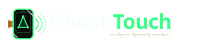
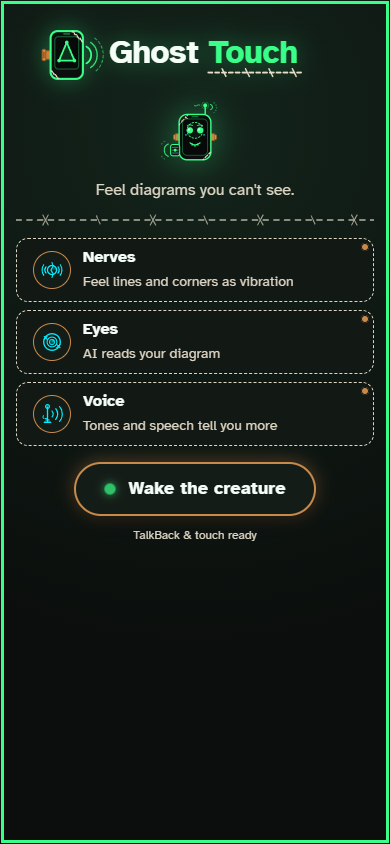
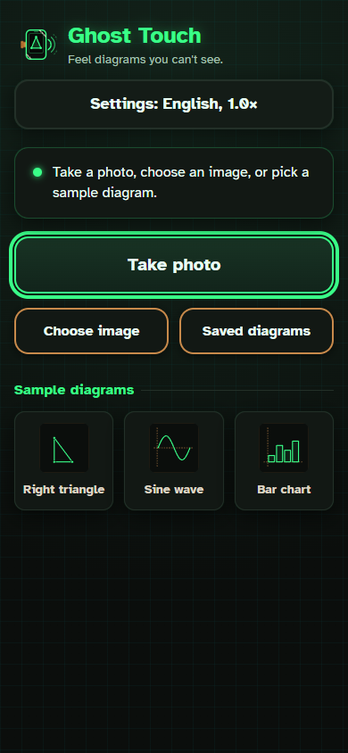
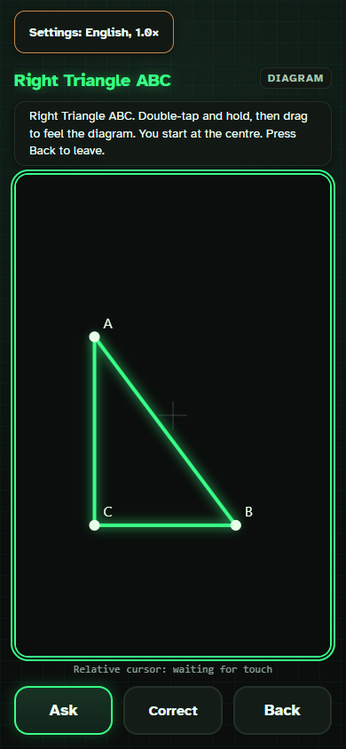
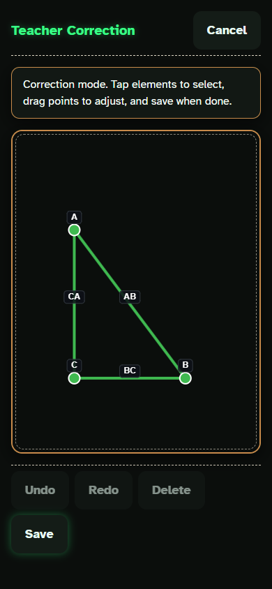

<p align="center">
  
</p>

# Ghost Touch 👻

[](https://github.com/Ratnesh-101/ghost-touch/actions/workflows/ci.yml)
[](https://github.com/Ratnesh-101/ghost-touch/actions/workflows/codeql.yml)
[](https://github.com/Ratnesh-101/ghost-touch/actions/workflows/gitleaks.yml)

Ghost Touch is a Frankenstein creature stitched from spare phone components: an inexpensive notification buzzer for tactile nerves, a vision LLM for eyes, and a Web Audio theremin synthesizer for voice. It turns photos, screenshots, or PDF pages of STEM diagrams into tactile graphics that blind and low-vision students explore by touch on an ordinary Android phone. As students trace shapes on the screen, the phone vibrates along lines, pulses at corners, plays rising tones along curves, and answers spoken questions about the picture.

## Try it

- **Live frontend (PWA):** [https://ghost-touch-iota.vercel.app](https://ghost-touch-iota.vercel.app)
- **Live backend API:** [https://ghost-touch-api.onrender.com](https://ghost-touch-api.onrender.com)
- **Target environment:** Android Chrome (iOS does not support web vibration, so iOS is out of scope).
- **Cold-start notice:** The backend runs on the Render free tier; if idle, the first request takes 30 to 60 seconds (up to 70 seconds under heavy load) to wake up.
- **Resilience floor:** If AI providers are slow or unconfigured, the pipeline falls back to OpenCV edge detection (Raw Mode) so students are never left with an empty screen.

## How it feels

| Start Screen | Capture & Samples | Tactile Explore | Teacher Correction |
| :---: | :---: | :---: | :---: |
|  |  |  |  |

Haptic and auditory feedback is tuned to keep tactile sensations distinct:
- **Lines vibrate:** Tracing a line buzzes continuously (`vibrate(80)` retriggered every 70 ms).
- **Corners "bzzzz-tap":** Vertices emit a `vibrate([50, 90, 50])` pattern, speak point labels, and enforce a 450 ms quiet period where line buzz is suppressed.
- **Curves sing:** Tracing function graphs plays a continuous theremin pitch (200–1000 Hz) that rises with visual height.
- **TalkBack pass-through (unverified on hardware):** Supports TalkBack double-tap-and-hold relative dragging, with a 25 ms centre reference tick on touch start.
- **Voice Q&A:** Ask questions aloud ("How long is AB?") and receive spoken answers grounded in detected diagram facts.
- **Guide my finger (Flagged OFF by default, unverified on hardware):** Directional audio/haptic guidance toward diagram elements, peaks, or Ask targets (e.g. "take me to B", "find the peak", or Ask followed by "Guide me"). Pulses accelerate as the finger approaches, Web Audio pitch indicates vertical direction (higher pitch when target is above), and dynamic stereo pan guides horizontal position on headphones. Phone speakers receive spoken directional hints ("left", "up-right", "here"). Cancelable at any time by voice ("stop"), Back button, or a 20-second timeout, concluding with a distinct arrival buzz. (Requires `VITE_FEATURE_GUIDE=1` and Settings toggle; default OFF; unverified on hardware).
- **Teacher verify & share (Flagged OFF by default, unverified on hardware):** Sighted teachers can review, adjust, and stamp diagrams with their name and note at `#/teach`. Diagrams are compressed into URL fragment hashes (`#s=...`) using `lz-string` and shared via direct link or on-screen QR code. Students open shared diagrams instantly and offline, greeted by a spoken "Verified by [Name]" announcement and banner with zero server round-trips. (Requires `VITE_FEATURE_SHARE=1` and Settings toggle; default OFF; unverified on hardware).
  > **Note on verification:** Verified means a person reviewed this diagram. It is not cryptographic proof. Shared links live in the URL fragment and never reach our server.

### Tuned haptic vocabulary

| Sensation | Physical Pattern | Sound & Speech | Tuned Purpose |
|---|---|---|---|
| Line trace | `vibrate(80)` retriggered every 70 ms | Theremin pitch on curves | Feels continuous |
| Leaving line | `vibrate(0)` | Pitch silenced | Instant feedback when stepping off an edge |
| Vertex / corner | `vibrate([50, 90, 50])` | Speaks point label | Distinct "bzzzz-tap" with 450 ms line quiet window |
| Graph curve | Line buzz retriggered | 200–1000 Hz sine | Higher screen coordinate = higher pitch |
| Centre reference tick | `vibrate(25)` | Short audio tick | Crisp haptic anchor upon gesture hold start |

Hit radii: vertex 22 CSS px (priority over lines), line 14 CSS px.

## Architecture

```text
Photo / PDF ──> FastAPI Backend ──> Vision Chain (OpenAI ──> Gemini ──> Nebius ──> Raw Mode)
                                           │
                                           ▼
                                   DiagramScene JSON (Normalized [0, 1])
                                           │
                                           ▼
                                 Pure Core TypeScript (geometry, hitTest, hapticEngine, pitch, correct)
                                           │
                                           ▼
                             Browser Drivers (vibration, Web Audio, speech, camera, storage)
```

- **FastAPI backend (`backend/`):** Orchestrates the multi-provider vision chain (`OpenAI` → `Gemini` → `Nebius` → OpenCV Canny edge detection in `Raw Mode`), validates JSON schema invariants, and provides Q&A endpoints.
- **Pure core (`frontend/src/core/`):** Pure TypeScript decision logic free of DOM or browser APIs, handling coordinate normalization, letterboxing, hit testing, haptic sequencing, and pitch calculations.
- **Browser drivers (`frontend/src/drivers/`):** Thin isolation wrappers for `navigator.vibrate`, Web Audio API, Web Speech API, camera, and IndexedDB storage.

## Project structure

```text
ghost-touch/
├── .github/          # CI, CodeQL, Gitleaks workflows, Dependabot config
├── .kiro/            # Specs (requirements, design, tasks), steering docs, hooks
├── backend/          # FastAPI, multi-provider vision pipeline, OpenCV edge detection, pytest
├── frontend/         # React 19 + Vite PWA, pure core geometry/haptics, Vitest property suites
├── prototypes/       # haptics-test.html device reference spike
├── research/         # Vision benchmarking, ground truth scoring, and test scripts
├── scripts/          # setup-dev.ps1, agy-run runner scripts, allowlist settings
├── docs/             # Briefs, handoffs, reviews, test kits, BUILD_LOG.md, DEPLOY.md
└── README.md
```

## Accessibility commitments

- **48×48 px targets:** Every interactive button and control meets or exceeds 48×48 CSS px for accessible touch.
- **7:1 contrast (WCAG AAA):** Laboratory color tokens exceed 7:1 contrast on deep charcoal backgrounds (`#0b0e0c`).
- **Atkinson Hyperlegible:** Self-hosted Braille Institute font optimized for low-vision character distinction.
- **Spoken state changes:** Every screen transition, coordinate tick, and mode change is announced via speech synthesis and ARIA live regions.
- **Reduced motion:** Full `prefers-reduced-motion` compliance, disabling glows and animations.
- **Offline PWA:** Progressive Web App with service worker precaching and built-in sample diagrams that work offline.

## Built with Kiro, Antigravity and Claude Code

Ghost Touch was built collaboratively using three agent tools. Git log history shows over 300 commits authored under the repository owner's identity, so commit authorship does not reflect individual tool contributions. See [docs/KIRO_WRITEUP.md](docs/KIRO_WRITEUP.md), [docs/kiro-evidence/round2.md](docs/kiro-evidence/round2.md), and [docs/BUILD_LOG.md](docs/BUILD_LOG.md) for complete verifiable evidence.

| Tool | Role & Contributions | Evidence / Key Files |
|---|---|---|
| **Kiro** (IDE & CLI) | **Foundational Architecture, Specs, Pure Core & Invariants:**<br>• Authored EARS `requirements.md`, `design.md` (P1–P15), and `tasks.md` in `.kiro/specs/ghost-touch/`.<br>• Authored architectural steering docs (`tech.md`, `product.md`, `review.md`) and 5 agent hooks (`.kiro/hooks/`).<br>• Built pure core modules: `hapticEngine.ts`, `geometry.ts`, `hitTest.ts`, and `pitch.ts`.<br>• Authored Pydantic schema (`schema.py`) and validator (`validate.py`).<br>• Authored property-based test suites P1–P13 and fixed P1 generator flake.<br>• Specified Task 13 (Saved Diagrams).<br>• Authored Round 2 spec (Requirements 16 and 17, tasks 23–28, properties P40–P46), Task 24 (Ask fixes), most T25/T26 code, frontend properties P43/P44, and T26 mutation checks. *(Credits paused during Task 13, resumed for Round 2; Kiro did not build the Lab redesign).* | `.kiro/specs/`<br>`.kiro/steering/`<br>`.kiro/hooks/`<br>`frontend/src/core/`<br>`docs/kiro-evidence/` |
| **Antigravity** (agy) | **Lab Redesign, Secondary Core, Drivers & Polish:**<br>• Built the complete Frankenstein Laboratory redesign across parallel lanes (tokens, fonts, brand SVGs, i18n, screens, HUD, previews, PWA precaching).<br>• Built Teacher Correct mode (`core/correct.ts`, `screens/Correct.tsx`, `POST /api/v1/validate`, P16/P17).<br>• Completed Saved Diagrams (`core/savedDiagrams.ts`, P14/P15 suites, IndexedDB driver).<br>• Built browser drivers, screen flows, PDF first-page extraction, and Explore screen with relative cursor.<br>• Implemented backend vision providers (`Gemini`, `OpenAI`, `Nebius`), OpenCV Raw Mode (`raw_mode.py`), and Ask pipeline (`ask.py`).<br>• Built parallel lane work (cost guards, raw mode uploads, explore fixes, ask accuracy, nav fixes) and audit reports. | `docs/BUILD_LOG.md`<br>`frontend/src/`<br>`backend/app/`<br>`docs/reports/` |
| **Claude Code** (Anthropic) | **Supervision, Orchestration, Review & Integration:**<br>• Supervised all development lanes, authored briefs in `docs/briefs/`, and reviewed all diffs in `docs/reviews/`.<br>• Gated and committed T25/T26, authored backend properties P40–P42 and P45–P46 (`backend/tests/test_round2_props.py`), and assembled T28 evidence.<br>• Launched and monitored agy runs via permission-safe runner (`scripts/agy-run.sh`).<br>• Resolved merge conflicts and captured automated headless Brave screenshots.<br>• Verified production builds and live deployments on Vercel and Render. | `docs/briefs/`<br>`docs/reviews/`<br>`docs/kiro-evidence/round2.md`<br>`scripts/agy-run.sh`<br>`scripts/setup-dev.ps1` |

## Run it locally

Run the idempotent setup script from the repository root:
```powershell
powershell -ExecutionPolicy Bypass -File scripts\setup-dev.ps1
```

Or run manual commands:
```bash
# Frontend (React 19 + Vite PWA)
npm --prefix frontend install
npm --prefix frontend run dev

# Backend (Python 3.11 + FastAPI)
python -m venv backend/.venv && backend/.venv/Scripts/activate
pip install -e "backend[dev]"
uvicorn app.main:app --app-dir backend --reload --port 8000
```

## Environment variables

| Variable | Target | Purpose |
|---|---|---|
| `OPENAI_API_KEY` | Backend | OpenAI primary vision API key |
| `GEMINI_API_KEY` | Backend | Google Gemini fallback vision API key |
| `NEBIUS_API_KEY` | Backend | Nebius Token Factory fallback vision API key |
| `VISION_PROVIDERS` | Backend | Provider fallback order (`openai,gemini,nebius`) |
| `GEMINI_MODEL` | Backend | Model name (default: `gemini-3.5-flash-lite`) |
| `GEMINI_THINKING` | Backend | Thinking level budget (default: `minimal`) |
| `ALLOWED_ORIGINS` | Backend | CORS allowed frontend URLs |
| `VITE_API_URL` | Frontend | Backend API endpoint URL |
| `VITE_FEATURE_GUIDE` | Frontend | Feature flag: "Guide my finger" (`1` = ON, unset = OFF; default OFF) |
| `VITE_FEATURE_SHARE` | Frontend | Feature flag: "Teacher verify & share" (`1` = ON, unset = OFF; default OFF) |

## Tests

Current test suite status: **[RECOUNT] frontend tests across [RECOUNT] files** and **[RECOUNT] backend tests** pass cleanly (supervisor will recount on submission day).

```bash
# Frontend: Vitest and fast-check property tests ([RECOUNT] tests in [RECOUNT] files)
npm --prefix frontend test
npm --prefix frontend exec -- tsc -p frontend --noEmit
npm --prefix frontend run build

# Backend: pytest and Hypothesis property tests ([RECOUNT] tests)
backend/.venv/Scripts/python -m pytest backend
backend/.venv/Scripts/python -m ruff check backend
backend/.venv/Scripts/python -m ruff format --check backend
```

## Status and honest limitations

- **Unverified on hardware:** Automated test suites and browser emulation pass cleanly, but physical vibration motor strength, TalkBack pass-through gesture tracking, and headphone panning have not yet been validated on an actual phone by the owner (`docs/OWNER_CHECKLIST.md`).
- **Guide and Share flagged OFF by default:** "Guide my finger" and "Teacher verify & share" are implemented behind dual feature flags (`VITE_FEATURE_GUIDE`, `VITE_FEATURE_SHARE` plus user settings toggles), unverified on hardware, and remain OFF by default until full phone verification. Verified means a person reviewed this diagram; it is not cryptographic proof. Shared links live in the URL fragment and never reach our server.
- **Security & bug audits ongoing (no "bug free" or "secure" claims):** Comprehensive audits are actively ongoing. Two Round 2 items remain OPEN: CORE-09 (lost pointer capture on canvas boundary traversal) and NEEDS-KIRO-02 (`hapticEngine.ts:132` line tone sequencing).
- **Spec Ghost status:** Spec Ghost (`frontend/src/verify`) is an experimental client-side geometric consistency check designed to detect impossible shapes; it is not yet wired into the main flow, and has a measured parse rate of ~35% on real-world scenes.
- **Data privacy:** All image processing is stateless and in-memory. Diagrams are never stored on disk. For detailed data flows, third-party AI provider disclosures, and local storage bounds, see [docs/PRIVACY.md](docs/PRIVACY.md).
- **Machine-translated Hindi and Gujarati:** Interface text and speech synthesis support English, Hindi (`hi`), and Gujarati (`gu`); Hindi and Gujarati translations are machine-translated and have not yet been reviewed by native speakers.
- **AI fallback to Raw Mode on free tier:** The Render backend free tier spins down on idle (~30 to 60s cold start). If upstream vision providers time out or encounter rate limits, the backend drops into OpenCV edge detection (Raw Mode) so students can still feel the outlines.
- **Android only:** The application targets Android Chrome because iOS Safari does not support the Web Vibration API.

## Deployment

See [docs/DEPLOY.md](docs/DEPLOY.md) for production deployment instructions on Render and Vercel.

## License

MIT
