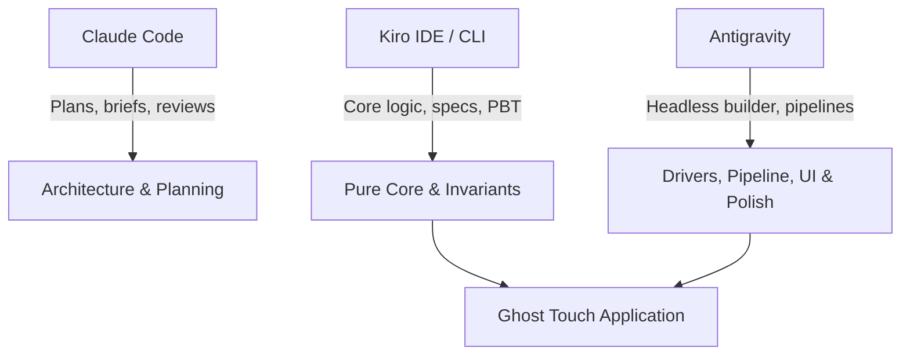

# Kiroween Write-up: Building Ghost Touch with Kiro

> **Project:** Ghost Touch — Feel diagrams you cannot see  
> **Repository:** https://github.com/Ratnesh-101/ghost-touch  
> **Category:** Frankenstein (Buzzer + Vision AI + Theremin Synthesizer)  
> **Date:** November 2026  

---

## 1. Executive Summary

Ghost Touch enables blind and low-vision students to explore STEM diagrams by touch on standard Android smartphones. Stitched from three disparate components—an inexpensive notification buzzer for tactile nerves, a vision-language model for eyes, and a Web Audio theremin synthesizer for voice—the system transforms visual diagrams into interactive haptic-audio experiences.

This document details how **Kiro** served as the architectural foundation and primary core builder for Ghost Touch. It outlines our spec-driven development process, steering documents, agent hooks, property-based testing strategy with fast-check and Hypothesis, a deep dive into an edge-case flake identified by property testing, how tasks were divided across tools (Kiro, Antigravity, and Claude Code), and how the team adapted transparently when Kiro credit limits were encountered.

Every claim herein is verifiable against files and logs preserved in the repository.

---

## 2. Spec-Driven Development: Requirements → Design → Tasks

Kiro's spec-driven development workflow in `.kiro/specs/ghost-touch/` served as the single source of truth from project inception:

```
.kiro/specs/ghost-touch/
├── requirements.md   # EARS-formatted functional & non-functional requirements
├── design.md         # Component interfaces, data models, and correctness properties
└── tasks.md          # Traceable implementation tasks mapped to requirements
```

### 2.1 EARS Requirements
Requirements were authored using the **Easy Approach to Requirements Syntax (EARS)**:
- **Ubiquitous:** *"THE system SHALL normalize all coordinates to [0, 1] with origin top-left."* (Requirement 3.2)
- **Event-driven:** *"WHEN the finger enters the hit radius of a vertex THE system SHALL play the corner vibration pattern, speak the label, and suppress line buzz for quietMs."* (Requirement 4.2)
- **State-driven:** *"WHILE the finger is on a line segment and no corner pattern is playing THE system SHALL vibrate with the line pattern every retriggerMs."* (Requirement 4.1)
- **Complex accessibility:** *"WHEN TalkBack is active AND the user double-taps and holds on the canvas and then drags THE system SHALL treat the pointer position as a cursor and SHALL apply the line, corner, bar and tone rules..."* (Requirement 13.2)

### 2.2 Design Architecture
The design document (`.kiro/specs/ghost-touch/design.md`) converted requirements into concrete software contracts:
- **Backend:** A FastAPI service parsing image inputs through a `VisionProvider` protocol, validating invariants via `validate.py`, and falling back gracefully to OpenCV Canny edge detection in `raw_mode.py`.
- **Frontend Core:** Pure TypeScript decision logic (`geometry.ts`, `hitTest.ts`, `hapticEngine.ts`, `pitch.ts`) strictly separated from browser APIs.
- **Frontend Shell:** Thin drivers (`haptics.ts`, `audio.ts`, `speech.ts`, `camera.ts`) handling browser interactions (`navigator.vibrate`, Web Audio API, Web Speech API).

### 2.3 Task Decomposition
Tasks in `tasks.md` broke the build into sequenced, atomic steps with explicit Definition of Done (DoD) criteria and property test mappings (e.g., Task 3.4 for P1, Task 4.3 for P3, Task 8.6 for P9). This structure allowed automated tracking and verification across all iterations.

---

## 3. Steering Documents: Guardrails for the Architecture

Kiro's steering files in `.kiro/steering/` enforced technical consistency, product principles, and coding standards throughout development:

### 3.1 `tech.md`: Architecture & Tuned Haptic Vocabulary
- **The Pure Core Rule:** All mathematical transforms, hit detection, haptic sequencing, and pitch calculations must live in `frontend/src/core/` without DOM, React, or browser APIs. This enabled exhaustive, sub-millisecond property testing in Node/Vitest environments.
- **One Schema, Two Languages:** The `DiagramScene` data model is defined once in `backend/app/schema.py` using Pydantic v2. TypeScript types are generated automatically via `json-schema-to-typescript` (`frontend/src/types/scene.gen.ts`). No duplicated, hand-written schemas were permitted.
- **Tuned Haptic Constants:** To prevent haptic feedback from blurring into indistinguishable vibration, physical motor timings were tuned on real hardware (OnePlus Nord CE6) and locked in `tech.md`:

| Meaning | Pattern / Timing | Tuned Purpose |
|---|---|---|
| Line Buzz | `vibrate(80)` retriggered every 70 ms | Feels continuous without overheating the motor |
| Leaving Line | `vibrate(0)` | Immediate silence when stepping off an edge |
| Vertex / Corner | `vibrate([50, 90, 50])` + 450 ms quiet window | Distinct "bzzzz-tap" sensation with speech pause |
| Graph Curve | Line buzz + 200–1000 Hz continuous tone | Theremin pitch rising with screen height |
| Centre Reference Tick (proposed, pending owner approval; not yet in the locked set) | `vibrate(25)` | Short, crisp haptic anchor upon gesture start |
| Hit Radii | Vertex: 22 CSS px, Line: 14 CSS px | Vertex priority prevents missed corners |

### 3.2 `product.md`: Non-Visual First & Frankenstein Ethos
- **Eyes-Closed Usability:** Visual UI is secondary. Every state change is spoken aloud; every control exceeds the 48×48 CSS px touch target; and TalkBack users are treated as first-class participants.
- **Never Silent Failure:** If vision AI models fail or time out, the app drops into classical edge-detection (**Raw Mode**) and announces the switch to the user.
- **Halloween Narrative Boundary:** The Frankenstein creature theme lives in the visual skin and soundscape (dark void, glowing neon green lines `#39ff88`, theremin wave), never touching the reality of blindness or disability.

### 3.3 `review.md`: Automated Review Protocol
A rigorous protocol used whenever reviewing handoffs: re-running commands instead of trusting reports, checking ownership boundaries, validating haptic constants, and ensuring accessible naming.

---

## 4. Agent Hooks in Action

Ghost Touch utilized three dedicated agent hooks in `.kiro/hooks/` to automate quality gates and enforce architectural rules:

1. **Schema & Type Synchronization (`.kiro/hooks/regenerate-scene-types.json`):**
   - **Trigger:** `PostFileSave` on `backend/app/schema.py`
   - **Action:** Automatically executes `python -m app.export_schema` in the backend virtual environment, followed by `npm run gen:types` in the frontend, and runs `npx tsc --noEmit`.
   - **Benefit:** Eliminated schema drift across the Python/TypeScript boundary. Any modification to backend validation rules immediately propagated typed structures into frontend components.

2. **Builder Review Hook (`.kiro/hooks/review-builder-handoff.json`):**
   - **Trigger:** `PostFileSave` on `docs/handoffs/*-report.md`
   - **Action:** Triggers an automated agent review following `.kiro/steering/review.md`, inspecting git diffs, verifying DoD claims, re-running test suites, and filing structured reports in `docs/reviews/<TNN>-review.md`.
   - **Benefit:** Provided continuous, automated code review for builder tasks before human sign-off.

3. **Core Test Hook (`Run tests on core save`):**
   - **Trigger:** `PostFileSave` on `frontend/src/core/**`
   - **Action:** Runs the full frontend suite with `npm --prefix frontend test` (Vitest, including the fast-check property tests) with a 120 s timeout.
   - **Benefit:** Ensured that any touch or geometry modification was immediately validated against hundreds of randomized inputs before moving to driver integration.

---

## 5. Property-Based Testing (P1–P13)

A core judging pillar of Kiroween is technological rigor. Ghost Touch uses **fast-check** in the frontend and **Hypothesis** in the backend to verify 13 mathematical and behavioural invariants across thousands of randomized diagram topologies, viewports, and interaction sequences:

| # | Property Invariant | Engine / Layer | Validates | Description |
|---|---|---|---|---|
| **P1** | Every point is reachable | `frontend/src/core/hitTest.ts` | Req 4.3, 4.6 | For any scene and letterboxed viewport, `hitTest` at a vertex's screen position returns that vertex. |
| **P2** | Vertex beats line | `frontend/src/core/hitTest.ts` | Req 4.6 | Any finger position within vertex radius of a point is never classified as a line, even if lines intersect there. |
| **P3** | Corner pulse is never merged | `frontend/src/core/hapticEngine.ts` | Req 4.2, 4.5 | For any input sequence, no line buzz or stop effect is emitted within `quietMs` (450 ms) after a corner pattern. |
| **P4** | No repeated corner | `frontend/src/core/hapticEngine.ts` | Req 4.4 | Consecutive moves on the same vertex emit the corner vibration pattern exactly once. |
| **P5** | Continuous line buzz | `frontend/src/core/hapticEngine.ts` | Req 4.1 | While continuously traversing a line, the interval between vibration commands never exceeds `retriggerMs + dt`. |
| **P6** | Lift silences everything | `frontend/src/core/hapticEngine.ts` | Req 4.7 | On pointer lift (`lift`), the engine unconditionally emits `vibrate(0)` and `tone(null)` and resets internal state. |
| **P7** | Pitch is monotonic | `frontend/src/core/pitch.ts` | Req 5.1, 5.2 | Higher screen coordinates yield higher audio frequencies: `y1 < y2 ⇒ pitchForY(y1) > pitchForY(y2)` in [200, 1000] Hz. |
| **P8** | Coordinate round-trip | `frontend/src/core/geometry.ts` | Req 3.2 | Projection is invertible: `toNorm(toScreen(p)) ≈ p` within 1e-9 tolerance for any letterboxed viewport. |
| **P9** | Validator invariants | `backend/app/validate.py` | Req 3.2, 3.3, 3.5 | Any scene accepted by the validator has unique IDs, valid segment references, and coordinates in [0, 1]. Arbitrary garbage input never crashes. |
| **P10** | Raw Mode segment bound | `backend/app/raw_mode.py` | Req 8.2 | For any arbitrary image (noise, blank, extreme aspect ratios), Raw Mode produces ≤ 300 normalized segments. |
| **P11** | Bar pitch order | `frontend/src/core/pitch.ts` | Req 6.2 | In a bar chart, bars with larger values are never assigned a lower frequency than bars with smaller values. |
| **P12** | Explore gesture pipeline | `frontend/tests/explore.p12.test.ts` | Req 13.2 | End-to-end integration: synthetic pointer streams through `hitTest` → `step` → `runEffects` produce correct multi-modal effects. |
| **P13** | Rejection of non-STEM labels | `backend/app/validate.py` | Req 3.6 | Labels consisting purely of visual descriptions ("blue polygon") are rejected; STEM terminology ("hypotenuse", "vertex A") is accepted. |

---

## 6. Real Evidence: The P1 Flake Investigation

Rather than presenting an idealized narrative, Ghost Touch documents real findings caught by property-based testing. Property **P1** exhibited an intermittent failure rate of approximately 20% (failing in 6 of 30 isolated test runs). 

The full investigation is documented in `docs/kiro-evidence/pbt-p1-flake.md` with an automated replay harness in `docs/kiro-evidence/pbt-p1-replay.ts`.

### 6.1 The Counterexample
When P1 failed, fast-check's shrinking algorithm consistently reduced the counterexample to a distinct mathematical structure:
- **Point 0:** `(0.9999992847442627, 0)`
- **Point 1:** `(0.9999992847442627, 1.401298464324817e-45)` (the smallest non-zero 32-bit subnormal float)
- **Viewport:** `width = 1.0, height = 1.0000001192092896`
- **Replay Seed:** `-732699702`

```
Failure output:
expected { kind: 'vertex', id: 'p0' } to deeply equal ObjectContaining{ kind: 'vertex', id: 'p1' }
```

### 6.2 Root Cause Analysis
The investigation proved that **`hitTest` was functioning correctly**, and that the bug lay in the test generator's assumptions:
1. **Projection Collision:** In normalized unit space, `0` and `1.4e-45` are distinct numbers. However, when projected into screen coordinates with letterboxing offsets (`5.96e-8`), 64-bit double precision addition rounds the difference away. Both points mapped to the **exact same screen pixel coordinate**.
2. **Deterministic Distance Ties:** At distance 0, two points occupy the identical location. `hitTest` employs a sound, deterministic rule: the first candidate encountered wins (`dist < prev.dist`).
3. **Over-claiming Generator:** The property generator enforced uniqueness in normalized space (`selector: ${x}|${y}`), but failed to ensure uniqueness after screen projection. Expecting `hitTest` to return `p1` at a pixel identical to `p0` was mathematically impossible.

### 6.3 The Resolution
The scene generator now requires points to be separated on screen by at least the vertex hit radius (22 px, see `frontend/tests/hitTest.prop.test.ts`), while preserving normalized uniqueness, and a regression test covers the distance-0 tie rule (`P1 - Tie rule`). After the change the file passed 25 of 25 isolated runs on 2026-11-03 (it used to fail about 1 in 5). Which agent made the edit is recorded in the git history of that file.

---

## 7. Division of Labor: Kiro, Antigravity, and Claude Code

Ghost Touch was built through collaborative multi-agent pairing, logged in `docs/BUILD_LOG.md`:



| Tool | Primary Role | Key Deliverables Backed by Repo Files |
|---|---|---|
| **Kiro** | Core Architect & Invariant Builder | Author of specifications (`.kiro/specs/ghost-touch/`), steering rules (`.kiro/steering/`), agent hooks (`.kiro/hooks/`), Pydantic models (`backend/app/schema.py`), pure core modules (`geometry.ts`, `hitTest.ts`, `hapticEngine.ts`, `pitch.ts`), core validator (`validate.py`), sample diagram fixtures, and property tests (P1–P8, P9, P11, P13). |
| **Antigravity (agy)** | Autonomous Builder Agent | Built components from detailed briefs: PDF first-page rendering via dynamic `pdfjs-dist` chunking (T06b), Explore screen with relative cursor, TalkBack double-tap pass-through and centre tick (T07), backend vision pipeline with Gemini/OpenAI/Nebius and OpenCV Canny Raw Mode (T08), frontend/backend voice Q&A Ask flow (T09a/b), deployment blueprint configurations (T10a), accessible CSS design tokens and creature theme styling, and follow-up property tests P10 and P12. |
| **Claude Code** | Planner, Reviewer & Spike Researcher | Master planning (`docs/WIN_PLAN.md`), architectural reviews (`docs/reviews/`), research spikes (`talkback-spike.md`, `vision-spike.md`), agy sandboxing launcher (`scripts/agy-run.sh`, `scripts/agy-settings.json`), dev setup tooling (`scripts/setup-dev.ps1`), and builder stand-in for browser drivers (T05) and Start/Capture screens (T06). |

---

## 8. What Changed When Kiro Credits Ran Out (2026-11-02)

On **2026-11-02**, Kiro reached its free usage credit allocation while performing specification hygiene and follow-ups. Rather than stalling development or violating architectural rules, the team adhered strictly to the protocol defined in `AGENTS.md` and `docs/handoffs/KIRO-PAUSE.md`:

1. **Strict Ownership Boundaries Preserved:** Antigravity was prohibited from directly editing Kiro-owned folders (`frontend/src/core/**`, `backend/app/schema.py`, `backend/app/validate.py`, and `*.prop.test.ts`).
2. **TEMP Stub Register:** When builder tasks required unimplemented Kiro modules, minimal, throwaway stubs were created outside owned directories (e.g., `frontend/src/_temp/hapticEngine.stub.ts`, `backend/app/_temp/validate_stub.py`) with explicit headers:
   `// TEMP-STUB: replaced by <real path> (Task N, Kiro). Do not extend.`
   All stubs were registered in `docs/handoffs/KIRO-PAUSE.md`.
3. **Review Role Delegation:** Because the automated Kiro review hook could not trigger, Claude Code conducted independent code reviews using the protocol in `.kiro/steering/review.md`.
4. **Core completion:** Before the credits ran out, Kiro's follow-up pass on 2026-11-02 implemented the haptic engine, pitch mapping and the real validator (with P2-P7, P9, P11, P13) and the TEMP stubs were swapped for the real modules. The rest of that pass (P10, P12, schema typing, spec hygiene) was finished by an Antigravity agent at the owner's request, as logged in `docs/BUILD_LOG.md`.

---

## 9. Verification & Proof

All claims in this document are supported by automated test suites in the repository:
- **Frontend:** 249 unit and property tests passing across 25 test files (`npm --prefix frontend test`).
- **Backend:** 337 tests passing (`backend/.venv/Scripts/python -m pytest backend`, run 2026-11-04 after lanes A, B, C and F merged).
- **Formatting & Linting:** Strict TypeScript checking (`tsc -p frontend --noEmit`) and Ruff verification (`ruff check backend`, `ruff format --check backend`) run clean with 0 errors.

Ghost Touch demonstrates that combining spec-driven architecture, property-based testing, and disciplined multi-agent orchestration yields robust, accessible software engineered for real-world impact.
