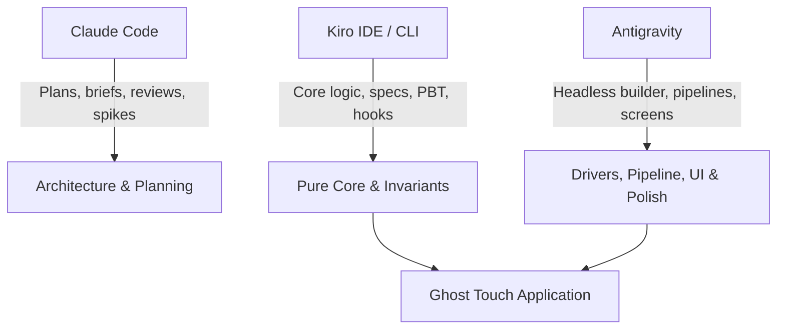

# Kiroween Write-up: Building Ghost Touch with Kiro

> **Project:** Ghost Touch — Feel diagrams you cannot see  
> **Repository:** https://github.com/Ratnesh-101/ghost-touch  
> **Category:** Frankenstein (Buzzer + Vision AI + Theremin Synthesizer)  
> **Date:** November 2026  

---

## 1. Executive Summary

Ghost Touch enables blind and low-vision students to explore STEM diagrams by touch on standard Android smartphones. Stitched from three disparate components—an inexpensive notification buzzer for tactile nerves, a vision-language model for eyes, and a Web Audio theremin synthesizer for voice—the system transforms visual diagrams into interactive haptic-audio experiences.

This document details how **Kiro** served as the architectural foundation and primary core builder for Ghost Touch. It outlines our spec-driven development process, steering documents, agent hooks, property-based testing strategy with fast-check and Hypothesis, a deep dive into an edge-case flake identified by property testing, how tasks were divided across tools (Kiro, Antigravity, and Claude Code), and how the team adapted transparently when Kiro credit limits were encountered.

Every claim herein is verifiable against files and logs preserved in the repository.

---

## 2. Spec-Driven Development: Requirements → Design → Tasks

Kiro's spec-driven development workflow in `.kiro/specs/ghost-touch/` served as the single source of truth from project inception:

```
.kiro/specs/ghost-touch/
├── requirements.md   # EARS-formatted functional & non-functional requirements
├── design.md         # Component interfaces, data models, and correctness properties
└── tasks.md          # Traceable implementation tasks mapped to requirements
```

### 2.1 EARS Requirements
Requirements were authored using the **Easy Approach to Requirements Syntax (EARS)**:
- **Ubiquitous:** *"THE system SHALL normalize all coordinates to [0, 1] with origin top-left."* (Requirement 3.2)
- **Event-driven:** *"WHEN the finger enters the hit radius of a vertex THE system SHALL play the corner vibration pattern, speak the label, and suppress line buzz for quietMs."* (Requirement 4.2)
- **State-driven:** *"WHILE the finger is on a line segment and no corner pattern is playing THE system SHALL vibrate with the line pattern every retriggerMs."* (Requirement 4.1)
- **Complex accessibility:** *"WHEN TalkBack is active AND the user double-taps and holds on the canvas and then drags THE system SHALL treat the pointer position as a cursor and SHALL apply the line, corner, bar and tone rules..."* (Requirement 13.2)

### 2.2 Design Architecture
The design document (`.kiro/specs/ghost-touch/design.md`) converted requirements into concrete software contracts:
- **Backend:** A FastAPI service parsing image inputs through a `VisionProvider` protocol, validating invariants via `validate.py`, and falling back gracefully to OpenCV Canny edge detection in `raw_mode.py`.
- **Frontend Core:** Pure TypeScript decision logic (`geometry.ts`, `hitTest.ts`, `hapticEngine.ts`, `pitch.ts`, and `correct.ts`) strictly separated from browser APIs.
- **Frontend Shell:** Thin drivers (`haptics.ts`, `audio.ts`, `speech.ts`, `camera.ts`, `navigation.ts`, `storage.ts`) handling browser interactions (`navigator.vibrate`, Web Audio API, Web Speech API, History API, LocalStorage).

### 2.3 Task Decomposition
Tasks in `tasks.md` broke the build into sequenced, atomic steps with explicit Definition of Done (DoD) criteria and property test mappings (e.g., Task 2.4 for P1, Task 4.2 for P3, Task 7.3 for P9, Task 11.2 for P16/P17). This structure allowed automated tracking and verification across all iterations.

---

## 3. Steering Documents: Guardrails for the Architecture

Kiro's steering files in `.kiro/steering/` enforced technical consistency, product principles, and coding standards throughout development:

### 3.1 `tech.md`: Architecture & Tuned Haptic Vocabulary
- **The Pure Core Rule:** All mathematical transforms, hit detection, haptic sequencing, and pitch calculations must live in `frontend/src/core/` without DOM, React, or browser APIs. This enabled exhaustive, sub-millisecond property testing in Node/Vitest environments.
- **One Schema, Two Languages:** The `DiagramScene` data model is defined once in `backend/app/schema.py` using Pydantic v2. TypeScript types are generated automatically via `json-schema-to-typescript` (`frontend/src/types/scene.gen.ts`). No duplicated, hand-written schemas were permitted.
- **Tuned Haptic Constants:** To prevent haptic feedback from blurring into indistinguishable vibration, physical motor timings were tuned on real hardware (OnePlus Nord CE6) and locked in `tech.md`:

| Meaning | Pattern / Timing | Tuned Purpose |
|---|---|---|
| Line Buzz | `vibrate(80)` retriggered every 70 ms | Feels continuous without overheating the motor |
| Leaving Line | `vibrate(0)` | Immediate silence when stepping off an edge |
| Vertex / Corner | `vibrate([50, 90, 50])` + 450 ms quiet window | Distinct "bzzzz-tap" sensation with speech pause |
| Graph Curve | Line buzz + 200–1000 Hz continuous tone | Theremin pitch rising with screen height |
| Centre Reference Tick (proposed in `tech.md`) | `vibrate(25)` | Short, crisp haptic anchor upon gesture start |
| Hit Radii | Vertex: 22 CSS px, Line: 14 CSS px | Vertex priority prevents missed corners |

### 3.2 `product.md`: Non-Visual First & Frankenstein Ethos
- **Eyes-Closed Usability:** Visual UI is secondary. Every state change is spoken aloud; every control exceeds the 48×48 CSS px touch target; and TalkBack users are treated as first-class participants.
- **Never Silent Failure:** If vision AI models fail or time out, the app drops into classical edge-detection (**Raw Mode**) and announces the switch to the user.
- **Halloween Narrative Boundary:** The Frankenstein creature theme lives in the visual skin and soundscape (dark void, glowing neon green lines `#39ff88`, theremin wave), never touching the reality of blindness or disability.

### 3.3 `review.md`: Automated Review Protocol
A rigorous protocol used whenever reviewing handoffs: re-running commands instead of trusting reports, checking ownership boundaries, validating haptic constants, and ensuring accessible naming.

---

## 4. Agent Hooks in Action

Ghost Touch defines five agent hooks in `.kiro/hooks/` to automate quality gates, enforce architectural boundaries, and execute property suites upon file saves:

1. **Schema & Type Synchronization (`.kiro/hooks/regenerate-scene-types.json`):**
   - **Name:** `Regenerate scene types`
   - **Trigger:** `PostFileSave`
   - **Matcher:** `backend[\\/]app[\\/]schema\.py$`
   - **Action Type:** `agent`
   - **Prompt:** Runs `python -m app.export_schema` in the backend virtualenv, runs `npm run gen:types` in `frontend/`, and reports whether `frontend/src/types/scene.gen.ts` changed, flagging any frontend code that fails `npx tsc --noEmit`.
   - **Benefit:** Eliminates schema drift between Python and TypeScript. Modifications to backend validation immediately propagate typed models to the frontend.

2. **Builder Review Hook (`.kiro/hooks/review-builder-handoff.json`):**
   - **Name:** `Review builder handoff`
   - **Trigger:** `PostFileSave`
   - **Matcher:** `docs[\\/]handoffs[\\/].*-report\.md$`
   - **Action Type:** `agent`
   - **Prompt:** Enforces the review protocol from `.kiro/steering/review.md`, inspecting git diffs, re-running Definition of Done commands rather than trusting reports, and writing the structured review to `docs/reviews/<TNN>-review.md`.
   - **Benefit:** Provides continuous automated peer review for builder tasks before human sign-off.

3. **Core Test Hook (`.kiro/hooks/run-tests-on-core-save.json`):**
   - **Name:** `Run tests on core save`
   - **Trigger:** `PostFileSave`
   - **Matcher:** `frontend[\\/]src[\\/]core[\\/].*\.ts$`
   - **Action Type:** `command`
   - **Command:** `npm --prefix frontend test` (timeout: 120s)
   - **Benefit:** Automatically runs Vitest + fast-check whenever pure core logic changes, ensuring zero regression across mathematical transforms.

4. **Property Tests on Haptics & Validator Save (`.kiro/hooks/prop-tests-on-save.json` — added by Kiro):**
   - **Name:** `Run property tests on haptics/validator save`
   - **Trigger:** `PostFileSave`
   - **Matcher:** `hapticEngine|pitch|hapticEngine\\.prop\\.test|pitch\\.prop\\.test|hitTest\\.prop\\.test|validate\\.py|test_validate_props`
   - **Action Type:** `command`
   - **Command:** Shell script determining which suite to execute based on `$KIRO_EVENT_DATA` filePath:
     - For backend files (`validate.py`, `test_validate_props.py`): executes `py -3.11 -m pytest tests/test_validate_props.py -q --tb=short` (validates P9, P13).
     - For frontend files (`hapticEngine*`, `pitch*`, `hitTest*`): executes `npx vitest run tests/hapticEngine.prop.test.ts tests/pitch.prop.test.ts tests/hitTest.prop.test.ts --reporter=dot` (validates P1–P7, P11).
     - Exits with return code 2 upon test failure to halt the save and report errors immediately in the IDE (timeout: 120s).
   - **Benefit:** Targeted, fast feedback on critical invariant-bearing files without needing a full-repo test run.

5. **Post-Session Review Hook (`.kiro/hooks/review-on-stop.json` — added by Kiro):**
   - **Name:** `Post-session review`
   - **Trigger:** `Stop` (fires automatically when a Kiro session concludes)
   - **Matcher:** None (fires upon session stop)
   - **Action Type:** `agent`
   - **Prompt:** Acts as Kiro reviewer, inspecting all changed Kiro-owned files against `.kiro/steering/review.md` (pure core rules, locked `tech.md` haptic values, P1–P13 property coverage, absence of TEMP stubs, and `tasks.md` checkbox accuracy) and writes a concise verdict to `docs/reviews/session-review-latest.md`.
   - **Benefit:** Guarantees that every coding session ends with an architectural integrity check.

> [!NOTE]
> Static regex and path verification of all five hooks was confirmed on 2026-11-04 (see `docs/kiro-evidence/hooks-check.md`). As noted in that audit, live GUI panel inspection and event firing require the interactive Kiro IDE desktop environment.

---

## 5. Property-Based Testing (P1–P17)

A core judging pillar of Kiroween is technological rigor. Ghost Touch uses **fast-check** in the frontend and **Hypothesis** in the backend to verify 17 mathematical and behavioural invariants across thousands of randomized diagram topologies, viewports, and interaction sequences:

| # | Property Invariant | Engine / Layer | Validates | Description |
|---|---|---|---|---|
| **P1** | Every point is reachable | `frontend/src/core/hitTest.ts` | Req 4.3, 4.6 | For any scene and letterboxed viewport, `hitTest` at a vertex's screen position returns that vertex. |
| **P2** | Vertex beats line | `frontend/src/core/hitTest.ts` | Req 4.6 | Any finger position within vertex radius of a point is never classified as a line, even if lines intersect there. |
| **P3** | Corner pulse is never merged | `frontend/src/core/hapticEngine.ts` | Req 4.2, 4.5 | For any input sequence, no line buzz or stop effect is emitted within `quietMs` (450 ms) after a corner pattern. |
| **P4** | No repeated corner | `frontend/src/core/hapticEngine.ts` | Req 4.4 | Consecutive moves on the same vertex emit the corner vibration pattern exactly once. |
| **P5** | Continuous line buzz | `frontend/src/core/hapticEngine.ts` | Req 4.1 | While continuously traversing a line, the interval between vibration commands never exceeds `retriggerMs + dt`. |
| **P6** | Lift silences everything | `frontend/src/core/hapticEngine.ts` | Req 4.7 | On pointer lift (`lift`), the engine unconditionally emits `vibrate(0)` and `tone(null)` and resets internal state. |
| **P7** | Pitch is monotonic | `frontend/src/core/pitch.ts` | Req 5.1, 5.2 | Higher screen coordinates yield higher audio frequencies: `y1 < y2 ⇒ pitchForY(y1) > pitchForY(y2)` in [200, 1000] Hz. |
| **P8** | Coordinate round-trip | `frontend/src/core/geometry.ts` | Req 3.2 | Projection is invertible: `toNorm(toScreen(p)) ≈ p` within 1e-9 tolerance for any letterboxed viewport. |
| **P9** | Validator invariants | `backend/app/validate.py` | Req 3.2, 3.3, 3.5 | Any scene accepted by the validator has unique IDs, valid segment references, and coordinates in [0, 1]. Arbitrary garbage input never crashes. |
| **P10** | Raw Mode segment bound | `backend/app/raw_mode.py` | Req 8.2 | For any arbitrary image (noise, blank, extreme aspect ratios), Raw Mode produces ≤ 300 normalized segments. |
| **P11** | Bar pitch order | `frontend/src/core/pitch.ts` | Req 6.2 | In a bar chart, bars with larger values are never assigned a lower frequency than bars with smaller values. |
| **P12** | Explore gesture pipeline | `frontend/tests/explore.p12.test.ts` | Req 13.2 | End-to-end integration: synthetic pointer streams through `hitTest` → `step` → `runEffects` produce correct multi-modal effects. |
| **P13** | Rejection of non-STEM labels | `backend/app/validate.py` | Req 3.6 | Labels consisting purely of visual descriptions ("blue polygon") are rejected; STEM terminology ("hypotenuse", "vertex A") is accepted. |
| **P14** | Serialise round-trip | `frontend/src/core/savedDiagrams.ts` (spec by Kiro; tests by Antigravity) | Req 11.1 | `deserialise(serialise(entry))` returns an identical `DiagramScene` for any valid scene (coordinates preserved, kind preserved, no data loss). |
| **P15** | Eviction invariants | `frontend/src/core/savedDiagrams.ts` (spec by Kiro; tests by Antigravity) | Req 11.5, 11.6 | Saves at cap (20 entries) never exceed cap; pinned entries are immune to eviction; removed entry is always the oldest unpinned one. |
| **P16** | Correct edit invariants | `frontend/src/core/correct.ts` | Req 9.2, 9.3 | Any sequence of valid edits on a valid scene yields a scene that preserves invariants (unique IDs, no dangling segment references, coords in [0, 1]) or is rejected. |
| **P17** | Undo/Redo round-trip | `frontend/src/core/correct.ts` | Req 9.2 | Undo after any edit restores the previous scene exactly; redo re-applies it without drift. |

### 5.1 Authorship and Attribution Disclosure
We state plainly:
- **Properties P1 through P13** were designed and primarily implemented by **Kiro** (with follow-up tests P10 and P12 completed by Antigravity under Kiro pause rules).
- **Properties P14 and P15** were specified and drafted by **Kiro** in `design.md` as part of Task 13 (Saved Diagrams); Task 13 was completed by Antigravity agents after Kiro's credits ran out (reviews: `docs/reviews/agy-savedcore.md` and `docs/reviews/agy-savedui.md`). The agents wrote the final `core/savedDiagrams.ts`, the P14 and P15 property tests, the IndexedDB driver, the Saved screen and the wiring. While finishing Kiro's draft their tests found four real defects in it: `applyAdd` evicted an entry when merely updating an existing id at the cap, `deserialise` rejected JSON strings, `IDBDiagramStore` leaked its database connection on transaction errors, and a `NaN` timestamp was accepted.
- **Properties P16 and P17**, the pure module `frontend/src/core/correct.ts`, the frontend screen `screens/Correct.tsx`, `flow/correct.ts`, and the backend endpoint `POST /api/v1/validate` were written by **Antigravity** at the owner's explicit direction after Kiro's credits ran out, **NOT by Kiro** (verified in `docs/reviews/agy-correct.md` and `docs/reviews/agy-validate.md`).

---

## 6. Real Evidence: The P1 Flake Investigation

Rather than presenting an idealized narrative, Ghost Touch documents real findings caught by property-based testing. Property **P1** exhibited an intermittent failure rate of approximately 20% (failing in 6 of 30 isolated test runs).

The full investigation is documented in `docs/kiro-evidence/pbt-p1-flake.md` with an automated replay harness in `docs/kiro-evidence/pbt-p1-replay.ts`.

### 6.1 The Counterexample
When P1 failed, fast-check's shrinking algorithm consistently reduced the counterexample to a distinct mathematical structure:
- **Point 0:** `(0.9999992847442627, 0)`
- **Point 1:** `(0.9999992847442627, 1.401298464324817e-45)` (the smallest non-zero 32-bit subnormal float)
- **Viewport:** `width = 1.0, height = 1.0000001192092896`
- **Replay Seed:** `-732699702`

```
Failure output:
expected { kind: 'vertex', id: 'p0' } to deeply equal ObjectContaining{ kind: 'vertex', id: 'p1' }
```

### 6.2 Root Cause Analysis
The investigation proved that **`hitTest` was functioning correctly**, and that the bug lay in the test generator's assumptions:
1. **Projection Collision:** In normalized unit space, `0` and `1.4e-45` are distinct numbers. However, when projected into screen coordinates with letterboxing offsets (`5.96e-8`), 64-bit double precision addition rounds the difference away. Both points mapped to the **exact same screen pixel coordinate**.
2. **Deterministic Distance Ties:** At distance 0, two points occupy the identical location. `hitTest` employs a sound, deterministic rule: the first candidate encountered wins (`dist < prev.dist`).
3. **Over-claiming Generator:** The property generator enforced uniqueness in normalized space (`selector: ${x}|${y}`), but failed to ensure uniqueness after screen projection. Expecting `hitTest` to return `p1` at a pixel identical to `p0` was mathematically impossible.

### 6.3 The Resolution by Kiro (2026-11-03)
The P1 generator fix was authored directly by **Kiro** on **2026-11-03**. As documented in Kiro's evidence notes (`docs/kiro-evidence/step1-p1-fix.md` and `docs/kiro-evidence/pbt-p1-flake.md`), Kiro applied four comprehensive fixes to `frontend/tests/hitTest.prop.test.ts`:

1. **Screen-space separation filter:** The `pointsArb` generator projects candidate points through `toScreen` with the actual viewport and rejects any pair whose screen distance is `≤ DEFAULT_RADII.vertex` (22 CSS px). Two points that land on the same pixel are impossible to generate.
2. **`fc.double` instead of `fc.float`:** Eliminates 32-bit denormals (`1e-45`) that were the source of precision collapse.
3. **Realistic canvas range (200–2000 px):** A 1 px viewport can no longer be generated, removing the extreme distortion factor.
4. **Tie-rule regression unit test:** A dedicated regression test block (`describe('P1 — Tie rule (regression from flake)')`) pins the counterexample from seed `-732699702`, testing that when two points artificially share a pixel, `hitTest` deterministically returns the first point.

Kiro verified the fix with **10 consecutive seeded runs** (seeds: `12345`, `98765`, `-732699702`, `42`, `999999`, `-1`, `2147483647`, `314159`, `-100000`, `77777`), all passing (3 tests × 10 runs = 30/30 green). Isolated runs by Claude Code (25 of 25 green) and repeated runs by Antigravity (3 of 3 full frontend suite passes) confirmed zero flakiness, allowing the CI single-retry workaround in `.github/workflows/ci.yml` to be cleanly removed.

---

## 7. Division of Labor: What Kiro Did vs What Agents Did

Ghost Touch was built through collaborative multi-agent pairing, logged in `docs/BUILD_LOG.md` and evidence records:



### 7.1 "What Kiro Did vs What Agents Did" Matrix

| Area | What Kiro Did | What Agents Did (Antigravity & Claude Code) | Supporting Evidence Files |
|---|---|---|---|
| **Specifications & Steering** | Authored initial EARS `requirements.md`, `design.md` (P1–P15), `tasks.md`, locked haptic table in `tech.md`, `product.md`, `review.md`. Integrated Req 13 (TalkBack) and Task 13 (Saved Diagrams spec). | Claude Code authored `WIN_PLAN.md`, briefs (`docs/briefs/`), and handoff registers (`KIRO-PAUSE.md`, `for-kiro.md`). Antigravity updated `design.md` and `tasks.md` for Req 9 (P16/P17). | `.kiro/specs/ghost-touch/`, `.kiro/steering/`, `docs/handoffs/KIRO-PAUSE.md`, `docs/reviews/agy-correct.md` |
| **Agent Hooks** | Added `.kiro/hooks/prop-tests-on-save.json` and `.kiro/hooks/review-on-stop.json` to complete the 5-hook suite. | Scaffolded `.kiro/hooks/` (schema sync, builder review, core test). Conducted static path audit (`docs/kiro-evidence/hooks-check.md`). | `.kiro/hooks/*.json`, `docs/kiro-evidence/step6-hooks.md`, `docs/kiro-evidence/hooks-check.md` |
| **Data Models & Validation** | Defined `DiagramScene` Pydantic models in `schema.py`, JSON schema exporter (`export_schema.py`), generated `types/scene.gen.ts`, bundled sample fixtures, and wrote `backend/app/validate.py` (clamping, dangling drop, non-STEM label rejection). | Antigravity refined coordinate field bounds `Field(ge=0.0, le=1.0)` in `schema.py`, removed dead `_temp` stub, and implemented `POST /api/v1/validate` (lane T11b). | `backend/app/schema.py`, `backend/app/validate.py`, `docs/reviews/agy-validate.md` |
| **Frontend Pure Core** | Authored `geometry.ts`, `hitTest.ts` (with bar edge hits), `hapticEngine.ts` (rules 1–6), `pitch.ts` (`pitchForY`, `pitchForValue`). Authored P1 fix. | Antigravity authored `frontend/src/core/correct.ts` (immutable point moves, label edits, segment deletes, history reducer) for Teacher Correct mode. | `frontend/src/core/`, `docs/kiro-evidence/step2-haptic-engine.md`, `docs/reviews/agy-correct.md` |
| **Property-Based Testing** | Authored P1, P2, P3, P4, P5, P6, P7, P8, P9, P11, P13 suites with fast-check and Hypothesis. Pinned tie-rule counterexample. | Antigravity authored P10 (Raw Mode bound), P12 (Explore gesture pipeline integration), and P16/P17 (Teacher Correct invariants and undo/redo). | `frontend/tests/*.prop.test.ts`, `backend/tests/test_*_props.py`, `docs/BUILD_LOG.md` |
| **Drivers & Screens** | Defined driver interfaces in `design.md`. | Claude Code built driver baseline (T05) and initial Start/Capture screens (T06). Antigravity built PDF intake (T06b), Explore screen with relative cursor & centre tick (T07), Ask UI (T09b), Correct screen (T11a), Mascot component (T14), localized speech/earcons (lane D), and the complete Frankenstein Laboratory redesign across all screens, primitives, and drivers supervised by Claude Code. | `frontend/src/drivers/`, `frontend/src/screens/`, `frontend/src/flow/`, `frontend/src/styles/` |
| **Backend AI Pipeline** | Defined `VisionProvider` contract and Raw Mode fallback concept in `design.md`. | Antigravity built `GeminiProvider`, `OpenAIProvider`, `NebiusProvider`, fallback chain, OpenCV Canny edge extraction (`raw_mode.py`), `POST /api/v1/scene`, and `POST /api/v1/ask` with facts fallback. | `backend/app/vision/`, `backend/app/raw_mode.py`, `backend/app/ask.py` |
| **Tooling, Bots & CI** | Provided Kiro hook integration points. | Claude Code built permission-safe runner (`agy-run.sh`) and dev recovery script (`setup-dev.ps1`). Antigravity set up CodeQL, gitleaks, submission-guard, nightly PBT soak, and Vercel/Render deploy blueprints. | `scripts/`, `.github/workflows/`, `render.yaml`, `frontend/vercel.json` |

---

## 8. What Changed When Kiro Credits Ran Out (2026-11-02)

On **2026-11-02**, Kiro reached its free usage credit allocation while performing specification hygiene and follow-ups. Rather than stalling development or violating architectural rules, the team adhered strictly to the protocol defined in `AGENTS.md` and `docs/handoffs/KIRO-PAUSE.md`:

1. **Strict Ownership Boundaries Preserved:** Antigravity was prohibited from directly editing Kiro-owned folders (`frontend/src/core/**`, `backend/app/schema.py`, `backend/app/validate.py`, and `*.prop.test.ts`) during standard feature work.
2. **TEMP Stub Register:** When builder tasks required unimplemented Kiro modules, minimal throwaway stubs were created outside owned directories (e.g., `frontend/src/_temp/hapticEngine.stub.ts`, `backend/app/_temp/validate_stub.py`) with explicit headers:
   `// TEMP-STUB: replaced by <real path> (Task N, Kiro). Do not extend.`
   All stubs were registered in `docs/handoffs/KIRO-PAUSE.md`. When Kiro completed the real modules on 2026-11-02, the stubs were cleanly deleted and imports switched.
3. **Review Role Delegation:** Because the automated Kiro review hook could not trigger in the desktop environment without credits, Claude Code conducted independent code reviews using the protocol in `.kiro/steering/review.md`.
4. **Explicit Owner Delegation for Subsequent Tasks:**
   - **Teacher Correct Mode (Task 11):** At the owner's explicit direction (2026-11-04), Antigravity built `core/correct.ts`, property tests P16/P17, `screens/Correct.tsx`, and backend `POST /api/v1/validate`. This work is transparently attributed to Antigravity, not Kiro.
   - **Saved Diagrams (Task 13):** Kiro authored the specification, data model (`SavedDiagram`), and properties P14/P15 in `design.md`. The pure core functions, IndexedDB driver, SavedDiagrams screen and wiring were completed by Antigravity agents (not Kiro) after its credits ran out, and their tests caught four real bugs in Kiro's first draft (see section 5).
   - **Voice & Accessibility (Tasks 12 & 14):** Localization (Hindi/Gujarati) and accessibility polish (creature mascot, WCAG AAA tokens) were built in parallel agent lanes (lanes D and G).
5. **The Frankenstein Laboratory Redesign (2026-11-06):** Kiro's credits remained exhausted; Kiro did NOT build the Lab redesign. The entire redesign across visual tokens, brand identity, i18n, screens (Start, Capture, Explore, Saved, Correct), PWA precaching, driver bug fixes, and layout resilience was built by Antigravity across parallel lanes supervised by Claude Code.

---

## 9. How the Tools Were Used (Transparent Attribution)

Ghost Touch is an entry in Kiroween 2026. To provide complete transparency and avoid either over-claiming or under-claiming any tool's contribution, this section details the division of work across Kiro, Antigravity, and Claude Code.

### 9.1 Git Commit Identity Context
Git log history shows 303 commits authored under the repository owner's name, 24 from Dependabot, and 4 explicitly authored by "Kiro". Because all agent-assisted development was executed and committed under the repository owner's Git identity, Git authorship alone does not reflect which tool created which artifact. The matrix below defines the true provenance verified against repository logs and evidence records.

### 9.2 Tool Attribution Matrix

| Tool | What It Did | Supporting Evidence Files |
|---|---|---|
| **Kiro** (IDE & CLI) | **Foundational Architecture, Specs, Core & Invariants:**<br>• Authored EARS `requirements.md`, `design.md` (specifying P1–P15), and sequenced `tasks.md` in `.kiro/specs/ghost-touch/`.<br>• Authored architectural steering documents (`.kiro/steering/product.md`, `structure.md`, `tech.md`, `review.md`).<br>• Created the 5 agent hooks in `.kiro/hooks/` (`prop-tests-on-save.json`, `regenerate-scene-types.json`, `review-builder-handoff.json`, `review-on-stop.json`, `run-tests-on-core-save.json`).<br>• Authored pure core modules: haptic engine (`hapticEngine.ts`), coordinate transforms (`geometry.ts`), hit testing (`hitTest.ts` with bar-edge hits), and pitch mapping (`pitch.ts`).<br>• Authored Pydantic schema (`schema.py`) and validator (`validate.py`).<br>• Authored property-based test suites P1 through P13.<br>• Diagnosed and resolved the P1 tie-rule flake in `hitTest.prop.test.ts`.<br>• Authored the Task 13 specification for Saved Diagrams and properties P14/P15.<br>*Note: Kiro credits ran out during Task 13. Kiro did not build the Lab redesign.* | `.kiro/specs/ghost-touch/`<br>`.kiro/steering/`<br>`.kiro/hooks/*.json`<br>`docs/kiro-evidence/` (`hooks-check.md`, `pbt-p1-flake.md`, `pbt-p1-replay.ts`, `spec-change-req13.md`, `step1-p1-fix.md`, `step2-haptic-engine.md`, `step4-validator.md`, `step5-req13.md`, `step6-hooks.md`) |
| **Antigravity** (agy, Gemini-based CLI agent run via `scripts/agy-run.sh`) | **Lab Redesign, Secondary Core, Drivers & Polish:**<br>• Built the entire Lab redesign in parallel lanes: foundation design tokens and fonts, brand identity and SVG logos, i18n system and modal settings sheet, Explore specimen table frame and HUD, specimen previews, Saved Diagrams and Correct restyle, loading power-up meter, Start organ tiles and hero screen, Capture screen, PWA precaching and Vercel routing fixes, CI workflows, backend warm-up route, phone test script, audio and speech driver fixes, Correct canvas sizing fix, mobile flow bug fixes, visual polish, and Explore canvas fill.<br>• Performed read-only audits and independent reviews.<br>• Earlier completed Teacher Correct mode (Task 11: `core/correct.ts`, properties P16/P17, `screens/Correct.tsx`, `POST /api/v1/validate`).<br>• Completed Saved Diagrams core implementation (Task 13: `core/savedDiagrams.ts`, P14/P15 suites, IndexedDB driver).<br>• Implemented backend vision providers (`GeminiProvider`, `OpenAIProvider`, `NebiusProvider`), OpenCV Raw Mode fallback (`raw_mode.py`), and Ask pipeline (`ask.py`). | `docs/BUILD_LOG.md`<br>`docs/reports/` (`agy-*.md`)<br>`docs/reviews/` (`agy-*.md`)<br>`frontend/src/`<br>`backend/app/` |
| **Claude Code** (Anthropic) | **Supervision, Orchestration, Review & Integration:**<br>• Supervised all development lanes.<br>• Authored all lane briefs and task definitions in `docs/briefs/`.<br>• Launched, monitored, and orchestrated parallel agy builder lanes.<br>• Reviewed every git diff against architectural contracts.<br>• Re-ran `tsc`, Vitest suites, and production builds across all lanes.<br>• Hand-resolved merge conflicts (including manual conflict resolution in `Correct.tsx` and `App.tsx` during flow-bugs lane merge).<br>• Captured automated before-and-after screenshots across viewports using headless Brave (`docs/design/screenshots/`).<br>• Ran brand image generation tooling (`scripts/build-brand.mjs`).<br>• Verified live Render and Vercel deployments.<br>• Maintained developer configuration (`.claude/settings.local.json`) and earlier dependency/deploy fixes. | `docs/briefs/`<br>`docs/reviews/`<br>`docs/handoffs/`<br>`docs/design/screenshots/`<br>`.claude/settings.local.json`<br>Git commit history |

### 9.3 Known Limitations & Honest Disclosures
- **Agent Run Interruptions:** Several Antigravity runs halted prematurely, exited without generating handoff reports, or ran unnecessary backend test cycles; the supervisor re-executed all verification gates independently and dispatched targeted follow-up passes.
- **Machine-Translated Locales:** UI strings in Hindi (`hi`) and Gujarati (`gu`) are machine-translated and have not yet been validated by native-speaking educators.
- **Physical Device Validation:** The application has undergone rigorous automated emulation (e.g. Brave at 390×844 and 1440×900) and property testing, but end-to-end motor tactile feel has not yet been validated on a physical Android handset.
- **Generated Brand Assets:** Brand artwork and logos were machine-generated and integrated into components, but await formal stakeholder approval.
- **Live Backend Fallback:** Live production deployments fell back to classical edge-detected Raw Mode due to upstream provider API keys and latency timeouts rather than live multimodal inference.

---

## 10. Verification & Proof

All claims in this document are supported by automated test suites in the repository:
- **Frontend:** 1049 unit and property tests passing across 74 test files (`npm --prefix frontend test`), on TypeScript 7, React 19, Vite 8 and Vitest 5.
- **Backend:** 348 passed, 1 skipped, 1 warning in 32.12s (`backend/.venv/Scripts/python -m pytest backend`).
- **Formatting & Type-Checking:** Strict TypeScript checking (`npm --prefix frontend exec -- tsc -p frontend --noEmit`) and Ruff verification (`backend/.venv/Scripts/python -m ruff check backend`, `backend/.venv/Scripts/python -m ruff format --check backend`) run clean with 0 errors.
- **Production Build:** Production bundle and PWA service worker compile cleanly (`npm --prefix frontend run build`).

Ghost Touch demonstrates that combining spec-driven architecture, property-based testing, and disciplined multi-agent orchestration yields robust, accessible software engineered for real-world impact.
