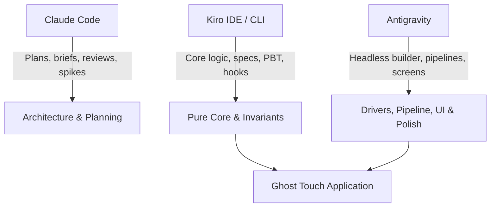

# Kiroween Write-up: Building Ghost Touch with Kiro

> **Project:** Ghost Touch — Feel diagrams you cannot see  
> **Repository:** https://github.com/Ratnesh-101/ghost-touch  
> **Category:** Frankenstein (Buzzer + Vision AI + Theremin Synthesizer)  
> **Date:** November 2026  

---

## 1. Executive Summary

Ghost Touch enables blind and low-vision students to explore STEM diagrams by touch on standard Android smartphones. Stitched from three disparate components—an inexpensive notification buzzer for tactile nerves, a vision-language model for eyes, and a Web Audio theremin synthesizer for voice—the system transforms visual diagrams into interactive haptic-audio experiences.

This document details how **Kiro** served as the architectural foundation and primary core builder for Ghost Touch. It outlines our spec-driven development process, steering documents, agent hooks, property-based testing strategy with fast-check and Hypothesis, a deep dive into an edge-case flake identified by property testing, how tasks were divided across tools (Kiro, Antigravity, and Claude Code), and how the team adapted transparently when Kiro credit limits were encountered.

Every claim herein is verifiable against files and logs preserved in the repository.

---

## 2. Spec-Driven Development: Requirements → Design → Tasks

Kiro's spec-driven development workflow in `.kiro/specs/ghost-touch/` served as the single source of truth from project inception:

```
.kiro/specs/ghost-touch/
├── requirements.md   # EARS-formatted functional & non-functional requirements
├── design.md         # Component interfaces, data models, and correctness properties
└── tasks.md          # Traceable implementation tasks mapped to requirements
```

### 2.1 EARS Requirements
Requirements were authored using the **Easy Approach to Requirements Syntax (EARS)**:
- **Ubiquitous:** *"THE system SHALL normalize all coordinates to [0, 1] with origin top-left."* (Requirement 3.2)
- **Event-driven:** *"WHEN the finger enters the hit radius of a vertex THE system SHALL play the corner vibration pattern, speak the label, and suppress line buzz for quietMs."* (Requirement 4.2)
- **State-driven:** *"WHILE the finger is on a line segment and no corner pattern is playing THE system SHALL vibrate with the line pattern every retriggerMs."* (Requirement 4.1)
- **Complex accessibility:** *"WHEN TalkBack is active AND the user double-taps and holds on the canvas and then drags THE system SHALL treat the pointer position as a cursor and SHALL apply the line, corner, bar and tone rules..."* (Requirement 13.2)

### 2.2 Design Architecture
The design document (`.kiro/specs/ghost-touch/design.md`) converted requirements into concrete software contracts:
- **Backend:** A FastAPI service parsing image inputs through a `VisionProvider` protocol, validating invariants via `validate.py`, and falling back gracefully to OpenCV Canny edge detection in `raw_mode.py`.
- **Frontend Core:** Pure TypeScript decision logic (`geometry.ts`, `hitTest.ts`, `hapticEngine.ts`, `pitch.ts`, and `correct.ts`) strictly separated from browser APIs.
- **Frontend Shell:** Thin drivers (`haptics.ts`, `audio.ts`, `speech.ts`, `camera.ts`, `navigation.ts`, `storage.ts`) handling browser interactions (`navigator.vibrate`, Web Audio API, Web Speech API, History API, LocalStorage).

### 2.3 Task Decomposition
Tasks in `tasks.md` broke the build into sequenced, atomic steps with explicit Definition of Done (DoD) criteria and property test mappings (e.g., Task 2.4 for P1, Task 4.2 for P3, Task 7.3 for P9, Task 11.2 for P16/P17). This structure allowed automated tracking and verification across all iterations.

---

## 3. Steering Documents: Guardrails for the Architecture

Kiro's steering files in `.kiro/steering/` enforced technical consistency, product principles, and coding standards throughout development:

### 3.1 `tech.md`: Architecture & Tuned Haptic Vocabulary
- **The Pure Core Rule:** All mathematical transforms, hit detection, haptic sequencing, and pitch calculations must live in `frontend/src/core/` without DOM, React, or browser APIs. This enabled exhaustive, sub-millisecond property testing in Node/Vitest environments.
- **One Schema, Two Languages:** The `DiagramScene` data model is defined once in `backend/app/schema.py` using Pydantic v2. TypeScript types are generated automatically via `json-schema-to-typescript` (`frontend/src/types/scene.gen.ts`). No duplicated, hand-written schemas were permitted.
- **Tuned Haptic Constants:** To prevent haptic feedback from blurring into indistinguishable vibration, physical motor timings were tuned by hand on the owner's OnePlus Nord CE6 in the haptics prototype (prototypes/haptics-test.html; end-to-end testing of the full app on the phone is still pending) and locked in `tech.md`:

| Meaning | Pattern / Timing | Tuned Purpose |
|---|---|---|
| Line Buzz | `vibrate(80)` retriggered every 70 ms | Feels continuous |
| Leaving Line | `vibrate(0)` | Immediate silence when stepping off an edge |
| Vertex / Corner | `vibrate([50, 90, 50])` + 450 ms quiet window | Distinct "bzzzz-tap" sensation with speech pause |
| Graph Curve | Line buzz + 200–1000 Hz continuous tone | Theremin pitch rising with screen height |
| Centre Reference Tick (proposed in `tech.md`) | `vibrate(25)` | Short, crisp haptic anchor upon gesture start |
| Hit Radii | Vertex: 22 CSS px, Line: 14 CSS px | Vertex priority prevents missed corners |

### 3.2 `product.md`: Non-Visual First & Frankenstein Ethos
- **Eyes-Closed Usability:** Visual UI is secondary. Every state change is spoken aloud; every control exceeds the 48×48 CSS px touch target; and TalkBack users are treated as first-class participants.
- **Never Silent Failure:** If vision AI models fail or time out, the app drops into classical edge-detection (**Raw Mode**) and announces the switch to the user.
- **Halloween Narrative Boundary:** The Frankenstein creature theme lives in the visual skin and soundscape (dark void, glowing neon green lines `#39ff88`, theremin wave), never touching the reality of blindness or disability.

### 3.3 `review.md`: Automated Review Protocol
A rigorous protocol used whenever reviewing handoffs: re-running commands instead of trusting reports, checking ownership boundaries, validating haptic constants, and ensuring accessible naming.

---

## 4. Agent Hooks in Action

Ghost Touch defines five agent hooks in `.kiro/hooks/` to automate quality gates, enforce architectural boundaries, and execute property suites upon file saves:

1. **Schema & Type Synchronization (`.kiro/hooks/regenerate-scene-types.json`):**
   - **Name:** `Regenerate scene types`
   - **Trigger:** `PostFileSave`
   - **Matcher:** `backend[\\/]app[\\/]schema\.py$`
   - **Action Type:** `agent`
   - **Prompt:** Runs `python -m app.export_schema` in the backend virtualenv, runs `npm run gen:types` in `frontend/`, and reports whether `frontend/src/types/scene.gen.ts` changed, flagging any frontend code that fails `npx tsc --noEmit`.
   - **Benefit:** Eliminates schema drift between Python and TypeScript. Modifications to backend validation immediately propagate typed models to the frontend.

2. **Builder Review Hook (`.kiro/hooks/review-builder-handoff.json`):**
   - **Name:** `Review builder handoff`
   - **Trigger:** `PostFileSave`
   - **Matcher:** `docs[\\/]handoffs[\\/].*-report\.md$`
   - **Action Type:** `agent`
   - **Prompt:** Enforces the review protocol from `.kiro/steering/review.md`, inspecting git diffs, re-running Definition of Done commands rather than trusting reports, and writing the structured review to `docs/reviews/<TNN>-review.md`.
   - **Benefit:** Provides continuous automated peer review for builder tasks before human sign-off.

3. **Core Test Hook (`.kiro/hooks/run-tests-on-core-save.json`):**
   - **Name:** `Run tests on core save`
   - **Trigger:** `PostFileSave`
   - **Matcher:** `frontend[\\/]src[\\/]core[\\/].*\.ts$`
   - **Action Type:** `command`
   - **Command:** `npm --prefix frontend test` (timeout: 120s)
   - **Benefit:** Automatically runs Vitest + fast-check whenever pure core logic changes, ensuring zero regression across mathematical transforms.

4. **Property Tests on Haptics & Validator Save (`.kiro/hooks/prop-tests-on-save.json` — added by Kiro):**
   - **Name:** `Run property tests on haptics/validator save`
   - **Trigger:** `PostFileSave`
   - **Matcher:** `hapticEngine|pitch|hapticEngine\\.prop\\.test|pitch\\.prop\\.test|hitTest\\.prop\\.test|validate\\.py|test_validate_props`
   - **Action Type:** `command`
   - **Command:** Shell script determining which suite to execute based on `$KIRO_EVENT_DATA` filePath:
     - For backend files (`validate.py`, `test_validate_props.py`): executes `py -3.11 -m pytest tests/test_validate_props.py -q --tb=short` (validates P9, P13).
     - For frontend files (`hapticEngine*`, `pitch*`, `hitTest*`): executes `npx vitest run tests/hapticEngine.prop.test.ts tests/pitch.prop.test.ts tests/hitTest.prop.test.ts --reporter=dot` (validates P1–P7, P11).
     - Exits with return code 2 upon test failure to halt the save and report errors immediately in the IDE (timeout: 120s).
   - **Benefit:** Targeted, fast feedback on critical invariant-bearing files without needing a full-repo test run.

5. **Post-Session Review Hook (`.kiro/hooks/review-on-stop.json` — added by Kiro):**
   - **Name:** `Post-session review`
   - **Trigger:** `Stop` (fires automatically when a Kiro session concludes)
   - **Matcher:** None (fires upon session stop)
   - **Action Type:** `agent`
   - **Prompt:** Acts as Kiro reviewer, inspecting all changed Kiro-owned files against `.kiro/steering/review.md` (pure core rules, locked `tech.md` haptic values, P1–P13 property coverage, absence of TEMP stubs, and `tasks.md` checkbox accuracy) and writes a concise verdict to `docs/reviews/session-review-latest.md`.
   - **Benefit:** Guarantees that every coding session ends with an architectural integrity check.

> [!NOTE]
> Static regex and path verification of all five hooks was confirmed on 2026-11-04 (see `docs/kiro-evidence/hooks-check.md`). As noted in that audit, live GUI panel inspection and event firing require the interactive Kiro IDE desktop environment.

---

## 5. Property-Based Testing (P1–P84)

A core judging pillar of Kiroween is technological rigor. Ghost Touch uses **fast-check** in the frontend and **Hypothesis** in the backend to check the mathematical and behavioural invariants listed below across thousands of randomized diagram topologies, viewports, and interaction sequences ([RECOUNT] property suites across frontend and backend):

| # | Property Invariant | Engine / Layer | Validates | Description |
|---|---|---|---|---|
| **P1** | Every point is reachable | `frontend/src/core/hitTest.ts` | Req 4.3, 4.6 | For any scene and letterboxed viewport, `hitTest` at a vertex's screen position returns that vertex. |
| **P2** | Vertex beats line | `frontend/src/core/hitTest.ts` | Req 4.6 | Any finger position within vertex radius of a point is never classified as a line, even if lines intersect there. |
| **P3** | Corner pulse is never merged | `frontend/src/core/hapticEngine.ts` | Req 4.2, 4.5 | For any input sequence, no line buzz or stop effect is emitted within `quietMs` (450 ms) after a corner pattern. |
| **P4** | No repeated corner | `frontend/src/core/hapticEngine.ts` | Req 4.4 | Consecutive moves on the same vertex emit the corner vibration pattern exactly once. |
| **P5** | Continuous line buzz | `frontend/src/core/hapticEngine.ts` | Req 4.1 | While continuously traversing a line, the interval between vibration commands never exceeds `retriggerMs + dt`. |
| **P6** | Lift silences everything | `frontend/src/core/hapticEngine.ts` | Req 4.7 | On pointer lift (`lift`), the engine unconditionally emits `vibrate(0)` and `tone(null)` and resets internal state. |
| **P7** | Pitch is monotonic | `frontend/src/core/pitch.ts` | Req 5.1, 5.2 | Higher screen coordinates yield higher audio frequencies: `y1 < y2 ⇒ pitchForY(y1) > pitchForY(y2)` in [200, 1000] Hz. |
| **P8** | Coordinate round-trip | `frontend/src/core/geometry.ts` | Req 3.2 | Projection is invertible: `toNorm(toScreen(p)) ≈ p` within 1e-9 tolerance for any letterboxed viewport. |
| **P9** | Validator invariants | `backend/app/validate.py` | Req 3.2, 3.3, 3.5 | Any scene accepted by the validator has unique IDs, valid segment references, and coordinates in [0, 1]. Arbitrary garbage input never crashes. |
| **P10** | Raw Mode segment bound | `backend/app/raw_mode.py` | Req 8.2 | For any arbitrary image (noise, blank, extreme aspect ratios), Raw Mode produces ≤ 300 normalized segments. |
| **P11** | Bar pitch order | `frontend/src/core/pitch.ts` | Req 6.2 | In a bar chart, bars with larger values are never assigned a lower frequency than bars with smaller values. |
| **P12** | Explore gesture pipeline | `frontend/tests/explore.p12.test.ts` | Req 13.2 | End-to-end integration: synthetic pointer streams through `hitTest` → `step` → `runEffects` produce correct multi-modal effects. |
| **P13** | Rejection of non-STEM labels | `backend/app/validate.py` | Req 3.6 | Labels consisting purely of visual descriptions ("blue polygon") are rejected; STEM terminology ("hypotenuse", "vertex A") is accepted. |
| **P14** | Serialise round-trip | `frontend/src/core/savedDiagrams.ts` (spec by Kiro; tests by Antigravity) | Req 11.1 | `deserialise(serialise(entry))` returns an identical `DiagramScene` for any valid scene (coordinates preserved, kind preserved, no data loss). |
| **P15** | Eviction invariants | `frontend/src/core/savedDiagrams.ts` (spec by Kiro; tests by Antigravity) | Req 11.5, 11.6 | Saves at cap (20 entries) never exceed cap; pinned entries are immune to eviction; removed entry is always the oldest unpinned one. |
| **P16** | Correct edit invariants | `frontend/src/core/correct.ts` | Req 9.2, 9.3 | Any sequence of valid edits on a valid scene yields a scene that preserves invariants (unique IDs, no dangling segment references, coords in [0, 1]) or is rejected. |
| **P17** | Undo/Redo round-trip | `frontend/src/core/correct.ts` | Req 9.2 | Undo after any edit restores the previous scene exactly; redo re-applies it without drift. |
| **P18** | Alive animation bound and flash frequency | `frontend/src/styles/explore.css` | Req 14.5 | Keyframe duration ≤ 1.2 s and pulse frequency ≤ 3 flashes per second. |
| **P19** | CSS @import ordering and stylesheet integrity | `frontend/src/styles/` | Req 14.1, 14.6 | All `@import` statements precede style rules; every imported sheet exists on disk. |
| **P20** | Design token color conformance | `frontend/src/styles/` | Req 14.1, 14.6 | Component stylesheets consume CSS custom properties (`var(--gt-*)`) with no bare hex literals. |
| **P21–P24** | Image header parsing | `backend/tests/test_infra_props.py` | Req 15 | Dimension sniffing never raises; PNG/JPEG decode exact sizes; EXIF orientations 5–8 swap width/height. |
| **P25–P28** | Scene cache bounds | `backend/tests/test_infra_props.py` | Req 15 | Same bytes yield same key; cache never exceeds cap; get after put returns entry; monotonic expiry. |
| **P29–P30** | Rate limiter bounds | `backend/tests/test_infra_props.py` | Req 15 | New client granted first request; at most `per_minute` requests in 60 s sliding window. |
| **P31** | Edit operations total, local, bounded | `frontend/src/core/correct.ts` | Req 9.2 | Point move/delete/rename never throws, keeps [0, 1] bounds, and mutates only intended element. |
| **P32** | Invariant checker catches violations | `frontend/src/core/correct.ts` | Req 9.2, 9.3 | Accepts well-formed scenes; rejects duplicate IDs, dangling references, out-of-bound coords, NaN/Inf. |
| **P33** | List order and spoken title | `frontend/src/core/savedDiagrams.ts` | Req 11.1, 11.3 | Newest-first display order; spoken title is never blank, fallback uses kind and trimmed point labels. |
| **P34** | Re-saving or pinning never evicts | `frontend/src/core/savedDiagrams.ts` | Req 11.5, 11.6 | Saving existing ID replaces in place; full store of pinned entries never evicts on update. |
| **P35** | Corrupt storage never crashes reader | `frontend/src/core/savedDiagrams.ts` | Req 11.7 | `deserialise` returns typed entry or `undefined`; missing/mistyped fields safely rejected without throw. |
| **P36** | Centre tick fires once per excursion | `frontend/src/flow/explore.ts` | Req 13.3 | Fires only within centre radius; must leave 1.5× re-arm radius before ticking again. |
| **P37** | Centre tick never merges with corner | `frontend/src/flow/explore.ts` | Req 13.3, 4.5 | Suppressed in corner quiet window; "Centre." spoken at most once; haptic tick is shorter than lines. |
| **P38** | Exit swipe is unambiguous | `frontend/src/flow/explore.ts` | Req 13.5, 13.6 | Two-finger downward swipe triggers exit; never conflicts with two-finger Ask long-press. |
| **P39** | Validation is a fixed point | `backend/app/validate.py` | Req 9.3 | Validating an accepted scene's output returns the identical scene idempotently. |
| **P40** | Rate-limit identity resists spoofing | `backend/tests/test_round2_props.py` | Req 16.1 | Forged `X-Forwarded-For` cannot alter key; untrusted entries left of trusted hops are never read. |
| **P41** | Rate-limit state is bounded | `backend/tests/test_round2_props.py` | Req 16.2 | Popped expired entries leave no empty windows; memory bounded by active clients in last window. |
| **P42** | Guards path-normalisation invariant | `backend/tests/test_round2_props.py` | Req 16.5 | Normalized paths collapse duplicate/trailing slashes; share rate and body limits idempotently. |
| **P43** | Back navigation total and spoken | `frontend/tests/round2.navigation.prop.test.ts` | Req 17.1 | Back from any screen carries non-empty announcement; unsaved teacher edits require confirmation. |
| **P44** | Announcements join without loss | `frontend/tests/round2.announce.prop.test.ts` | Req 17.2 | Non-blank announcements join in order into single utterance; axis crossings precede vertex. |
| **P45** | Fact answers bounded | `backend/tests/test_round2_props.py` | Req 16.10 | Clamped answer has at most 2 sentences and ≤ 300 characters; clamping is idempotent. |
| **P46** | "Don't know" ignores trailing punctuation | `backend/tests/test_round2_props.py` | Req 16.10 | Adding trailing '.', danda, double danda, or spaces never alters `is_dont_know` verdict. |
| **P47–P50** | Spec Ghost geometric consistency invariants | `frontend/tests/verify.test.ts` | Req 18 | Scale invariance, rotation/translation invariance, "not to scale" suppression, sorting tolerance. |
| **P51** | Corner tone sequencing & localized speech | `frontend/tests/vertexSpeech.prop.test.ts` | Req 4.2 | Resolves NEEDS-KIRO-02; corner pattern speaks in active language without audio tone overlap. |
| **P52** | Hit-test performance invariance | `frontend/tests/hitTest.perf.prop.test.ts` | Req 4.6 | Optimized hit-test returns identical results to reference implementation (PERF-01). |
| **P53** | Non-finite bar value safety | `frontend/tests/hitTest.perf.prop.test.ts` | Req 6.2 | Hit-testing and pitch calculations safely handle NaN/Inf bar values without throwing (R3-07). |
| **P54–P57** | Ghostwriter addPoint and addSegment | `frontend/tests/correct.ghostwriter.prop.test.ts` | Req 19 | Pure immutable addition: unique IDs, segment reference validity, [0, 1] bounds, and idempotent no-op returns. |
| **P58–P61** | Ghostwriter UI in Teach mode | `frontend/tests/ghostwriter.prop.test.ts` | Req 20 | Add point outcome, add edge ordering, undo description fidelity, and i18n completeness. |
| **P62–P65** | Correct delete curves and bars | `frontend/tests/correct.deleteKinds.prop.test.ts` | Req 21 | Pure deletion of polylines and bars in `core/correct.ts`, empty array preservation, unknown ID idempotency. |
| **P66–P70** | Share name and title sanitization | `frontend/tests/share.sanitize.prop.test.ts` | Req 22.1–22.5 | Strips badges, checkmarks, invisible marks, and connector prefixes idempotently while preserving ordinary names. |
| **P71** | Share template replacer safety | `frontend/tests/share.template.prop.test.ts` | Req 22.6 | Titles with regex meta-characters (`$&`, `$'`, `$1`) cannot corrupt template announcements. |
| **P72–P76** | Saved diagram eviction invariants | `frontend/tests/saved.eviction.prop.test.ts` | Req 22.7–22.11 | Cap bound, pinned entry immunity, atomic eviction rollback, and in-place update preservation. |
| **P77–P78** | Share honesty copy invariants | `frontend/tests/share.honesty.prop.test.ts` | Req 22.12–22.13 | Honest non-contradictory wording and absence of misleading verification badges. |
| **P79** | Reserved ids are never used | `frontend/tests/correct.reservedIds.prop.test.ts` | Req 23.1–23.3 | `addPoint`/`addSegment` never assign a reserved id (any case); invariants reject one; the share validator renames endpoints too. |
| **P80–P81** | Spec Ghost language | `frontend/tests/verify.language.prop.test.ts` | Req 23.5, 18.10 | Angle wording is the same with or without `angleVertex`; Hindi and Gujarati facts are silent, never guessed. |
| **P82** | No two points share a position | `frontend/tests/correct.coincident.prop.test.ts` | Req 23.6 | `addPoint` nudges off an occupied spot; existing points never move. |
| **P83** | A failed save never loses an entry | `frontend/tests/saved.writeOrder.prop.test.ts` | Req 22.14 | Memory store and fallback, one injected failure anywhere. **Red over the cap until a lane fixes `flow/saved.ts`.** |
| **P84** | Reserved ids renamed, segments kept | `frontend/tests/share.reservedIds.prop.test.ts` | Req 24.2–24.3 | Oracle for lane a1. **Red until a1 merges.** |

### 5.1 Authorship and Attribution Disclosure
We state plainly:
- **Properties P1 through P13** were designed and primarily implemented by **Kiro** (with follow-up tests P10 and P12 completed by Antigravity under Kiro pause rules).
- **Properties P14 and P15** were specified and drafted by **Kiro** in `design.md` as part of Task 13 (Saved Diagrams); Task 13 was completed by Antigravity agents after Kiro's credits ran out (reviews: `docs/reviews/agy-savedcore.md` and `docs/reviews/agy-savedui.md`). The agents wrote the final `core/savedDiagrams.ts`, the P14 and P15 property tests, the IndexedDB driver, the Saved screen and the wiring. While finishing Kiro's draft their tests found four real defects in it: `applyAdd` evicted an entry when merely updating an existing id at the cap, `deserialise` rejected JSON strings, `IDBDiagramStore` leaked its database connection on transaction errors, and a `NaN` timestamp was accepted.
- **Properties P16 and P17**, the pure module `frontend/src/core/correct.ts`, the frontend screen `screens/Correct.tsx`, `flow/correct.ts`, and the backend endpoint `POST /api/v1/validate` were written by **Antigravity** at the owner's explicit direction after Kiro's credits ran out, **NOT by Kiro** (verified in `docs/reviews/agy-correct.md` and `docs/reviews/agy-validate.md`).
- **Properties P18 through P20** (design tokens and stylesheet integrity) and **P21 through P30** (backend image header parsing, scene caching, and rate limiting in `backend/tests/test_infra_props.py`) were authored by **Antigravity**.
- **Properties P31 through P39** were authored by **Kiro** during the Task 19 review pass.
- **Properties P40 through P46 (Round 2):** **Kiro** authored the Round 2 specification in `.kiro/specs/ghost-touch/` (Requirements 16 and 17, tasks 23–28, properties P40–P46), Task 24 (backend Ask fixes, committed `abd4640`), most of Task 25 and Task 26 code, the frontend properties P43 and P44, and the seven mutation checks for T26. **Claude Code** (finishing Kiro's work after the owner shut Kiro off) gated and committed T25 (`dabd499`) and T26 (`8f60415`), wrote the backend properties P40, P41, P42, P45, P46 (`backend/tests/test_round2_props.py`), ran their mutation checks, fixed the 301-character bug, and documented T28 evidence (`docs/kiro-evidence/round2.md`). **Antigravity** built the lane work and audits (a6, a7, f4, h2, h3, h4, h6, h7, k5). Claude subagents audited.
- **Spec Ghost, properties P47 through P50 (Round 3):** the feature was picked by an agent tournament and **built by Antigravity**: the module (first at `frontend/src/verify/verify.ts`), its first tests P47–P50 in `frontend/tests/verify.test.ts`, and the wiring into Explore and Ask (lane k1). **Kiro did not write the module.** Kiro's part, all after the code existed: Requirement 18 written as "spec after code" and marked so, the design section and P47–P50 as implemented, the steering file `.kiro/steering/verify.md`, the hook `.kiro/hooks/verify-tests-on-save.json`, and a review against the requirement. The review moved the pure module to `frontend/src/core/verify.ts` (the old path re-exports it) and found two contradictions, each shown first by a failing test in `frontend/tests/verify.review.test.ts`: the `aspect` of the diagram was ignored, so an honest wide triangle was flagged, and "3 cm", "40 mm", "0.05 m" were compared as bare numbers. Kiro fixed both (new criteria 18.6 and 18.7), raised P47–P50 to 200 runs, made agy's regression test actually assert "no false disagreement", and mutation-checked P47–P50 (all four mutants killed). Tolerances were left as agy built them (owner decision).
- **Properties P51 through P53 (Round 3):** written and mutation-checked by **Kiro**: P51 for corners spoken in the active language (NEEDS-KIRO-02), P52 for the faster hit test against a frozen copy of the old one (PERF-01), P53 for bars with non-finite values (R3-07). Kiro also fixed CORE-09 (lost pointer capture in the teacher canvas) with a component test that fails without the fix. Evidence: `docs/kiro-evidence/round3.md`.
- **Ghostwriter core addPoint and addSegment, properties P54 through P57 (Round 3, Task 34):** Authored by **Kiro** (Requirement 19, pure functions in `core/correct.ts`, P54–P57 property tests with 12 mutants killed).
- **Disputed angle localized naming (Round 3, Task 35):** Authored by **Kiro** (Requirement 18.2 / M4-10, localized angle target in `core/verify.ts`, `verify.angleName` property test).
- **Ghostwriter UI in Teach mode, properties P58 through P61 (Task 36):** Specification authored by **Kiro** (Requirement 20); pure flow module `flow/ghostwriter.ts`, properties P58–P61 in `frontend/tests/ghostwriter.prop.test.ts`, and Teach screen toolbar controls built by **Antigravity** (lane g1, reviewed by Claude Code), with follow-up audit fixes in lane v1 (eliminated button focus speech cancellation, behavioral jsdom tests).
- **Correct mode delete curves and bars, properties P62 through P65 (Task 37.1):** Authored by **Kiro** (Requirement 21, pure functions `deletePolyline` and `deleteBar` in `core/correct.ts`, P62–P65 property tests with 7 mutants killed).
- **Validator parity fixture (Task 37.3):** Authored by **Kiro** (`backend/fixtures/validator_parity.json`, pytest and Vitest parity runners, discrepancies documented in `docs/reports/validator-parity.md`).
- **Round-5 audit invariant properties P66 through P78 (Task 38):** Authored by **Kiro** as test-first property oracles (Requirement 22, covering share sanitization P66–P70, template replacers P71, eviction invariants P72–P76, and honesty copy P77–P78). All of P66–P78 pass in the repository as of the last full run: the fixes came from agy lanes q1 (share-name sanitisation), p2 and t1 (saved-diagram eviction and in-place update, share copy), reviewed by Claude Code.
- **Round-5 audit fixes:** Built by **Antigravity** across lanes p1 (backend MIME `image/jpg`, permit release), p2 (saved diagram atomic eviction and in-place save), p3 (share honesty copy, ShareError single announcement, a11y labels), p5 (P1..P99 IDs in /ask), and q1 (share-name prefix loop sanitization for Req 22), reviewed by Claude Code.
- **Round-5 core and test items, properties P79 through P82 (Task 39):** authored by **Kiro**. This covers Requirement 23, the reserved-id list in core, the decision that the point cap belongs to the caller, the angle wording that no longer needs `angleVertex`, English-only facts stated as non-goal 18.10, the nudge for coincident points, and three tests tightened so they cannot pass vacuously. Each audit claim was checked against the code first; two were wrong or not reachable (below).
- **Round-6 decisions and oracles, P43 amended, P83 and P84 (Task 40):** **Kiro** wrote Requirement 24 and 22.14, the exact `leaveByBack` signature, and the tests, **before the code**. Kiro also fixed `MemoryDiagramStore.putWithEviction` in `drivers/`. The code these tests wait for is in `flow/`, `App.tsx` and the validators, which **Antigravity** lanes own; until those lanes merge, the tests listed in `docs/reviews/kiro-round6.md` are red **on purpose**.

### 5.2 What the properties caught in Tasks 34-40 (with counterexamples)
Bugs that a property found, or confirmed, in code already on `main`. In each case, who wrote the property and who wrote the fix are stated separately.

| Property | What it caught | Counterexample (shrunk) | Fixed by |
|---|---|---|---|
| P66, P67 (Kiro) | A check mark straight after a badge word survived the share-name sanitiser, so a spoofed name still began with "Verified" | `"verified✓"` returned unchanged; in practice `"✅Verified✅ Mrs Sharma"` gave `"Verified✅ Mrs Sharma"` (seeds `-831805181`, `-1958317831`) | Antigravity, `3fdad91` |
| P69 (Kiro) | A connector was left at the front after a badge was stripped | `"verified, and:Alice"` gave `"and:Alice"` | Antigravity, `3fdad91` |
| P74 (Kiro) | Over the cap, a save could report `ok: true` after a failed delete | cap 2, deletes broken, a save in place gave `{"ok":true}` with 3 entries (seed `937312435`, now a fixed example) | Antigravity, `3a6353d` |
| P76 (Kiro) | An in-place update took `pinned` and `createdAt` from the caller | saving `d0` again with `pinned: true` pinned the stored entry | Antigravity, `3a6353d` |
| P77 (Kiro) | Share strings said "verified" in en, hi and gu | `share.verified` = "Verified", "सत्यापित", "પ્રમાણિત"; `share.honesty` (en) contained "verified" | Antigravity, `c3855b6` |
| P79 (Kiro, task 39.1) | `addPoint` accepted the reserved id `title`; renaming that point then renamed the scene title | `addPoint(scene, 0.5, 0.2, 'Apex', 'title')`, then `renameLabel(…, 'title', 'Top')` set `scene.title` to "Top" | Kiro |
| P82 (Kiro, task 39.5) | Two adds at the centre stacked two points, and the earlier one could never be selected again | `C`, then two adds at (0.5, 0.5) | Kiro (nudge) |
| Tightened 18.2 property (Kiro, task 39.4) | The old 18.2 property passed against a verifier that never reports anything | the "never disagree" mutant: old property passed, new one failed | Kiro (test) |
| P83 (Kiro, task 40.2) | **Open.** A failed save over the cap loses an older diagram | cap 2, store `d0`-`d3`, update `d0`, 3rd call fails: `put d0` ok, `delete d1` ok, `delete d2` fails, rollback, and `d1` is gone (seed `1120139535`) | Waiting on an Antigravity lane (`flow/saved.ts`) |
| P84 + parity `reserved_*` (Kiro, task 40.3) | **Open.** Renaming a reserved id to `el_…` collides with an id already in the scene, so a segment joins the wrong point or loops onto itself; the backend keeps reserved ids | points `el___proto__`, `__proto__`, `title`; segment `__proto__`-`el___proto__` ends up joining `el___proto__` to itself (seed `855832413`) | Waiting on Antigravity lane a1 |
| P43 amended (Kiro, task 40.1) | **Open.** The Back policy says Correct never needs a confirmation, though the Correct screen asks | `leaveByBack('correct', { correctDirty: true, … })` gives `needsConfirm: false` | Waiting on the navigation lane |

Audit claims these checks showed to be wrong or not reachable:
- "The share export drops the point's segment" (39.1): the share validator renames the endpoints too.
- "More than 500 points can be saved offline through `addPoint`" (39.2): `addPoint`'s only caller already caps at 300.
- "A delete succeeds and then the put fails" (40.2): both save paths put before they delete. The loss that does happen is the multi-victim one above.

**Properties that found nothing** (P80, P81, the rest of P66-P78): they pin behaviour, and a mutation check shows each one fails on a deliberately broken version.

**Mutation checks in Task 39: 19, all killed.**
- 39.1: 5 (requested id not checked, generated segment id not checked, case-sensitive check, invariants ignore reserved ids, share validator stops renaming).
- 39.2: 2 (Ghostwriter cap set to 500, backend cap set to 400).
- 39.3: 2 (fallback removed, a "guessing" fact parser).
- 39.4: 5 (never disagree, run twice to compare the old and new 18.2 properties; angle check never fires; `addSegment` always a no-op; redo broken).
- 39.5: 5 (no nudge, nudge out of range, nudge onto an occupied spot, nudge on every add, existing point moved).

Earlier tasks in this range: 12 mutants for P54-P57, 3 for task 35, 7 for P62-P65, all killed.

**What was not done:** none of this was tried on a phone. TalkBack, Guide, Share and the Ghostwriter controls are tested only in jsdom and in properties; nothing here was checked on hardware.

---

## 6. Real Evidence: The P1 Flake Investigation

Rather than presenting an idealized narrative, Ghost Touch documents real findings caught by property-based testing. Property **P1** exhibited an intermittent failure rate of approximately 20% (failing in 6 of 30 isolated test runs).

The full investigation is documented in `docs/kiro-evidence/pbt-p1-flake.md` with an automated replay harness in `docs/kiro-evidence/pbt-p1-replay.ts`.

### 6.1 The Counterexample
When P1 failed, fast-check's shrinking algorithm consistently reduced the counterexample to a distinct mathematical structure:
- **Point 0:** `(0.9999992847442627, 0)`
- **Point 1:** `(0.9999992847442627, 1.401298464324817e-45)` (the smallest non-zero 32-bit subnormal float)
- **Viewport:** `width = 1.0, height = 1.0000001192092896`
- **Replay Seed:** `-732699702`

```
Failure output:
expected { kind: 'vertex', id: 'p0' } to deeply equal ObjectContaining{ kind: 'vertex', id: 'p1' }
```

### 6.2 Root Cause Analysis
The investigation proved that **`hitTest` was functioning correctly**, and that the bug lay in the test generator's assumptions:
1. **Projection Collision:** In normalized unit space, `0` and `1.4e-45` are distinct numbers. However, when projected into screen coordinates with letterboxing offsets (`5.96e-8`), 64-bit double precision addition rounds the difference away. Both points mapped to the **exact same screen pixel coordinate**.
2. **Deterministic Distance Ties:** At distance 0, two points occupy the identical location. `hitTest` employs a sound, deterministic rule: the first candidate encountered wins (`dist < prev.dist`).
3. **Over-claiming Generator:** The property generator enforced uniqueness in normalized space (`selector: ${x}|${y}`), but failed to ensure uniqueness after screen projection. Expecting `hitTest` to return `p1` at a pixel identical to `p0` was mathematically impossible.

### 6.3 The Resolution by Kiro (2026-11-03)
The P1 generator fix was authored directly by **Kiro** on **2026-11-03**. As documented in Kiro's evidence notes (`docs/kiro-evidence/step1-p1-fix.md` and `docs/kiro-evidence/pbt-p1-flake.md`), Kiro applied four comprehensive fixes to `frontend/tests/hitTest.prop.test.ts`:

1. **Screen-space separation filter:** The `pointsArb` generator projects candidate points through `toScreen` with the actual viewport and rejects any pair whose screen distance is `≤ DEFAULT_RADII.vertex` (22 CSS px). Two points that land on the same pixel are impossible to generate.
2. **`fc.double` instead of `fc.float`:** Eliminates 32-bit denormals (`1e-45`) that were the source of precision collapse.
3. **Realistic canvas range (200–2000 px):** A 1 px viewport can no longer be generated, removing the extreme distortion factor.
4. **Tie-rule regression unit test:** A dedicated regression test block (`describe('P1 — Tie rule (regression from flake)')`) pins the counterexample from seed `-732699702`, testing that when two points artificially share a pixel, `hitTest` deterministically returns the first point.

Kiro verified the fix with **10 consecutive seeded runs** (seeds: `12345`, `98765`, `-732699702`, `42`, `999999`, `-1`, `2147483647`, `314159`, `-100000`, `77777`), all passing (3 tests × 10 runs = 30/30 green). Isolated runs by Claude Code (25 of 25 green) and repeated runs by Antigravity (3 of 3 full frontend suite passes) confirmed zero flakiness, allowing the CI single-retry workaround in `.github/workflows/ci.yml` to be cleanly removed.

---

## 7. Division of Labor: What Kiro Did vs What Agents Did

Ghost Touch was built through collaborative multi-agent pairing, logged in `docs/BUILD_LOG.md` and evidence records:



### 7.1 "What Kiro Did vs What Agents Did" Matrix

| Area | What Kiro Did | What Agents Did (Antigravity & Claude Code) | Supporting Evidence Files |
|---|---|---|---|
| **Specifications & Steering** | Authored initial EARS `requirements.md`, `design.md` (P1–P15), `tasks.md`, locked haptic table in `tech.md`, `product.md`, `review.md`. Integrated Req 13 (TalkBack) and Task 13 (Saved Diagrams spec). | Claude Code authored `WIN_PLAN.md`, briefs (`docs/briefs/`), and handoff registers (`KIRO-PAUSE.md`, `for-kiro.md`). Antigravity updated `design.md` and `tasks.md` for Req 9 (P16/P17). | `.kiro/specs/ghost-touch/`, `.kiro/steering/`, `docs/handoffs/KIRO-PAUSE.md`, `docs/reviews/agy-correct.md` |
| **Agent Hooks** | Added `.kiro/hooks/prop-tests-on-save.json` and `.kiro/hooks/review-on-stop.json` to complete the 5-hook suite. | Scaffolded `.kiro/hooks/` (schema sync, builder review, core test). Conducted static path audit (`docs/kiro-evidence/hooks-check.md`). | `.kiro/hooks/*.json`, `docs/kiro-evidence/step6-hooks.md`, `docs/kiro-evidence/hooks-check.md` |
| **Data Models & Validation** | Defined `DiagramScene` Pydantic models in `schema.py`, JSON schema exporter (`export_schema.py`), generated `types/scene.gen.ts`, bundled sample fixtures, and wrote `backend/app/validate.py` (clamping, dangling drop, non-STEM label rejection). | Antigravity refined coordinate field bounds `Field(ge=0.0, le=1.0)` in `schema.py`, removed dead `_temp` stub, and implemented `POST /api/v1/validate` (lane T11b). | `backend/app/schema.py`, `backend/app/validate.py`, `docs/reviews/agy-validate.md` |
| **Frontend Pure Core** | Authored `geometry.ts`, `hitTest.ts` (with bar edge hits), `hapticEngine.ts` (rules 1–6), `pitch.ts` (`pitchForY`, `pitchForValue`), P1 generator fix, `core/verify.ts` review and aspect/unit fixes, Ghostwriter core `addPoint`/`addSegment` (Req 19), localized angle naming (Task 35), and `deletePolyline`/`deleteBar` (Req 21). | Antigravity authored `frontend/src/core/correct.ts` (immutable point moves, label edits, segment deletes, history reducer) for Teacher Correct mode, and pure flow `flow/ghostwriter.ts` (caps, planning, undo description). | `frontend/src/core/`, `docs/kiro-evidence/step2-haptic-engine.md`, `docs/reviews/agy-correct.md` |
| **Property-Based Testing** | Authored P1–P9, P11, P13 suites with fast-check and Hypothesis; Pinned tie-rule counterexample; Round 2 P43/P44; Round 3 P51–P57, P62–P65; and Round 5 audit test-first property oracles P66–P78. | Antigravity authored P10 (Raw Mode bound), P12 (Explore gesture pipeline integration), P14/P15 (Saved diagrams), P16/P17 (Teacher Correct), P18–P20 (tokens), P21–P30 (infra/limits), P47–P50 (Spec Ghost), and P58–P61 (Ghostwriter UI). Claude Code authored backend P40–P42, P45–P46. | `frontend/tests/*.prop.test.ts`, `backend/tests/test_*_props.py`, `docs/BUILD_LOG.md` |
| **Drivers & Screens** | Defined driver interfaces in `design.md`. | Claude Code built driver baseline (T05) and initial Start/Capture screens (T06). Antigravity built PDF intake (T06b), Explore screen with relative cursor & centre tick (T07), Ask UI (T09b), Correct screen (T11a), Mascot component (T14), localized speech/earcons (lane D), and the complete Frankenstein Laboratory redesign across all screens, primitives, and drivers supervised by Claude Code. | `frontend/src/drivers/`, `frontend/src/screens/`, `frontend/src/flow/`, `frontend/src/styles/` |
| **Backend AI Pipeline** | Defined `VisionProvider` contract and Raw Mode fallback concept in `design.md`. | Antigravity built `GeminiProvider`, `OpenAIProvider`, `NebiusProvider`, fallback chain, OpenCV Canny edge extraction (`raw_mode.py`), `POST /api/v1/scene`, and `POST /api/v1/ask` with facts fallback. | `backend/app/vision/`, `backend/app/raw_mode.py`, `backend/app/ask.py` |
| **Tooling, Bots & CI** | Provided Kiro hook integration points. | Claude Code built permission-safe runner (`agy-run.sh`) and dev recovery script (`setup-dev.ps1`). Antigravity set up CodeQL, gitleaks, submission-guard, nightly PBT soak, and Vercel/Render deploy blueprints. | `scripts/`, `.github/workflows/`, `render.yaml`, `frontend/vercel.json` |

---

## 8. What Changed When Kiro Credits Ran Out (2026-11-02)

On **2026-11-02**, Kiro reached its free usage credit allocation while performing specification hygiene and follow-ups. Rather than stalling development or violating architectural rules, the team adhered strictly to the protocol defined in `AGENTS.md` and `docs/handoffs/KIRO-PAUSE.md`:

1. **Strict Ownership Boundaries Preserved:** Antigravity was prohibited from directly editing Kiro-owned folders (`frontend/src/core/**`, `backend/app/schema.py`, `backend/app/validate.py`, and `*.prop.test.ts`) during standard feature work.
2. **TEMP Stub Register:** When builder tasks required unimplemented Kiro modules, minimal throwaway stubs were created outside owned directories (e.g., `frontend/src/_temp/hapticEngine.stub.ts`, `backend/app/_temp/validate_stub.py`) with explicit headers:
   `// TEMP-STUB: replaced by <real path> (Task N, Kiro). Do not extend.`
   All stubs were registered in `docs/handoffs/KIRO-PAUSE.md`. When Kiro completed the real modules on 2026-11-02, the stubs were cleanly deleted and imports switched.
3. **Review Role Delegation:** Because the automated Kiro review hook could not trigger in the desktop environment without credits, Claude Code conducted independent code reviews using the protocol in `.kiro/steering/review.md`.
4. **Explicit Owner Delegation for Subsequent Tasks:**
   - **Teacher Correct Mode (Task 11):** At the owner's explicit direction (2026-11-04), Antigravity built `core/correct.ts`, property tests P16/P17, `screens/Correct.tsx`, and backend `POST /api/v1/validate`. This work is transparently attributed to Antigravity, not Kiro.
   - **Saved Diagrams (Task 13):** Kiro authored the specification, data model (`SavedDiagram`), and properties P14/P15 in `design.md`. The pure core functions, IndexedDB driver, SavedDiagrams screen and wiring were completed by Antigravity agents (not Kiro) after its credits ran out, and their tests caught four real bugs in Kiro's first draft (see section 5).
   - **Voice & Accessibility (Tasks 12 & 14):** Localization (Hindi/Gujarati) and accessibility polish (creature mascot, WCAG AAA tokens) were built in parallel agent lanes (lanes D and G).
5. **The Frankenstein Laboratory Redesign (2026-11-06):** Kiro's credits remained exhausted; Kiro did NOT build the Lab redesign. The entire redesign across visual tokens, brand identity, i18n, screens (Start, Capture, Explore, Saved, Correct), PWA precaching, driver bug fixes, and layout resilience was built by Antigravity across parallel lanes supervised by Claude Code.
6. **Kiro's Return for Round 2 (Tasks 23–28):** Following credit renewal, Kiro returned to author EARS Requirements 16 and 17, tasks 23–28, and the properties P40–P46 specification in `design.md`. Kiro implemented Task 24 (backend Ask fixes, committed `abd4640`), most of Task 25 security hardening and Task 26 navigation/announcement code, frontend properties P43 and P44, and seven mutation checks. When the owner halted Kiro at Task 26, Claude Code completed Kiro's work at the owner's instruction: gated and committed T25 (`dabd499`) and T26 (`8f60415`), wrote the backend properties P40, P41, P42, P45, P46 in `backend/tests/test_round2_props.py`, ran their mutation checks, fixed the 301-character bug, and documented T28 evidence (`docs/kiro-evidence/round2.md`).

---

## 9. How the Tools Were Used (Transparent Attribution)

Ghost Touch is an entry in Kiroween 2026. To provide complete transparency and avoid either over-claiming or under-claiming any tool's contribution, this section details the division of work across Kiro, Antigravity, and Claude Code.

### 9.1 Git Commit Identity Context
Git log history shows over 300 commits authored under the repository owner's name, 24 from Dependabot, and 4 explicitly authored by "Kiro". Because all agent-assisted development was executed and committed under the repository owner's Git identity, Git authorship alone does not reflect which tool created which artifact. The matrix below defines the true provenance verified against repository logs and evidence records.

### 9.2 Tool Attribution Matrix

| Tool | What It Did | Supporting Evidence Files |
|---|---|---|
| **Kiro** (IDE & CLI) | **Foundational Architecture, Specs, Core & Invariants:**<br>• Authored EARS `requirements.md`, `design.md` (specifying P1–P15), and sequenced `tasks.md` in `.kiro/specs/ghost-touch/`.<br>• Authored architectural steering documents (`.kiro/steering/product.md`, `structure.md`, `tech.md`, `review.md`).<br>• Created the 5 agent hooks in `.kiro/hooks/`.<br>• Authored pure core modules: haptic engine (`hapticEngine.ts`), coordinate transforms (`geometry.ts`), hit testing (`hitTest.ts` with bar-edge hits), and pitch mapping (`pitch.ts`).<br>• Authored Pydantic schema (`schema.py`) and validator (`validate.py`).<br>• Authored property-based test suites P1 through P13.<br>• Diagnosed and resolved the P1 tie-rule flake in `hitTest.prop.test.ts`.<br>• Authored Task 13 specification for Saved Diagrams and properties P14/P15.<br>• Authored Task 19 review properties P31–P39.<br>• Authored Round 2 spec (Requirements 16 and 17, tasks 23–28, properties P40–P46), Task 24 (Ask fixes), most T25/T26 code, frontend properties P43/P44, and T26 mutation checks.<br>• Round 3 & follow-ups: Requirement 18 for Spec Ghost (spec after code), its design section, steering `verify.md`, hook `verify-tests-on-save.json`, and the review (move to `core/verify.ts`, aspect and unit fixes, P47–P50 at 200 runs with mutation checks); CORE-09 fix, NEEDS-KIRO-02 (P51); hit-test PERF-01 and R3-07 (P52, P53); Ghostwriter core `addPoint`/`addSegment` (Req 19, P54–P57); localized angle naming (Task 35); `deletePolyline`/`deleteBar` (Req 21, P62–P65); validator parity fixture (Task 37.3); and test-first property oracles P66–P78 for Round 5 audit invariants (Task 38).<br>*Note: Credits paused during Task 13, resumed for Round 2; Kiro did not build the Lab redesign.* | `.kiro/specs/ghost-touch/`<br>`.kiro/steering/`<br>`.kiro/hooks/*.json`<br>`docs/kiro-evidence/` (`hooks-check.md`, `pbt-p1-flake.md`, `pbt-p1-replay.ts`, `spec-change-req13.md`, `step1-p1-fix.md`, `step2-haptic-engine.md`, `step4-validator.md`, `step5-req13.md`, `step6-hooks.md`, `round2.md`) |
| **Antigravity** (agy, Gemini-based CLI agent run via `scripts/agy-run.sh`) | **Lab Redesign, Secondary Core, Drivers, Lanes & Audits:**<br>• Built the entire Lab redesign in parallel lanes: foundation design tokens, Atkinson fonts, brand identity SVGs, i18n system, settings sheet, specimen table, Saved/Correct restyle, loading power-up meter, Start hero screen, Capture screen, and PWA precaching.<br>• Built Teacher Correct mode (Task 11: `core/correct.ts`, properties P16/P17, `screens/Correct.tsx`, `POST /api/v1/validate`).<br>• Completed Saved Diagrams core (Task 13: `core/savedDiagrams.ts`, P14/P15 suites, IndexedDB driver).<br>• Built browser drivers, screen flows, PDF intake, and Explore screen with relative cursor.<br>• Implemented backend vision providers (`GeminiProvider`, `OpenAIProvider`, `NebiusProvider`), OpenCV Raw Mode (`raw_mode.py`), and Ask pipeline (`ask.py`).<br>• Built Spec Ghost (the fact check module, its first tests P47–P50, and the k1 wiring into Explore and Ask).<br>• Built Ghostwriter UI in Teach mode (lane g1, Task 36: pure `flow/ghostwriter.ts`, P58–P61, Teach toolbar controls, undo speech) and v1 audit fixes (eliminated button focus speech cancellation, behavioral jsdom tests).<br>• Built Round-5 audit fixes: p1 (backend MIME `image/jpg`, permit release), p2 (saved diagram atomic eviction and in-place save), p3 (share honesty copy, ShareError single announcement, a11y labels), p5 (P1..P99 IDs in /ask), q1 (share-name prefix loop sanitization for Req 22).<br>• Built parallel feature and hardening lanes (cost guards, raw mode uploads, explore fixes, ask accuracy, nav fixes), post-round hardening lanes (m1 a11y/tokens, m2 test quality, m3 ShareGate/honesty copy, n1 backend stability, n2 frontend persistence/504 retry fix), and audits. | `docs/BUILD_LOG.md`<br>`docs/reports/` (`agy-*.md`)<br>`docs/reviews/` (`agy-*.md`)<br>`frontend/src/`<br>`backend/app/` |
| **Claude Code** (Anthropic) | **Supervision, Orchestration, Review & Round 2 Gating:**<br>• Supervised all development lanes, authored briefs in `docs/briefs/`, and reviewed diffs in `docs/reviews/`.<br>• Gated and committed T25/T26, authored backend properties P40–P42 and P45–P46 (`backend/tests/test_round2_props.py`), and assembled T28 evidence (`docs/kiro-evidence/round2.md`).<br>• Launched and monitored agy runs via runner (`scripts/agy-run.sh`).<br>• Resolved merge conflicts, captured automated headless Brave screenshots, and verified live Vercel and Render deployments. | `docs/briefs/`<br>`docs/reviews/`<br>`docs/handoffs/`<br>`docs/design/screenshots/`<br>`docs/kiro-evidence/round2.md`<br>Git commit history |

### 9.3 Known Limitations & Honest Disclosures
- **Hardware Verification Pending:** Automated test suites and browser emulation pass cleanly. Haptic values were tuned by hand on the owner's OnePlus Nord CE6 in the prototype; full-app phone testing is pending. Physical vibration motor strength, live TalkBack pass-through gesture tracking, and headphone stereo pan are unverified on physical phone hardware (`docs/OWNER_CHECKLIST.md`).
- **Feature Flags:** "Guide my finger" and "Teacher verify & share" are flagged OFF by default until physical device verification. Shared diagram link content is announced as "Shared by <name>, not checked".
- **Security & Bug Audits Ongoing:** No claims of "bug free" or "secure" software. The Round 2 items CORE-09 and NEEDS-KIRO-02 were fixed by Kiro in Round 3 (`docs/reviews/kiro-round2.md`). Round-5 audit fixes resolved backend permits and MIME acceptance, IndexedDB atomic eviction and in-place save, share-name prefix sanitization, and button accessibility labels. Kiro authored test-first property oracles P66–P78 for Round 5 invariants: passing in the repository are P71 (template replacer safety), P72 (saved diagram cap invariant), P73 (pinned diagram immunity), P75 (in-place save preservation), and P66–P70 (prefix sanitization resolved by agy lane q1). Remaining pending oracles from Kiro T38: P74 (non-atomic save path over-cap on delete failure; latent as shipped stores are atomic), P76 (in-place update taking pinned/createdAt from caller contract question), and P77/P78 (share honesty copy and legacy key cleanup).
- **Spec Ghost (`frontend/src/core/verify.ts`):** A consistency check between printed facts and the drawing, not forgery protection. It never says "verified" and is silent when unsure. Disputed angles are localized per language ("angle C" in English, "कोण C" in Hindi, "ખૂણા C" in Gujarati per Kiro Task 35). Wired into Explore and Ask by lane k1. Facts parse on 21 of 60 sample and research scenes (about 35%). At the 15% tolerance used for samples, the research ground truth `01_right_triangle.json` (labelled 3-4-5, drawn about 18% off) is flagged; AI scenes use 25%. Not tested on a phone.
- **Privacy Architecture:** All diagram processing is stateless in RAM; images are never written to server disk. See [docs/PRIVACY.md](docs/PRIVACY.md) for full verified data flow.
- **Machine-Translated Locales:** UI strings in Hindi (`hi`) and Gujarati (`gu`) are machine-translated and have not yet been validated by native-speaking educators.
- **Agent Run Interruptions:** Several Antigravity runs halted prematurely, exited without generating handoff reports, or ran unnecessary backend test cycles; the supervisor re-executed all verification gates independently and dispatched targeted follow-up passes.
- **Live Backend Fallback:** Live production deployments fell back to classical edge-detected Raw Mode due to upstream provider API keys and latency timeouts rather than live multimodal inference.

---

## 10. Verification & Proof

All claims in this document are supported by automated test suites in the repository:
- **Frontend:** [RECOUNT] unit and property tests passing across [RECOUNT] test files (`npm --prefix frontend test`), on TypeScript 7, React 19, Vite 8 and Vitest 5.
- **Backend:** [RECOUNT] tests collected and passing (`backend/.venv/Scripts/python -m pytest backend`).
- **Formatting & Type-Checking:** Strict TypeScript checking (`npm --prefix frontend exec -- tsc -p frontend --noEmit`) and Ruff verification (`backend/.venv/Scripts/python -m ruff check backend`, `backend/.venv/Scripts/python -m ruff format --check backend`) run clean with 0 errors.
- **Production Build:** Production bundle and PWA service worker compile cleanly (`npm --prefix frontend run build`).
- **Submission Day Verification:** Verified on main as of 2026-11-06: 1203 frontend tests in 82 files, 422 backend tests, and clean passes for tsc, ruff check, ruff format --check, and production build (re-run on submission day: [RECOUNT] frontend across [RECOUNT] files, [RECOUNT] backend tests).

Ghost Touch demonstrates that combining spec-driven architecture, property-based testing, and disciplined multi-agent orchestration yields robust, accessible software engineered for real-world impact.
